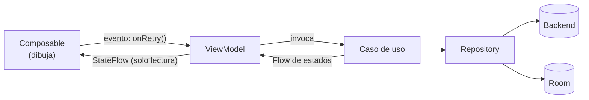
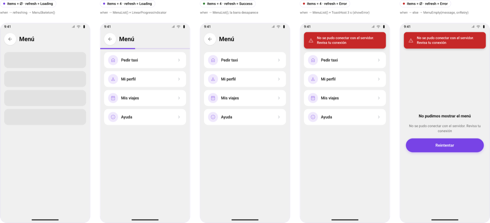
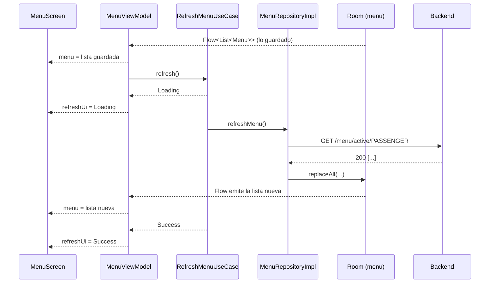
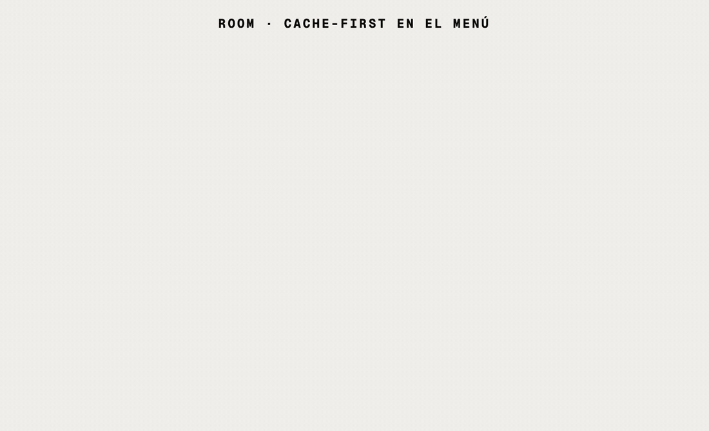
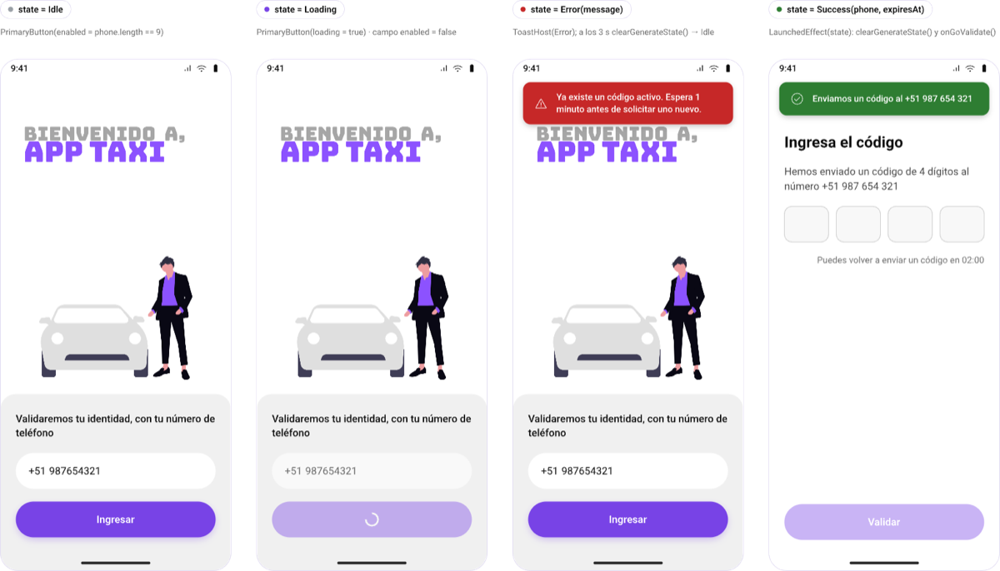
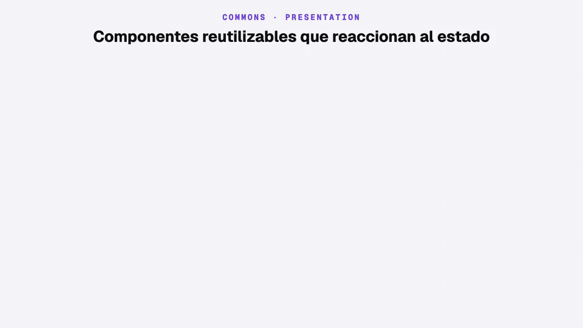

# Módulo 3 · Sesión 4

## UI reactiva con datos remotos: la pantalla es una función del estado

---

## Objetivos

1. Entender qué es una **UI reactiva** y el flujo unidireccional de datos (UDF).
2. Modelar los estados de una operación remota (`Idle`, `Loading`, `Success`, `Error`) con una `sealed interface`.
3. Exponer el estado desde el ViewModel con **`StateFlow`** y recolectarlo en Compose respetando el ciclo de vida.
4. Dibujar la pantalla con **renderizado condicional**, sin estados imposibles.
5. Distinguir **estado** (se dibuja) de **evento** (ocurre una vez: navegar, mostrar un toast).
6. Probar todo sin backend: **fakes** en la JVM, **MockWebServer** para la red y un `@Preview` por estado.

---

## Contenido

1. Qué es una UI reactiva
2. Qué estudiamos: los features que ya existen
3. Paso a paso en `android-app-taxi`
4. Errores comunes y cómo los evita el proyecto
5. Cómo quedó integrado en el proyecto de taxi
6. Ejecutar y probar
7. Checklist, conclusiones y práctica

---

## 1) Qué es una UI reactiva

En una UI imperativa, el código **le ordena** a la pantalla qué cambiar: «oculta el spinner», «muestra la lista», «habilita el botón». Cada orden olvidada es un bug: un spinner que nunca se va, un botón que queda bloqueado.

En una UI reactiva, la pantalla **no recibe órdenes**. Solo recibe un **estado** y lo dibuja. Si el estado cambia, Compose vuelve a dibujar lo que haga falta.

```
pantalla = f(estado)
```

Los datos viajan en un solo sentido (**UDF**, *Unidirectional Data Flow*): el estado baja, los eventos suben.



| Pieza                    | Qué hace                                              | En el proyecto                                       |
| ------------------------ | ----------------------------------------------------- | ---------------------------------------------------- |
| **Estado**               | Describe todo lo que la pantalla necesita dibujar     | `RefreshMenuState`, `OtpGenerateState`, `SignUpState` |
| **`Flow`**               | Entrega valores a lo largo del tiempo                 | Casos de uso y `MenuDao.observeAll()`                |
| **`StateFlow`**          | Un `Flow` que **siempre** tiene un valor actual       | `MenuViewModel.menu`, `SignInViewModel.generateOtpUi` |
| **Recolección**          | Convierte el `StateFlow` en estado de Compose         | `collectAsStateWithLifecycle()`                      |
| **Renderizado condicional** | Elige qué composable mostrar según el estado       | `when { … }` en `MenuScreen`                         |

| Regla                                                    | Por qué                                                          |
| -------------------------------------------------------- | ---------------------------------------------------------------- |
| El Composable **no decide**: dibuja y avisa              | Se puede previsualizar y probar con cualquier estado             |
| El ViewModel expone el estado como **solo lectura**      | Nadie fuera del ViewModel puede dejar la pantalla en un estado inválido |
| Un estado por operación, modelado con `sealed interface` | El compilador obliga a cubrir todos los casos en el `when`       |

### `StateFlow`, `SharedFlow` o `mutableStateOf`

| Criterio             | `StateFlow`                          | `SharedFlow`                         | `mutableStateOf` (en el ViewModel)   |
| -------------------- | ------------------------------------ | ------------------------------------ | ------------------------------------ |
| Tiene valor actual   | Sí                                   | No                                   | Sí                                   |
| Quien llega tarde    | Recibe el último valor               | No recibe lo que ya pasó             | Lee el valor actual                  |
| Úsalo para           | Estado de pantalla                   | Eventos de una sola vez              | Estado que solo usa Compose          |
| En el proyecto       | `refreshUi`, `generateOtpUi`, `signUpUi` | `SessionExpiration.events`       | `SignUpViewModel.draft`              |

---

## 2) Qué estudiamos: los features que ya existen

Esta clase **no agrega código**. La app ya es reactiva desde que nació: cada clase anterior sumó un feature con su estado, su ViewModel y sus pantallas. Hoy abrimos esos features y nombramos el patrón que comparten.

| Feature  | Dato remoto                          | Estado                                   | Dónde se dibuja                                |
| -------- | ------------------------------------ | ---------------------------------------- | ---------------------------------------------- |
| `signin` | `POST /auth/otp-generate`            | `OtpGenerateState`                       | Botón con spinner, campo bloqueado, toast      |
| `signin` | `POST /auth/otp-validate`            | `OtpValidateState`                       | Casillas OTP, toast, navegación a Home o registro |
| `signup` | `PUT /passenger/signup`              | `SignUpState` + `draft`                  | Botón con spinner, toast, navegación a Home    |
| `menu`   | `GET /menu/active/PASSENGER` + Room  | `List<Menu>` + `RefreshMenuState`        | Skeleton, lista, barra de progreso, toast, «Reintentar» |
| `splash` | Sesión guardada                      | `StartDestination?`                      | Logo y navegación al destino inicial           |
| `core`   | `POST /auth/refresh` rechazado       | `SessionExpiration.events`               | Vuelve a «Generar OTP» con toast               |

El **menú** es el caso más completo: combina un dato local que cambia solo (Room) con una operación remota (la sincronización). Es el hilo conductor del paso a paso.



### Proyectos de la clase

| Proyecto                                      | Qué es                                                             | Guía                                   |
| --------------------------------------------- | ------------------------------------------------------------------ | -------------------------------------- |
| [`infra-app-taxi`](./infra-app-taxi)          | MySQL 9.7, Redis 8.10 y la API con Docker Compose                  | [README](./infra-app-taxi/README.md)   |
| [`backend-app-taxi`](./backend-app-taxi)      | API NestJS 12: OTP, menú, registro y refresh                       | [README](./backend-app-taxi/README.md) |
| [`android-app-taxi`](./android-app-taxi)      | App Android: inicio de sesión, registro, menú con Room y sesión que se renueva | [README](./android-app-taxi/README.md) |
| [`design-m03-c04.pen`](./design-m03-c04.pen)  | Diseño del proyecto: se agrega la sección «7 · UI reactiva (estado → pantalla)» | —                         |

Los tres proyectos son **los mismos de la clase 03**, sin cambios de código. Si ya tienes el stack levantado, no necesitas reconstruir nada.

---

## 3) Paso a paso en `android-app-taxi`

> Todo el código de esta sección es el del proyecto. Seguimos un dato desde el backend hasta el píxel.

### Paso 0 · El recorrido completo



Nadie le dice a la pantalla «actualízate». La lista cambia porque **Room emitió**; la barra de progreso desaparece porque **el estado cambió**.

### Paso 1 · Modelar el estado

Una operación remota pasa siempre por los mismos momentos. Se modelan con una `sealed interface`:

```kotlin
// features/menu/domain/usecase/RefreshMenuUseCase.kt
sealed interface RefreshMenuState {
    data object Idle : RefreshMenuState
    data object Loading : RefreshMenuState
    data object Success : RefreshMenuState
    data class Error(val message: String) : RefreshMenuState
}
```

| Estado    | Significa                               | Lleva datos                         |
| --------- | --------------------------------------- | ----------------------------------- |
| `Idle`    | Todavía no se pidió nada                | No                                  |
| `Loading` | La petición está en curso               | No                                  |
| `Success` | Terminó bien                            | Solo si la pantalla los necesita    |
| `Error`   | Falló                                   | El mensaje listo para mostrar       |

El mismo molde, con datos distintos en `Success`, se repite en cada feature:

| Estado               | `Success` lleva                              | Por qué                                         |
| -------------------- | -------------------------------------------- | ----------------------------------------------- |
| `RefreshMenuState`   | Nada (`data object`)                         | La lista llega por otro camino: Room            |
| `OtpGenerateState`   | `phone`, `expiresAt`                         | La siguiente pantalla los necesita              |
| `OtpValidateState`   | `showRegister`                               | Decide si se navega a Home o al registro        |
| `SignUpState`        | Nada (`data object`)                         | Solo importa que terminó                        |

¿Por qué no tres `Boolean` (`isLoading`, `isError`, `isSuccess`)? Porque permiten combinaciones imposibles (`isLoading = true` e `isError = true`). Con una `sealed interface` solo existe **un** estado a la vez.

### Paso 2 · El caso de uso emite los estados

El caso de uso devuelve un `Flow`: emite `Loading`, hace el trabajo y emite el resultado.

```kotlin
// features/menu/domain/usecase/RefreshMenuUseCase.kt
class RefreshMenuUseCase(
    private val repo: MenuRepository
) {
    operator fun invoke(): Flow<RefreshMenuState> = flow {
        emit(RefreshMenuState.Loading)
        repo.refreshMenu()
        emit(RefreshMenuState.Success)
    }.catch { emit(RefreshMenuState.Error(it.toDomainException().message)) }
}
```

| Línea                     | Qué resuelve                                                                 |
| ------------------------- | ---------------------------------------------------------------------------- |
| `flow { }`                | Flujo **frío**: no hace nada hasta que alguien lo recolecta                  |
| `emit(Loading)` primero   | La pantalla muestra progreso antes de que salga la petición                  |
| `.catch { emit(Error) }`  | Un fallo no rompe el flujo: se convierte en un estado más                    |
| `toDomainException()`     | El mensaje ya viene traducido por el `ErrorMapper` de la clase 03            |

`.catch` no atrapa `CancellationException`: si el usuario sale de la pantalla, la corrutina se cancela y **no** se emite ningún `Error`.

### Paso 3 · Dos caminos: observar y refrescar

El repositorio del menú separa «dame lo que hay» de «ve a buscar lo nuevo»:

```kotlin
// features/menu/domain/repository/MenuRepository.kt
interface MenuRepository {
    fun observeMenu(): Flow<List<Menu>>
    suspend fun refreshMenu()
}

// features/menu/data/repository/MenuRepositoryImpl.kt
override fun observeMenu(): Flow<List<Menu>> =
    dao.observeAll().map { entities -> entities.map { it.toDomain() } }

override suspend fun refreshMenu() = safeCall {
    val updatedAt = now()
    val remote = api.getMenu()
    dao.replaceAll(remote.map { it.toEntity(updatedAt) })
}
```



| Función          | Tipo         | Emite                                    | Fuente       |
| ---------------- | ------------ | ---------------------------------------- | ------------ |
| `observeMenu()`  | `Flow`       | Cada vez que la tabla `menu` cambia      | Room         |
| `refreshMenu()`  | `suspend`    | Nada: termina o lanza `DomainException`  | Red → Room   |

La respuesta de la red **nunca** va directo a la pantalla: se guarda en Room, y Room avisa. Así la pantalla tiene una sola fuente de datos (*single source of truth*) y funciona sin conexión.

### Paso 4 · El ViewModel expone `StateFlow`

```kotlin
// features/menu/presentation/MenuViewModel.kt
@HiltViewModel
class MenuViewModel @Inject constructor(
    observeMenuUseCase: ObserveMenuUseCase,
    private val refreshMenuUseCase: RefreshMenuUseCase
) : ViewModel() {

    val menu: StateFlow<List<Menu>> = observeMenuUseCase()
        .stateIn(viewModelScope, SharingStarted.WhileSubscribed(STOP_TIMEOUT_MS), emptyList())

    private val _refreshUi = MutableStateFlow<RefreshMenuState>(RefreshMenuState.Idle)
    val refreshUi: StateFlow<RefreshMenuState> = _refreshUi.asStateFlow()

    init {
        refresh()
    }

    fun refresh() {
        if (_refreshUi.value is RefreshMenuState.Loading) return
        refreshMenuUseCase()
            .onEach { _refreshUi.value = it }
            .launchIn(viewModelScope)
    }
}
```

Hay dos formas de llegar a un `StateFlow`, y el ViewModel usa ambas:

| Forma                                   | Cuándo                                             | En el proyecto |
| --------------------------------------- | -------------------------------------------------- | -------------- |
| `flow.stateIn(scope, started, initial)` | Ya tienes un `Flow` que emite solo (Room)          | `menu`         |
| `MutableStateFlow` + `asStateFlow()`    | El valor cambia por acciones que tú lanzas         | `refreshUi`    |

| Línea                                      | Qué resuelve                                                              |
| ------------------------------------------ | ------------------------------------------------------------------------- |
| `WhileSubscribed(5_000)`                   | Deja de observar Room 5 s después de que la pantalla desaparece; una rotación (menos de 5 s) no reinicia nada |
| `private val _refreshUi` / `val refreshUi` | Solo el ViewModel escribe; la pantalla solo lee                           |
| `if (… is Loading) return`                 | Un segundo toque en «Reintentar» no lanza otra petición                   |
| `launchIn(viewModelScope)`                 | Si el ViewModel se destruye, la petición se cancela sola                  |

`SignInViewModel` y `SignUpViewModel` siguen exactamente la misma forma: un `MutableStateFlow` por operación, la guardia de `Loading` y `launchIn(viewModelScope)`.

### Paso 5 · `Route` y `Screen`: recolectar el estado

Cada pantalla se parte en dos composables:

```kotlin
// features/menu/presentation/MenuScreen.kt
@Composable
fun MenuRoute(
    onBack: () -> Unit,
    onMenuClick: (Menu) -> Unit,
    modifier: Modifier = Modifier,
    vm: MenuViewModel = hiltViewModel()
) {
    val items by vm.menu.collectAsStateWithLifecycle()
    val refresh by vm.refreshUi.collectAsStateWithLifecycle()
    var showError by remember { mutableStateOf(false) }

    LaunchedEffect(refresh) {
        showError = refresh is RefreshMenuState.Error
        if (showError) {
            delay(TOAST_DURATION_MS)
            showError = false
        }
    }

    MenuScreen(
        items = items,
        refresh = refresh,
        showError = showError,
        onBack = onBack,
        onRetry = vm::refresh,
        onMenuClick = onMenuClick,
        modifier = modifier
    )
}
```

| Composable     | Conoce                               | Responsabilidad                                         |
| -------------- | ------------------------------------ | ------------------------------------------------------- |
| `MenuRoute`    | Hilt, el ViewModel, los `StateFlow`  | Recolecta el estado y maneja efectos (toast temporal)   |
| `MenuScreen`   | Solo valores y callbacks             | Dibuja. Se puede previsualizar y probar sin Hilt        |

| API                              | Qué hace                                                                       |
| -------------------------------- | ------------------------------------------------------------------------------ |
| `collectAsStateWithLifecycle()`  | Recolecta solo cuando la pantalla está visible (`STARTED`); en segundo plano se detiene |
| `collectAsState()`               | Recolecta siempre, incluso con la app en segundo plano: evítalo en Android     |
| `remember { mutableStateOf() }`  | Estado que solo le importa a la UI (¿se ve el toast?)                          |
| `rememberSaveable { }`           | Igual, pero sobrevive a una rotación (el teléfono escrito en «Generar OTP»)    |

`collectAsStateWithLifecycle()` y `WhileSubscribed(5_000)` trabajan juntos: cuando la app pasa a segundo plano, la pantalla deja de recolectar y, 5 s después, el ViewModel deja de observar Room.

### Paso 6 · Renderizado condicional

`MenuScreen` recibe dos datos y decide con un `when`:

```kotlin
// features/menu/presentation/MenuScreen.kt
val refreshing = refresh is RefreshMenuState.Loading || refresh is RefreshMenuState.Idle
val errorMessage = (refresh as? RefreshMenuState.Error)?.message
val toast = errorMessage?.takeIf { showError }?.let { ToastMessage(ToastType.Error, it) }

if (refreshing && items.isNotEmpty()) {
    LinearProgressIndicator(…)
}

when {
    items.isNotEmpty() -> MenuList(items = items, onMenuClick = onMenuClick)
    refreshing -> MenuSkeleton()
    else -> MenuEmpty(
        message = errorMessage ?: "No hay opciones disponibles",
        onRetry = onRetry
    )
}
```

| `items` (Room) | `refresh`        | Qué se dibuja                                          |
| -------------- | ---------------- | ------------------------------------------------------ |
| Vacío          | `Idle` / `Loading` | `MenuSkeleton()`: 4 tarjetas grises                  |
| Con datos      | `Loading`        | `MenuList()` + barra de progreso bajo el título        |
| Con datos      | `Success`        | `MenuList()`                                           |
| Con datos      | `Error(message)` | `MenuList()` + toast rojo 3 s                          |
| Vacío          | `Error(message)` | `MenuEmpty()` con el mensaje y «Reintentar»            |
| Vacío          | `Success`        | `MenuEmpty()` con «No hay opciones disponibles»        |

-   **La lista manda.** Si hay datos guardados, siempre se muestran; el estado de la red solo agrega algo encima (barra o toast).
-   **`Idle` se trata como `Loading`.** Entre que la pantalla aparece y el `init` lanza la petición hay un instante en `Idle`; así no parpadea el estado vacío.
-   **«Vacío» y «error» son distintos.** Los dos usan `MenuEmpty`, pero con mensajes diferentes: el usuario sabe si no hay nada o si algo falló.
-   Las variables `refreshing`, `errorMessage` y `toast` son **estado derivado**: se calculan del estado en cada recomposición, no se guardan.

### Paso 7 · Estado o evento

No todo lo que el ViewModel comunica se dibuja. Navegar o mostrar un toast temporal ocurre **una vez**. En el proyecto, eso se resuelve con `LaunchedEffect`:

```kotlin
// features/signin/presentation/SignInGenerateOtpScreen.kt (SignInGenerateOtpRoute)
LaunchedEffect(state) {
    when (val s = state) {
        is OtpGenerateState.Success -> {
            vm.clearGenerateState()
            onGoValidate(s.phone, s.expiresAt)
        }
        is OtpGenerateState.Error -> {
            delay(TOAST_DURATION_MS)
            vm.clearGenerateState()
        }
        else -> Unit
    }
}
```



| `OtpGenerateState` | Cómo se trata  | Qué pasa                                                              |
| ------------------ | -------------- | --------------------------------------------------------------------- |
| `Idle`             | Estado         | Botón habilitado si el teléfono tiene 9 dígitos                       |
| `Loading`          | Estado         | Spinner en el botón y campo bloqueado                                 |
| `Error(message)`   | Estado temporal | Toast rojo; a los 3 s vuelve a `Idle`                                |
| `Success(…)`       | Evento         | Vuelve a `Idle` y navega a «Validar OTP»                              |

| Línea                       | Qué resuelve                                                                    |
| --------------------------- | ------------------------------------------------------------------------------- |
| `LaunchedEffect(state)`     | El bloque corre cuando `state` cambia, no en cada recomposición                 |
| `vm.clearGenerateState()`   | El evento se **consume**: al volver atrás, la pantalla no navega otra vez       |
| `delay(…)` dentro del efecto | Si el estado cambia antes, el efecto se cancela y el temporizador también      |

Cuando el evento no pertenece a ninguna pantalla, se usa un `SharedFlow`. Es el caso de la sesión expirada (clase 03): puede ocurrir en cualquier momento y nadie debe recibirlo dos veces.

```kotlin
// core/data/SessionExpirationImpl.kt
private val _events = MutableSharedFlow<Unit>(extraBufferCapacity = 1)
override val events: Flow<Unit> = _events.asSharedFlow()

// core/presentation/activity/MainActivity.kt (AppRoot)
LaunchedEffect(Unit) {
    vm.sessionExpired.collectLatest {
        nav.navigateClearingBackStack(Route.AuthGraph.path)
        sessionExpired = true
        delay(SESSION_EXPIRED_TOAST_MS)
        sessionExpired = false
    }
}
```

| ¿Qué es?                                   | Herramienta                          | Ejemplo en el proyecto            |
| ------------------------------------------ | ------------------------------------ | --------------------------------- |
| Algo que se **ve** mientras dure           | `StateFlow`                          | `refreshUi`, `generateOtpUi`      |
| Algo que **pasa una vez**, ligado a una pantalla | `StateFlow` + `LaunchedEffect` + limpiar | Navegar tras `Success`     |
| Algo que **pasa una vez**, global          | `SharedFlow`                         | `SessionExpiration.events`        |

### Paso 8 · Componentes que reaccionan

Los componentes de `commons` no conocen ViewModels: reciben valores. El estado se traduce a parámetros en la pantalla.



```kotlin
// features/signin/presentation/SignInGenerateOtpScreen.kt
val loading = state is OtpGenerateState.Loading
val isValid = phone.length == PHONE_LENGTH
val toast = (state as? OtpGenerateState.Error)?.let { ToastMessage(ToastType.Error, it.message) }

PhoneInputField(value = phone, onValueChange = onPhoneChange, enabled = !loading, …)
PrimaryButton(text = "Ingresar", onClick = { onSubmit(phone) }, enabled = isValid, loading = loading)
ToastHost(toast = toast, modifier = Modifier.align(Alignment.TopCenter))
```

| Componente        | Parámetros de estado      | Cómo reacciona                                                     |
| ----------------- | ------------------------- | ------------------------------------------------------------------ |
| `PrimaryButton`   | `enabled`, `loading`      | `loading` cambia el texto por un spinner **y** deshabilita el clic |
| `PhoneInputField` | `enabled`                 | Bloqueado mientras se envía                                        |
| `ToastHost`       | `toast: ToastMessage?`    | `AnimatedContent`: entra cuando hay mensaje, sale cuando es `null` |

`ToastHost` nunca recibe «muéstrate» ni «ocúltate»: recibe un mensaje o `null`, y la animación sale de comparar el valor anterior con el nuevo.

### Paso 9 · Un `@Preview` por estado

Como `MenuScreen` solo recibe valores, cada estado se puede ver en Android Studio sin emulador ni backend:

```kotlin
// features/menu/presentation/MenuScreen.kt
@Preview(showBackground = true, backgroundColor = 0xFFF0F0F0)
@Composable
private fun MenuScreenPreviewOffline() {
    MenuScreen(
        items = previewItems,
        refresh = RefreshMenuState.Error("No se pudo conectar con el servidor. Revisa tu conexión"),
        showError = true,
        onBack = {},
        onRetry = {},
        onMenuClick = {}
    )
}
```

| Preview                     | `items`   | `refresh`  | Muestra                          |
| --------------------------- | --------- | ---------- | -------------------------------- |
| `MenuScreenPreviewLoading`  | Vacío     | `Loading`  | Skeleton                         |
| `MenuScreenPreviewCached`   | 4 opciones | `Loading` | Lista + barra de progreso        |
| `MenuScreenPreviewSuccess`  | 4 opciones | `Success` | Lista                            |
| `MenuScreenPreviewOffline`  | 4 opciones | `Error`   | Lista + toast                    |
| `MenuScreenPreviewError`    | Vacío     | `Error`    | Mensaje y «Reintentar»           |

El proyecto tiene 27 previews. Son la primera prueba de una pantalla: si un estado no se puede previsualizar, la pantalla sabe demasiado.

### Paso 10 · Probar sin backend: fakes y MockWebServer

Cada capa se prueba reemplazando lo que tiene **debajo**:

| Qué se prueba        | Se reemplaza con                         | Prueba                          | Qué verifica                                      |
| -------------------- | ---------------------------------------- | ------------------------------- | ------------------------------------------------- |
| Caso de uso          | `FakeMenuRepository`                     | `RefreshMenuUseCaseTest`        | La secuencia `Loading → Success` y `Loading → Error` |
| Repositorio          | `FakeMenuApi` + `FakeMenuDao`            | `MenuRepositoryImplTest`        | Red → Room, caché intacta si falla, errores de dominio |
| Capa de red (OkHttp) | `MockWebServer`                          | `TokenAuthenticatorTest`, `InterceptorsTest` | Headers, 401, refresh y reintento    |
| DAO real             | Room en memoria (instrumentada)          | `MenuDaoTest`                   | Las consultas SQL y el orden                      |

Un **fake** es una implementación real, pero simple, de la interfaz:

```kotlin
// app/src/test/.../features/menu/FakeMenu.kt
class FakeMenuRepository(
    private val onRefresh: suspend () -> Unit = {}
) : MenuRepository {
    val menu = MutableStateFlow<List<Menu>>(emptyList())
    var refreshCalls = 0

    override fun observeMenu(): Flow<List<Menu>> = menu

    override suspend fun refreshMenu() {
        refreshCalls++
        onRefresh()
    }
}
```

Con él, la secuencia de estados se comprueba con `toList()`:

```kotlin
// app/src/test/.../features/menu/domain/usecase/RefreshMenuUseCaseTest.kt
@Test
fun `emite Loading y Success cuando la sincronizacion termina`() = runTest {
    val repo = FakeMenuRepository()

    val states = RefreshMenuUseCase(repo)().toList()

    assertEquals(listOf(RefreshMenuState.Loading, RefreshMenuState.Success), states)
    assertEquals(1, repo.refreshCalls)
}

@Test
fun `un error de dominio se emite como Error con su mensaje`() = runTest {
    val repo = FakeMenuRepository(onRefresh = {
        throw DomainException.NetworkException("No se pudo conectar con el servidor. Revisa tu conexión")
    })

    val last = RefreshMenuUseCase(repo)().toList().last()

    assertEquals(RefreshMenuState.Error("No se pudo conectar con el servidor. Revisa tu conexión"), last)
}
```

| Herramienta        | Reemplaza                    | Úsala cuando                                                   |
| ------------------ | ---------------------------- | -------------------------------------------------------------- |
| **Fake**           | Una interfaz tuya            | Pruebas un caso de uso o un repositorio: es rápido y legible   |
| **MockWebServer**  | El servidor HTTP             | Pruebas lo que vive en OkHttp: interceptores, `Authenticator`, JSON real |
| **`@Preview`**     | El ViewModel                 | Revisas cómo se ve un estado                                   |

`FakeMenuDao` guarda sus filas en un `MutableStateFlow`: igual que Room, **vuelve a emitir** cuando se escribe. Por eso el repositorio se prueba con el mismo comportamiento reactivo que tendrá en el dispositivo. MockWebServer se vio en detalle en la clase 03.

```bash
./gradlew testDebugUnitTest            # 49 pruebas JVM
./gradlew connectedDebugAndroidTest    # 22 instrumentadas (necesita emulador)
```

---

## 4) Errores comunes y cómo los evita el proyecto

| Error                                              | Síntoma                                              | En el proyecto                                              |
| -------------------------------------------------- | ---------------------------------------------------- | ----------------------------------------------------------- |
| Varios `Boolean` para el estado                    | Spinner y error a la vez                             | `sealed interface` por operación                            |
| Exponer el `MutableStateFlow`                      | La pantalla cambia el estado por su cuenta           | `_refreshUi` privado + `asStateFlow()`                      |
| Lanzar la petición desde el Composable             | Se repite en cada recomposición o rotación           | `init { refresh() }` en el ViewModel                        |
| No proteger el doble toque                         | Dos OTP, dos registros                               | `if (… is Loading) return` y `PrimaryButton(loading = …)`   |
| `collectAsState()` a secas                         | La app trabaja en segundo plano                      | `collectAsStateWithLifecycle()`                             |
| `GlobalScope` o un scope propio                    | Peticiones que siguen vivas sin pantalla             | `viewModelScope`                                            |
| Dejar `Success` en el estado tras navegar          | Al volver atrás, navega otra vez                     | `clearGenerateState()` antes de navegar                     |
| Mostrar lo mismo para «vacío» y «error»            | El usuario no sabe si reintentar                     | Mensajes distintos en `MenuEmpty`                           |
| Pantalla en blanco mientras carga                  | Parece que la app se colgó                           | `MenuSkeleton` y datos guardados al instante                |
| Atrapar `CancellationException`                    | Errores falsos al salir de la pantalla               | `safeCall` la relanza; `.catch` no la atrapa                |
| Mostrar `e.message` técnico                        | «HTTP 500 Internal Server Error» en un toast         | `ErrorMapper` → `DomainException.message`                   |

---

## 5) Cómo quedó integrado en el proyecto de taxi

Punto de partida y de llegada: los tres proyectos de la clase 03. **No hay archivos nuevos ni modificados en el código.**

### `android-app-taxi`

Dónde vive cada pieza del patrón:

| Pieza                         | `menu`                                     | `signin`                                         | `signup`                          |
| ----------------------------- | ------------------------------------------ | ------------------------------------------------ | --------------------------------- |
| Estado (`sealed interface`)   | `RefreshMenuState`                         | `OtpGenerateState`, `OtpValidateState`           | `SignUpState`                     |
| Caso de uso (`Flow`)          | `ObserveMenuUseCase`, `RefreshMenuUseCase` | `OtpGenerateUseCase`, `OtpValidateUseCase`       | `SignUpUseCase`                   |
| ViewModel (`StateFlow`)       | `MenuViewModel`                            | `SignInViewModel`                                | `SignUpViewModel`                 |
| `Route` + `Screen`            | `MenuScreen.kt`                            | `SignInGenerateOtpScreen.kt`, `SignInValidateOtpScreen.kt` | `SignUpStep1Screen.kt`, `SignUpStep2Screen.kt` |
| Fakes de prueba               | `FakeMenu.kt`                              | `FakeAuth.kt`                                    | `FakeSignUp.kt`                   |

```
features/menu/
├─ domain/
│  ├─ repository/MenuRepository.kt      // Paso 3 · observar y refrescar
│  └─ usecase/
│     ├─ ObserveMenuUseCase.kt          // Paso 3
│     └─ RefreshMenuUseCase.kt          // Pasos 1 y 2 · estado + Flow
├─ data/repository/MenuRepositoryImpl.kt // Paso 3
└─ presentation/
   ├─ MenuViewModel.kt                  // Paso 4 · StateFlow
   └─ MenuScreen.kt                     // Pasos 5, 6 y 9 · Route, Screen, previews

commons/presentation/                   // Paso 8 · PrimaryButton, ToastHost
core/presentation/activity/             // Paso 7 · evento global de sesión expirada
```

### `backend-app-taxi` e `infra-app-taxi`

Sin cambios. Son los mismos de la clase 03: mismas rutas, mismas migraciones, mismos archivos Compose.

### Diseño

`design-m03-c04.pen` contiene el diseño completo del proyecto (secciones 1 a 6, iguales a la clase 03) más la sección **«7 · UI reactiva (estado → pantalla)»**. No tiene pantallas nuevas: muestra las del menú y de «Generar OTP» rotuladas con el estado que las produce y el composable que se dibuja.

---

## 6) Ejecutar y probar

Orden: **infra → backend → app**. Si vienes de la clase 03, el stack ya sirve tal cual.

| Acción                                                                  | Qué verás                                                          | Estado                                   |
| ----------------------------------------------------------------------- | ------------------------------------------------------------------ | ---------------------------------------- |
| Borrar los datos de la app, iniciar sesión y abrir el menú              | Skeleton y luego las 4 opciones                                    | `∅ + Loading` → `4 + Success`            |
| Salir del menú y volver a abrirlo                                       | Las opciones al instante y una barra de progreso breve             | `4 + Loading` → `4 + Success`            |
| Activar el modo avión y abrir el menú                                   | Las opciones guardadas y un toast rojo 3 s                         | `4 + Error`                              |
| Con modo avión, cerrar sesión y tocar «Ingresar» en «Generar OTP»       | Spinner en el botón, toast «No se pudo conectar…» 3 s y el botón vuelve | `Loading` → `Error` → `Idle`        |
| En «Generar OTP», tocar «Ingresar» varias veces seguidas                | Una sola petición en Logcat (filtro `okhttp`)                      | La guardia de `Loading`                  |
| Girar el teléfono con el menú abierto                                   | La lista sigue ahí, sin skeleton ni petición nueva                 | El ViewModel sobrevive a la rotación     |
| Cambiar un `text` en la tabla `entity_menu` y reabrir el menú           | El texto anterior un instante y luego el nuevo, sin recargar a mano | Room emitió después de `replaceAll`     |

Para ver el estado «sin caché + error» (`MenuEmpty` con «Reintentar»), abre el *App Inspection* de Android Studio, vacía la tabla `menu`, activa el modo avión y entra al menú.

Para ver los estados sin ejecutar nada, abre `MenuScreen.kt` o `SignInGenerateOtpScreen.kt` en Android Studio y usa el panel **Split**: cada `@Preview` es un estado.

---

## 7) Checklist, conclusiones y práctica

### Checklist

-   [ ] Cada operación remota tiene su estado en una `sealed interface`; no hay `Boolean` sueltos.
-   [ ] El ViewModel expone `StateFlow` de solo lectura; el `MutableStateFlow` es privado.
-   [ ] Las peticiones se lanzan en `viewModelScope`, nunca desde un Composable.
-   [ ] Una operación en `Loading` no se lanza dos veces.
-   [ ] La pantalla recolecta con `collectAsStateWithLifecycle()`.
-   [ ] Cada pantalla tiene `Route` (con ViewModel) y `Screen` (solo valores y callbacks).
-   [ ] El `when` cubre carga, datos, vacío y error, y los dos últimos se distinguen.
-   [ ] Los eventos (navegar, toast) se consumen: el estado vuelve a `Idle`.
-   [ ] Cada estado tiene su `@Preview`.
-   [ ] Los casos de uso se prueban con fakes y la secuencia de estados con `toList()`.

### Conclusiones

-   **La pantalla es una función del estado.** No se le ordena nada: se le entrega un valor y lo dibuja.
-   Una `sealed interface` hace **imposibles** los estados incoherentes y obliga a cubrirlos todos.
-   `StateFlow` + `viewModelScope` + `collectAsStateWithLifecycle()` resuelven rotación, segundo plano y cancelación sin código extra.
-   Con una fuente local (Room) delante de la red, la UI muestra datos al instante y el estado remoto solo **acompaña**.
-   Separar `Route` de `Screen` da previews y pruebas gratis.
-   Estado y evento no son lo mismo: lo primero se dibuja, lo segundo se consume.

### Práctica propuesta

1. **Prueba del ViewModel**: escribe `MenuViewModelTest` con `FakeMenuRepository` y `StandardTestDispatcher` (`Dispatchers.setMain`). Verifica que `refreshUi` termina en `Success` y que dos llamadas seguidas a `refresh()` hacen una sola sincronización.
2. **Pull-to-refresh**: envuelve `MenuList` en `PullToRefreshBox` de Material 3, con `isRefreshing = refresh is RefreshMenuState.Loading` y `onRefresh = onRetry`.
3. **Un solo `UiState`**: combina `menu` y `refreshUi` en un `MenuUiState` con `combine(…).stateIn(…)`, de modo que `MenuScreen` reciba un único parámetro. Compara qué versión se lee mejor.
4. **Dato desactualizado**: `MenuEntity` ya guarda `updatedAt`. Muestra «Actualizado hace X min» bajo el título cuando la sincronización falla y la lista viene de la caché.
5. **Prueba de UI**: con `createComposeRule()`, dibuja `MenuScreen` con `items = emptyList()` y `RefreshMenuState.Error(…)`, y verifica que existe el botón «Reintentar» y que al tocarlo se llama `onRetry`.

---

## Recursos recomendados

-   [Capa de UI y flujo unidireccional de datos](https://developer.android.com/topic/architecture/ui-layer) (Android Developers).
-   [Estado y Jetpack Compose](https://developer.android.com/develop/ui/compose/state).
-   [`StateFlow` y `SharedFlow`](https://developer.android.com/kotlin/flow/stateflow-and-sharedflow).
-   [Recolectar flujos respetando el ciclo de vida](https://developer.android.com/develop/ui/compose/side-effects) (`collectAsStateWithLifecycle`, `LaunchedEffect`).
-   [Probar flujos de Kotlin en Android](https://developer.android.com/kotlin/flow/test).
-   Clase anterior: [Retrofit y manejo de errores](../clase-03/README.md).
