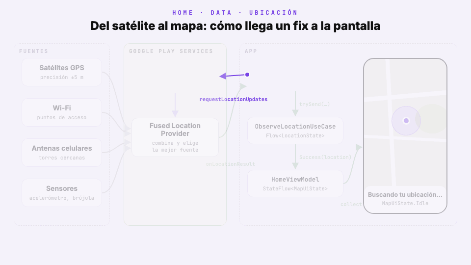
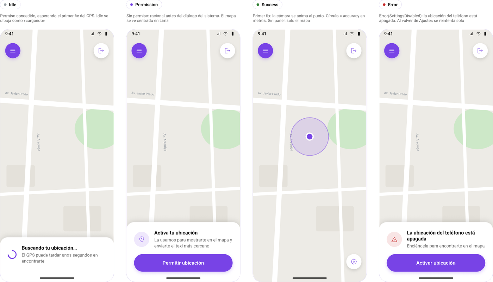
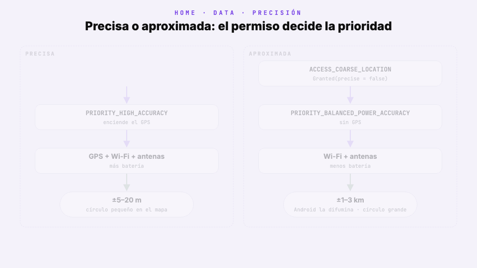
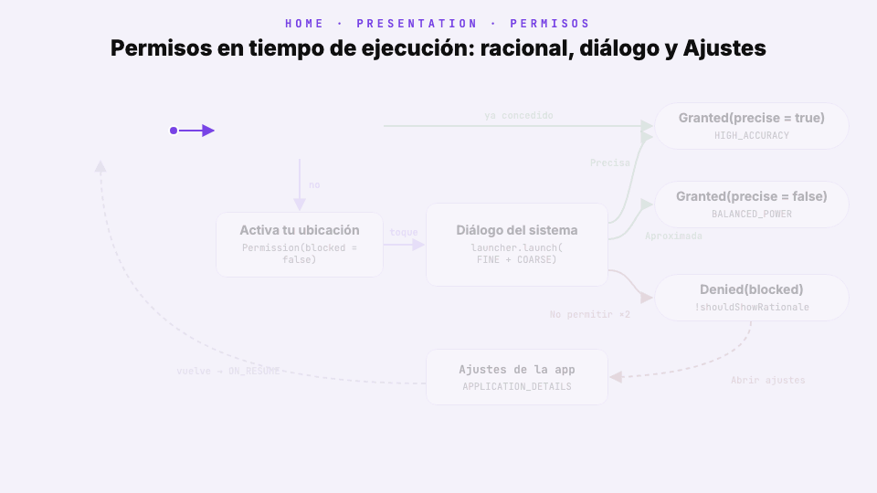
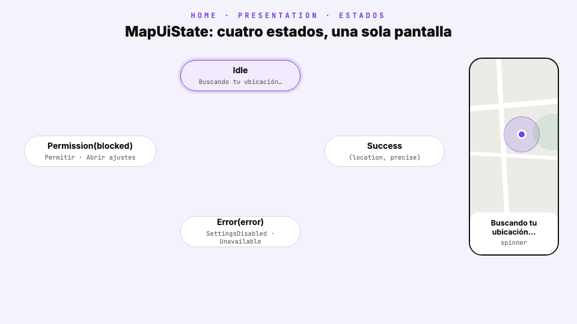
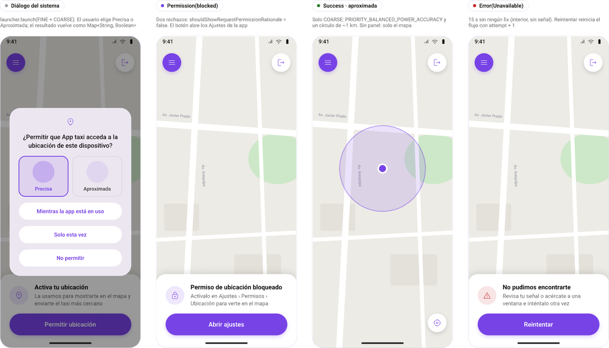
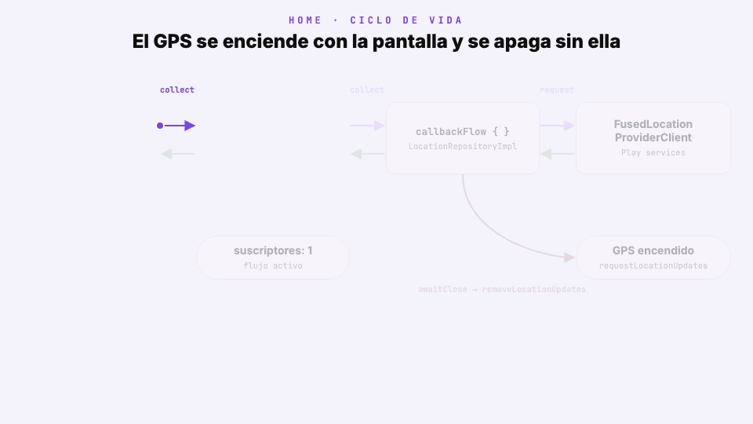

# Módulo 4 · Sesión 1

## GPS y permisos: tu ubicación en el mapa

---

## Objetivos

1. Entender **cómo obtiene Android la ubicación**: fuentes, *Fused Location Provider* y prioridades.
2. Pedir **permisos en tiempo de ejecución** con buena UX: racional, precisa o aproximada, y qué hacer cuando el usuario bloquea el diálogo.
3. Convertir las actualizaciones de `FusedLocationProviderClient` en un **`Flow`** con `callbackFlow`, sin fugas de batería.
4. Modelar la pantalla con **cuatro estados** (`Idle`, `Permission`, `Success`, `Error`) y dibujarlos sobre un **mapa de Google** en Compose.
5. Apagar el GPS automáticamente cuando la pantalla no se ve, usando el ciclo de vida.
6. Probar todo sin dispositivo: **fakes** para el repositorio y pruebas del ViewModel con `kotlinx-coroutines-test`.

---

## Contenido

1. Cómo obtiene Android la ubicación
2. Proyectos de la clase
3. Paso a paso en `android-app-taxi`
4. Errores comunes y cómo los evita el proyecto

---

## 1) Cómo obtiene Android la ubicación

La app **no lee el GPS**: le **pide** ubicaciones a Google Play services, y las respuestas llegan solas, una tras otra, mientras el pedido siga registrado.



| Pieza                       | Qué hace                                                       |
| --------------------------- | -------------------------------------------------------------- |
| Fuentes                     | GPS, Wi-Fi, antenas celulares y sensores                       |
| Fused Location Provider     | Combina las fuentes y entrega la mejor posición               |
| `LocationRequest`           | Dice qué precisión quieres y cada cuánto                       |
| `LocationCallback`          | Recibe cada posición nueva                                     |
| Permiso                     | Sin él no llega nada                                           |

La **prioridad** decide cuánto hardware se enciende:

| Prioridad                          | Usa                    | Precisión  | Batería |
| ---------------------------------- | ---------------------- | ---------- | ------- |
| `PRIORITY_HIGH_ACCURACY`           | GPS + Wi-Fi + antenas  | 5–20 m     | Alta    |
| `PRIORITY_BALANCED_POWER_ACCURACY` | Wi-Fi + antenas        | ~100 m     | Media   |
| `PRIORITY_LOW_POWER`               | Antenas                | ~10 km     | Baja    |

Y desde Android 12 el usuario elige **Precisa** o **Aproximada** en el diálogo de permisos. Tres reglas que sigue el proyecto:

1. **Explica antes de pedir**: primero un panel propio, luego el diálogo del sistema.
2. **Pide FINE y COARSE juntos**: si pides solo FINE, el diálogo no ofrece «Aproximada».
3. **Funciona con aproximada**: es una elección válida del usuario.

---

## 2) Proyectos de la clase

| Proyecto                                      | Qué es                                                                           | Guía                                   |
| --------------------------------------------- | -------------------------------------------------------------------------------- | -------------------------------------- |
| [`infra-app-taxi`](./infra-app-taxi)          | MySQL 9.7, Redis 8.10 y la API con Docker Compose                                | [README](./infra-app-taxi/README.md)   |
| [`backend-app-taxi`](./backend-app-taxi)      | API NestJS 12: OTP, menú, registro y refresh                                     | [README](./backend-app-taxi/README.md) |
| [`android-app-taxi`](./android-app-taxi)      | App Android: lo de la clase anterior + **Home con mapa, permisos y GPS**         | [README](./android-app-taxi/README.md) |
| [`design-m04-c01.pen`](./design-m04-c01.pen)  | Diseño del proyecto con la sección **«7 · Mapa y ubicación (GPS)»**              | —                                      |

Los tres proyectos parten de los del **módulo 3 · clase 04**. Backend e infra no cambian: todo ocurre en `features/home` de la app.



---

## 3) Paso a paso en `android-app-taxi`

Vamos a construir Home de abajo hacia arriba: librerías → dominio → datos → ViewModel → pantalla.

```
features/home/
├─ HomeModule.kt                               // Paso 5
├─ domain/
│  ├─ model/UserLocation.kt, LocationError.kt  // Paso 3
│  ├─ repository/LocationRepository.kt         // Paso 3
│  └─ usecase/ObserveLocationUseCase.kt        // Paso 5
├─ data/location/LocationRepositoryImpl.kt     // Paso 4
└─ presentation/
   ├─ LocationPermission.kt                    // Paso 6
   ├─ MapUiState.kt, HomeViewModel.kt          // Paso 7
   └─ HomeScreen.kt                            // Pasos 6, 8 y 9
```

### Paso 1 · Agregar las librerías

```toml
# gradle/libs.versions.toml
[versions]
playServicesLocation = "21.4.0"
mapsCompose = "9.0.1"

[libraries]
play-services-location = { module = "com.google.android.gms:play-services-location", version.ref = "playServicesLocation" }
kotlinx-coroutines-play-services = { module = "org.jetbrains.kotlinx:kotlinx-coroutines-play-services", version.ref = "coroutines" }
maps-compose = { module = "com.google.maps.android:maps-compose", version.ref = "mapsCompose" }
```

```kotlin
// app/build.gradle.kts
dependencies {
    implementation(libs.play.services.location)
    implementation(libs.kotlinx.coroutines.play.services)
    implementation(libs.maps.compose)
}
```

| Librería                           | Para qué                                                 |
| ---------------------------------- | -------------------------------------------------------- |
| `play-services-location`           | `FusedLocationProviderClient`, `LocationRequest`         |
| `kotlinx-coroutines-play-services` | `.await()`: usar las tareas de Play services con corrutinas |
| `maps-compose`                     | `GoogleMap`, `Circle` y marcadores en Compose            |

### Paso 2 · Permisos y API key en el manifest

```xml
<!-- app/src/main/AndroidManifest.xml -->
<uses-permission android:name="android.permission.ACCESS_COARSE_LOCATION" />
<uses-permission android:name="android.permission.ACCESS_FINE_LOCATION" />

<application ...>
    <meta-data
        android:name="com.google.android.geo.API_KEY"
        android:value="${MAPS_API_KEY}" />
</application>
```

La key de **Maps SDK for Android** se lee de `local.properties`, que no se sube a git:

```properties
# local.properties
MAPS_API_KEY=AIza...
```

```kotlin
// app/build.gradle.kts → defaultConfig
manifestPlaceholders["MAPS_API_KEY"] = localProperties.getProperty("MAPS_API_KEY", "")
```

-   Declarar un permiso **no** lo concede: solo dice que la app podrá pedirlo.
-   Sin key la app funciona y encuentra la ubicación, pero el mapa se ve gris.

### Paso 3 · El dominio: qué es una ubicación

```kotlin
// domain/model/UserLocation.kt
data class UserLocation(
    val latitude: Double,
    val longitude: Double,
    val accuracyMeters: Float,
    val timeMillis: Long,
    val isMock: Boolean
)

// domain/model/LocationError.kt
enum class LocationError { SettingsDisabled, PermissionMissing, Unavailable }

// domain/repository/LocationRepository.kt
interface LocationRepository {
    fun observeLocation(precise: Boolean): Flow<UserLocation>
}
```

-   Devuelve un **`Flow`** y no una función `suspend`: la ubicación cambia mientras el usuario se mueve.
-   `accuracyMeters` es el radio del círculo que veremos en el mapa.
-   Los tres errores son los únicos que la pantalla necesita distinguir: ubicación apagada, sin permiso o sin señal.

### Paso 4 · Los datos: de callback a `Flow`

Play services avisa cada posición con un *callback*. `callbackFlow` lo convierte en `Flow`:

```kotlin
// data/location/LocationRepositoryImpl.kt
override fun observeLocation(precise: Boolean): Flow<UserLocation> = callbackFlow {
    if (!LocationManagerCompat.isLocationEnabled(locationManager)) {
        throw LocationException(LocationError.SettingsDisabled)
    }

    val request = LocationRequest.Builder(priorityFor(precise), 5_000L)
        .setMinUpdateDistanceMeters(5f)
        .build()

    val callback = object : LocationCallback() {
        override fun onLocationResult(result: LocationResult) {
            result.lastLocation?.let { trySend(it.toDomain()) }
        }
    }

    client.requestLocationUpdates(request, callback, Looper.getMainLooper()).await()

    awaitClose { client.removeLocationUpdates(callback) }
}
```

1. Si la ubicación del teléfono está apagada, falla al instante con `SettingsDisabled`.
2. Pide una posición cada 5 s, solo si el usuario se movió 5 m.
3. Cada posición se emite con `trySend`.
4. **`awaitClose`**: cuando nadie escucha, quita el callback y el GPS se apaga. Sin esta línea, la batería se gasta.

El archivo real agrega tres detalles: usa `lastLocation` si tiene menos de 2 min (el mapa se centra al instante), cierra con `Unavailable` si en 15 s no llega nada y traduce `SecurityException` a `PermissionMissing`.



### Paso 5 · El caso de uso y Hilt

El caso de uso convierte el stream en estados, con el mismo molde que `RefreshMenuUseCase` de la clase anterior:

```kotlin
// domain/usecase/ObserveLocationUseCase.kt
sealed interface LocationState {
    data object Loading : LocationState
    data class Success(val location: UserLocation) : LocationState
    data class Error(val error: LocationError) : LocationState
}

operator fun invoke(precise: Boolean): Flow<LocationState> = flow {
    emit(LocationState.Loading)
    emitAll(repo.observeLocation(precise).map { LocationState.Success(it) })
}.catch { emit(LocationState.Error((it as? LocationException)?.error ?: LocationError.Unavailable)) }
```

```kotlin
// HomeModule.kt
@Provides
@Singleton
fun provideLocationRepository(@ApplicationContext context: Context): LocationRepository =
    LocationRepositoryImpl(
        client = LocationServices.getFusedLocationProviderClient(context),
        locationManager = context.getSystemService(LocationManager::class.java)
    )
```

-   La diferencia con el menú: `Success` **se repite**, una vez por cada posición nueva.
-   Hilt entrega la **interfaz**: el ViewModel nunca ve Play services.

### Paso 6 · Pedir el permiso



Pedir un permiso necesita una Activity, así que vive en presentación con su propio tipo:

```kotlin
// presentation/LocationPermission.kt
sealed interface LocationPermission {
    data object Unknown : LocationPermission
    data class Granted(val precise: Boolean) : LocationPermission
    data class Denied(val blocked: Boolean) : LocationPermission
}
```

`HomeRoute` hace dos cosas: revisa el permiso cada vez que la pantalla vuelve, y lanza el diálogo cuando el usuario toca «Permitir ubicación»:

```kotlin
// presentation/HomeScreen.kt (HomeRoute)
val launcher = rememberLauncherForActivityResult(
    ActivityResultContracts.RequestMultiplePermissions()
) { result ->
    val canAskAgain = activity?.shouldShowRequestPermissionRationale(ACCESS_FINE_LOCATION) == true
    vm.onPermissionResult(result.toLocationPermission(canAskAgain))
}

LifecycleResumeEffect(Unit) {
    vm.onPermissionChecked(context.currentLocationPermission())
    onPauseOrDispose { }
}

// al tocar «Permitir ubicación»
launcher.launch(arrayOf(ACCESS_FINE_LOCATION, ACCESS_COARSE_LOCATION))
```

| El usuario elige    | Resultado                    |
| ------------------- | ---------------------------- |
| Precisa             | `Granted(precise = true)`    |
| Aproximada          | `Granted(precise = false)`   |
| No permitir (1.ª)   | `Denied(blocked = false)`    |
| No permitir (2.ª)   | `Denied(blocked = true)` → solo queda «Abrir ajustes» |

### Paso 7 · Un solo estado para la pantalla



```kotlin
// presentation/MapUiState.kt
sealed interface MapUiState {
    data object Idle : MapUiState
    data class Permission(val blocked: Boolean) : MapUiState
    data class Success(val location: UserLocation, val precise: Boolean) : MapUiState
    data class Error(val error: LocationError) : MapUiState
}
```

El ViewModel junta el permiso y la ubicación en un solo `StateFlow`:

```kotlin
// presentation/HomeViewModel.kt
private val permission = MutableStateFlow<LocationPermission>(LocationPermission.Unknown)
private val attempt = MutableStateFlow(0)

val mapUi: StateFlow<MapUiState> = combine(permission, attempt) { current, _ -> current }
    .flatMapLatest { it.toMapUi() }
    .stateIn(viewModelScope, SharingStarted.WhileSubscribed(5_000), MapUiState.Idle)

private fun LocationPermission.toMapUi(): Flow<MapUiState> = when (this) {
    LocationPermission.Unknown -> flowOf(MapUiState.Idle)
    is LocationPermission.Denied -> flowOf(MapUiState.Permission(blocked))
    is LocationPermission.Granted -> observeLocation(precise).map { it.toMapUi(precise) }
}

fun retry() = attempt.update { it + 1 }
```

-   **Sin permiso** → `Permission`. **Con permiso** → se observa la ubicación.
-   `flatMapLatest` cancela el flujo anterior: si el permiso cambia, el GPS viejo se apaga.
-   `retry()` suma 1 a `attempt` y el flujo vuelve a empezar.

### Paso 8 · El mapa en Compose

```kotlin
// presentation/HomeScreen.kt (HomeMap)
GoogleMap(
    modifier = Modifier.fillMaxSize(),
    cameraPositionState = camera,
    uiSettings = MapUiSettings(zoomControlsEnabled = false, myLocationButtonEnabled = false)
) {
    if (location != null) {
        val position = LatLng(location.latitude, location.longitude)
        Circle(center = position, radius = location.accuracyMeters.toDouble(), …)
        MarkerComposable(state = rememberUpdatedMarkerState(position)) { UserDot() }
    }
}
```

La cámara arranca en Lima y se mueve al usuario con el primer `Success`:

```kotlin
val camera = rememberCameraPositionState {
    position = CameraPosition.fromLatLngZoom(LIMA, 12f)
}

LaunchedEffect(success != null) {
    if (success != null && !centered) {
        camera.centerOn(success.location)   // animate(newLatLngZoom(punto, 16f), 800)
        centered = true
    }
}
```

El panel inferior se muestra solo mientras **no** hay ubicación. En `Success` se esconde y queda el mapa libre; lo que irá encima llega en las próximas clases:

```kotlin
AnimatedVisibility(visible = success == null) {
    LocationPanel(state = state, …)   // Idle, Permission o Error
}
```



| Estado                     | Panel                                    | Botón                 |
| -------------------------- | ---------------------------------------- | --------------------- |
| `Idle`                     | «Buscando tu ubicación…»                 | —                     |
| `Permission(false)`        | «Activa tu ubicación»                    | «Permitir ubicación»  |
| `Permission(true)`         | «Permiso de ubicación bloqueado»         | «Abrir ajustes»       |
| `Success`                  | Ninguno: mapa, marcador y círculo        | «Mi ubicación» (flotante) |
| `Error(SettingsDisabled)`  | «La ubicación del teléfono está apagada» | «Activar ubicación»   |
| `Error(Unavailable)`       | «No pudimos encontrarte»                 | «Reintentar»          |

### Paso 9 · El GPS se apaga solo



No hay ningún `onPause` escrito a mano. Tres piezas encadenadas lo resuelven:

1. `collectAsStateWithLifecycle()` deja de escuchar cuando la app pasa a segundo plano.
2. `WhileSubscribed(5_000)` espera 5 s y cancela el flujo (una rotación no alcanza a reiniciarlo).
3. `awaitClose` quita el callback y Fused apaga el GPS.

```kotlin
// presentation/HomeScreen.kt (HomeRoute)
val mapUi by vm.mapUi.collectAsStateWithLifecycle()
```

### Paso 10 · Probarlo

Un fake del repositorio reemplaza a Play services y cuenta cuántos lo están escuchando:

```kotlin
// test/.../features/home/FakeLocation.kt
class FakeLocationRepository : LocationRepository {
    val updates = MutableSharedFlow<UserLocation>(replay = 1)
    var activeCollectors = 0
        private set

    override fun observeLocation(precise: Boolean) = flow {
        activeCollectors++
        try { updates.collect { emit(it) } } finally { activeCollectors-- }
    }
}
```

Con él se prueba que el GPS se suelta a los 5 s de perder la pantalla:

```kotlin
// test/.../features/home/presentation/HomeViewModelTest.kt
@Test
fun `sin pantalla visible deja de escuchar el GPS a los 5 segundos`() = runTest(dispatcher) {
    val screen = collect(vm)
    vm.onPermissionResult(LocationPermission.Granted(precise = true))
    assertEquals(1, repo.activeCollectors)

    screen.cancel()
    advanceTimeBy(5_001)
    runCurrent()
    assertEquals(0, repo.activeCollectors)
}
```

```bash
./gradlew testDebugUnitTest    # 57 pruebas JVM (8 nuevas)
```

Para ver cada estado sin emulador, abre `HomeScreen.kt` en Android Studio: hay un `@Preview` por estado.

---

## 4) Errores comunes y cómo los evita el proyecto

| Error                                            | Qué pasa                                       | En el proyecto                                  |
| ------------------------------------------------ | ---------------------------------------------- | ----------------------------------------------- |
| Pedir el permiso sin explicar                    | El usuario lo niega por reflejo                | Panel «Activa tu ubicación» antes del diálogo   |
| Pedir solo `ACCESS_FINE_LOCATION`                | El diálogo no ofrece «Aproximada»              | Se piden FINE y COARSE juntos                   |
| Volver a lanzar el diálogo bloqueado             | No pasa nada al tocar el botón                 | «Abrir ajustes»                                 |
| Olvidar `removeLocationUpdates`                  | El GPS sigue encendido: se gasta la batería    | `awaitClose` + `WhileSubscribed(5_000)`         |
| Esperar el GPS para siempre                      | Spinner infinito                               | 15 s sin señal → `Error(Unavailable)`           |
| Mover la cámara en cada posición                 | El usuario no puede explorar el mapa           | Se centra una vez; luego, botón «mi ubicación»  |
| Subir la API key de Maps a git                   | Key expuesta                                   | `local.properties`                              |

---

## Recursos recomendados

-   [Solicitar permisos de ubicación](https://developer.android.com/develop/sensors-and-location/location/permissions) (Android Developers).
-   [Solicitar actualizaciones de ubicación](https://developer.android.com/develop/sensors-and-location/location/request-updates).
-   [Maps Compose](https://developers.google.com/maps/documentation/android-sdk/maps-compose) y [API key de Maps SDK for Android](https://developers.google.com/maps/documentation/android-sdk/get-api-key).
-   [`callbackFlow`](https://kotlinlang.org/api/kotlinx.coroutines/kotlinx-coroutines-core/kotlinx.coroutines.flow/callback-flow.html) (Kotlin).
-   Clase anterior: [UI reactiva con datos remotos](../../modulo-03/clase-04/README.md).
