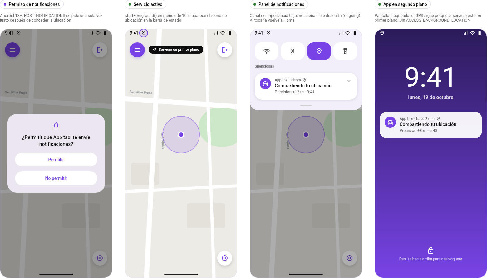
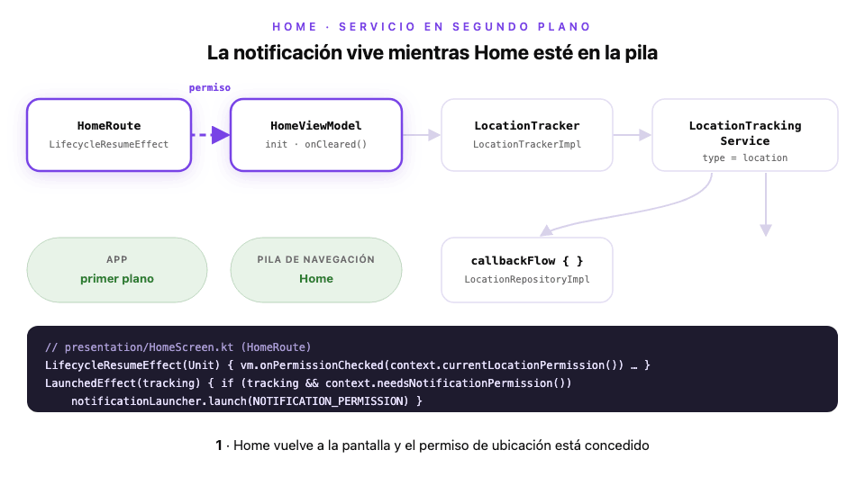
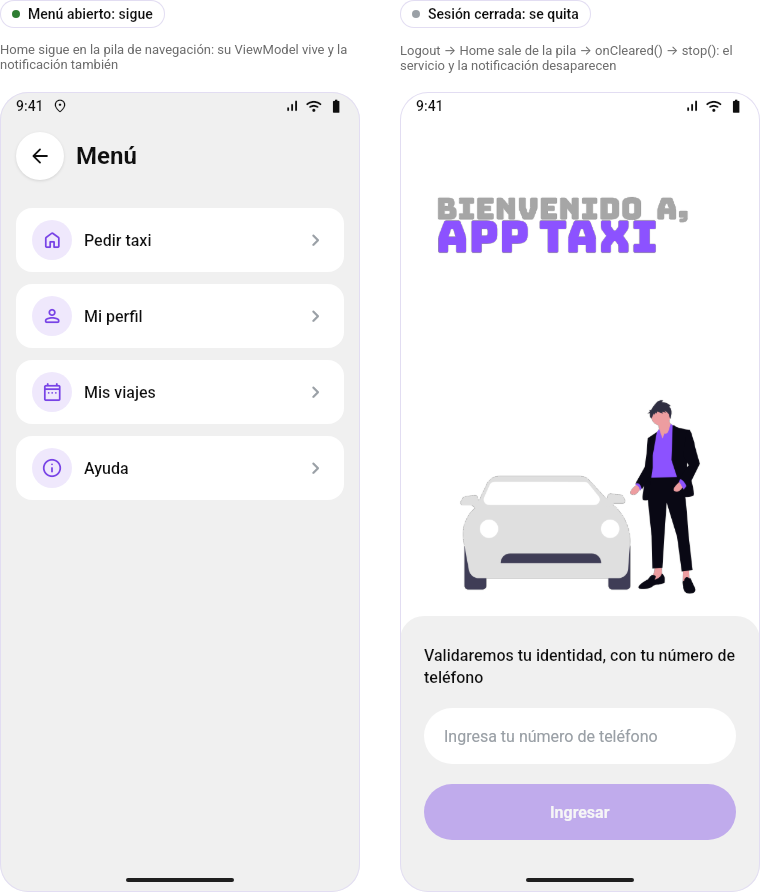

# Módulo 4 · Sesión 2

## Segundo plano: un servicio de ubicación que vive con Home

---

## Objetivos

1. Elegir bien entre **Service**, **Foreground Service** y **WorkManager**.
2. Crear un **Foreground Service** de tipo `location` que siga recibiendo posiciones con la app en segundo plano.
3. Mostrar una **notificación persistente** mientras Home esté abierto y quitarla al salir.
4. Probar el arranque y el apagado sin depender del GPS.

---

## Contenido

1. Segundo plano en Android, en dos tablas
2. Proyectos de la clase
3. Paso a paso en `android-app-taxi`
4. ¿Y WorkManager?
5. Errores comunes

---

## 1) Segundo plano en Android, en dos tablas

Cada versión recortó lo que una app puede hacer sin que el usuario la vea:

| Versión     | Cambio                                                        |
| ----------- | ------------------------------------------------------------- |
| Android 6   | Doze y App Standby: el sistema pausa trabajos en reposo       |
| Android 8   | Los servicios en segundo plano se detienen a los pocos minutos |
| Android 10  | La ubicación en segundo plano pasa a ser un permiso aparte    |
| Android 12  | No se puede iniciar un Foreground Service desde segundo plano |
| Android 13  | Las notificaciones piden permiso (`POST_NOTIFICATIONS`)       |
| Android 14  | El Foreground Service declara su **tipo** y su permiso        |

¿Qué uso?

| Necesito…                                      | Uso                                   | Ejemplo                       |
| ---------------------------------------------- | ------------------------------------- | ----------------------------- |
| Algo continuo que el usuario **sabe** que corre | **Foreground Service** + notificación | Tracking GPS, música, llamada |
| Algo que debe terminar aunque se cierre la app | **WorkManager** (`OneTimeWorkRequest`) | Subir una foto, sincronizar   |
| Algo cada cierto tiempo (≥ 15 min)             | **WorkManager** (`PeriodicWorkRequest`) | Refrescar el clima            |
| Algo a una hora exacta                         | `AlarmManager`                        | Recordatorio de medicación    |

Para el taxi la respuesta es clara: el pasajero espera que su ubicación se siga enviando mientras mira otra app, y debe **verlo**. Eso es un Foreground Service.

---

## 2) Proyectos de la clase

| Proyecto                                                   | Qué es                                                                     | Guía                                   |
| ---------------------------------------------------------- | -------------------------------------------------------------------------- | -------------------------------------- |
| [`infra-app-taxi`](./infra-app-taxi)                       | MySQL 9.7, Redis 8.10 y la API con Docker Compose                          | [README](./infra-app-taxi/README.md)   |
| [`backend-app-taxi`](./backend-app-taxi)                   | API NestJS 12: OTP, menú, registro y refresh                               | [README](./backend-app-taxi/README.md) |
| [`android-app-taxi`](./android-app-taxi)                   | App Android: lo de la clase anterior + **servicio de ubicación en segundo plano** | [README](./android-app-taxi/README.md) |
| [`design-m04-c02.pen`](./design-m04-c02.pen)               | Diseño con la sección **«8 · Ubicación en segundo plano»**                 | —                                      |
| [`diagrama-servicio-ubicacion.html`](./diagrama-servicio-ubicacion.html) | **Diagrama interactivo**: ábrelo en el navegador y avanza paso a paso | —                                      |

Los tres proyectos parten de los del **módulo 4 · clase 01**. Backend e infra no cambian.



---

## 3) Paso a paso en `android-app-taxi`



> El mismo flujo, interactivo: [`diagrama-servicio-ubicacion.html`](./diagrama-servicio-ubicacion.html). Usa ← → o toca una caja para ver su código.

```
features/home/
├─ domain/repository/LocationTracker.kt         // Paso 2
├─ data/tracking/
│  ├─ TrackingNotification.kt                   // Paso 3
│  ├─ LocationTrackingService.kt                // Paso 4
│  └─ LocationTrackerImpl.kt                    // Paso 2
└─ presentation/
   ├─ HomeViewModel.kt                          // Paso 5
   ├─ NotificationPermission.kt, HomeScreen.kt  // Paso 6
```

### Paso 1 · Manifest: permisos y servicio

```xml
<uses-permission android:name="android.permission.FOREGROUND_SERVICE" />
<uses-permission android:name="android.permission.FOREGROUND_SERVICE_LOCATION" />
<uses-permission android:name="android.permission.POST_NOTIFICATIONS" />

<service
    android:name=".features.home.data.tracking.LocationTrackingService"
    android:exported="false"
    android:foregroundServiceType="location"
    android:stopWithTask="true" />
```

-   `foregroundServiceType="location"` + `FOREGROUND_SERVICE_LOCATION`: obligatorio desde Android 14.
-   `stopWithTask`: si el usuario desliza la app en Recientes, el servicio muere con ella.
-   **No** pedimos `ACCESS_BACKGROUND_LOCATION`: el servicio arranca con la app visible y el permiso «mientras la app está en uso» alcanza.

### Paso 2 · El contrato: `LocationTracker`

```kotlin
// domain/repository/LocationTracker.kt
interface LocationTracker {
    fun start(precise: Boolean)
    fun stop()
}

// data/tracking/LocationTrackerImpl.kt
override fun start(precise: Boolean) {
    ContextCompat.startForegroundService(context, LocationTrackingService.intent(context, precise))
}

override fun stop() {
    context.stopService(Intent(context, LocationTrackingService::class.java))
}
```

El ViewModel solo ve la interfaz: ni `Service` ni `Intent`. Hilt la provee en `HomeModule`.

### Paso 3 · La notificación

```kotlin
// data/tracking/TrackingNotification.kt
NotificationChannelCompat.Builder(CHANNEL_ID, NotificationManagerCompat.IMPORTANCE_LOW)

NotificationCompat.Builder(context, CHANNEL_ID)
    .setSmallIcon(R.drawable.ic_tracking_location)
    .setContentTitle("Compartiendo tu ubicación")
    .setContentText(location.toTrackingText(ZoneId.systemDefault()))   // «Precisión ±12 m · 9:41»
    .setOngoing(true)
    .setSilent(true)
    .setContentIntent(openApp())
    .build()
```

| Opción              | Por qué                                         |
| ------------------- | ----------------------------------------------- |
| `IMPORTANCE_LOW`    | No suena: aparece en «Silenciosas»              |
| `setOngoing(true)`  | El usuario no la descarta mientras el servicio corre |
| `setContentIntent`  | Tocarla vuelve a la app                         |

### Paso 4 · El servicio

```kotlin
// data/tracking/LocationTrackingService.kt
@AndroidEntryPoint
class LocationTrackingService : Service() {

    @Inject lateinit var repository: LocationRepository

    override fun onStartCommand(intent: Intent?, flags: Int, startId: Int): Int {
        ServiceCompat.startForeground(
            this, TrackingNotification.ID, notification.build(location = null),
            ServiceInfo.FOREGROUND_SERVICE_TYPE_LOCATION
        )
        tracking = repository.observeLocation(precise)
            .onEach(notification::update)
            .launchIn(scope)
        return START_NOT_STICKY
    }

    override fun onDestroy() { scope.cancel() }
}
```

1. `startForeground` **primero**: hay 10 s desde `startForegroundService` o el sistema cierra la app.
2. Reutiliza el `LocationRepository` de la clase anterior: misma `callbackFlow`, mismo `awaitClose`.
3. `scope.cancel()` en `onDestroy` → `awaitClose` → `removeLocationUpdates`: el GPS se apaga.
4. `START_NOT_STICKY`: si el sistema lo mata, no revive solo; lo vuelve a encender Home.

### Paso 5 · El ViewModel lo enciende y lo apaga

```kotlin
// presentation/HomeViewModel.kt
init {
    permission
        .map { (it as? LocationPermission.Granted)?.precise }
        .distinctUntilChanged()
        .onEach { precise -> if (precise != null) tracker.start(precise) else tracker.stop() }
        .launchIn(viewModelScope)
}

override fun onCleared() {
    tracker.stop()
}
```

Atarlo al **ViewModel** (y no a la pantalla) es lo que hace que dure «mientras estés en Home»:



| Pasa esto                        | ¿Servicio?    | Por qué                                   |
| -------------------------------- | ------------- | ----------------------------------------- |
| Rotas la pantalla                | Sigue         | El ViewModel sobrevive                    |
| Vas a otra app o bloqueas        | Sigue         | Es justo para lo que existe               |
| Abres el menú                    | Sigue         | Home queda en la pila                     |
| Cierras sesión                   | **Se quita**  | Home sale de la pila → `onCleared()`      |
| Deslizas la app en Recientes     | **Se quita**  | `stopWithTask="true"`                     |
| Quitas el permiso de ubicación   | **Se quita**  | `Denied` → `tracker.stop()`               |

`distinctUntilChanged()` evita reiniciarlo en cada `ON_RESUME`; si el permiso pasa de preciso a aproximado, sí se reinicia con la nueva prioridad.

### Paso 6 · Pedir permiso de notificaciones

En Android 13+ sin este permiso el servicio corre igual, pero **la notificación no se ve**. Se pide una vez, cuando llega la primera ubicación:

```kotlin
// presentation/HomeScreen.kt (HomeRoute)
val tracking = mapUi is MapUiState.Success

LaunchedEffect(tracking) {
    if (tracking && !askedNotifications && context.needsNotificationPermission()) {
        askedNotifications = true
        notificationLauncher.launch(NOTIFICATION_PERMISSION)
    }
}
```

### Paso 7 · Probarlo

Un fake registra cada llamada:

```kotlin
// test/.../features/home/FakeLocation.kt
class FakeLocationTracker : LocationTracker {
    val calls = mutableListOf<String>()
    override fun start(precise: Boolean) { calls += "start(precise=$precise)" }
    override fun stop() { calls += "stop" }
}
```

```kotlin
// test/.../features/home/presentation/HomeViewModelTest.kt
@Test
fun `con permiso arranca el servicio una sola vez aunque la pantalla vuelva`() = runTest(dispatcher) {
    val vm = viewModel()

    vm.onPermissionResult(LocationPermission.Granted(precise = true))
    vm.onPermissionChecked(LocationPermission.Granted(precise = true))
    vm.onPermissionChecked(LocationPermission.Granted(precise = true))

    assertEquals(listOf("stop", "start(precise=true)"), tracker.calls)
}
```

```bash
./gradlew testDebugUnitTest            # 61 pruebas JVM (4 nuevas)
./gradlew connectedDebugAndroidTest    # LocationTrackerTest: start() publica la notificación y stop() la quita
adb shell dumpsys activity services com.example.android   # isForeground=true mientras estés en Home
```

---

## 4) ¿Y WorkManager?

Para trabajo **diferible** que debe terminar aunque la app se cierre. No reemplaza al servicio: no entrega posiciones cada 5 s.

```kotlin
class SyncTripsWorker(context: Context, params: WorkerParameters) : CoroutineWorker(context, params) {
    override suspend fun doWork(): Result = try {
        uploadPendingTrips()
        Result.success()
    } catch (e: IOException) {
        Result.retry()
    }
}

val request = PeriodicWorkRequestBuilder<SyncTripsWorker>(1, TimeUnit.HOURS)
    .setConstraints(Constraints.Builder().setRequiredNetworkType(NetworkType.CONNECTED).build())
    .setBackoffCriteria(BackoffPolicy.EXPONENTIAL, 30, TimeUnit.SECONDS)
    .build()

WorkManager.getInstance(context)
    .enqueueUniquePeriodicWork("sync-trips", ExistingPeriodicWorkPolicy.UPDATE, request)
```

| Concepto                    | Para qué                                          |
| --------------------------- | ------------------------------------------------- |
| `Constraints`               | Correr solo con red, cargando o batería suficiente |
| `Result.retry()` + backoff  | Reintentar con espera creciente                   |
| `enqueueUnique…Work`        | No duplicar el mismo trabajo                      |
| `.then(...)`                | Encadenar: leer → calcular → subir               |
| `setForeground(...)`        | Trabajo largo con notificación (subir un video)   |

---

## 5) Errores comunes

| Error                                              | Qué pasa                                         | En el proyecto                                 |
| -------------------------------------------------- | ------------------------------------------------ | ---------------------------------------------- |
| No llamar a `startForeground` a tiempo             | `ForegroundServiceDidNotStartInTimeException`    | Es lo primero de `onStartCommand`              |
| Olvidar `foregroundServiceType` (Android 14+)      | `MissingForegroundServiceTypeException`          | `type="location"` en manifest y en código      |
| Iniciar el servicio desde segundo plano (12+)      | `ForegroundServiceStartNotAllowedException`      | Solo arranca desde Home visible                |
| Pedir `ACCESS_BACKGROUND_LOCATION` sin necesitarlo | Revisión extra en Play y usuarios que lo niegan | El servicio en primer plano no lo necesita     |
| No pedir `POST_NOTIFICATIONS` (13+)                | El servicio corre, pero el usuario no lo ve      | Se pide tras la primera ubicación              |
| Atar el servicio a la pantalla                     | Se reinicia en cada rotación                     | Atado al ViewModel                             |
| No detenerlo nunca                                 | Batería y desconfianza del usuario               | `onCleared()`, `Denied` y `stopWithTask`       |
| Usar WorkManager para tracking continuo            | Mínimo 15 min entre ejecuciones                  | Foreground Service                             |

---

## Recursos recomendados

-   [Foreground services](https://developer.android.com/develop/background-work/services/fgs) y [tipos de foreground service](https://developer.android.com/develop/background-work/services/fgs/service-types) (Android Developers).
-   [Restricciones para iniciar foreground services desde segundo plano](https://developer.android.com/develop/background-work/services/fgs/restrictions-bg-start).
-   [Permiso de notificaciones en tiempo de ejecución](https://developer.android.com/develop/ui/views/notifications/notification-permission).
-   [Guía de WorkManager](https://developer.android.com/develop/background-work/background-tasks/persistent).
-   Clase anterior: [GPS y permisos](../clase-01/README.md).
