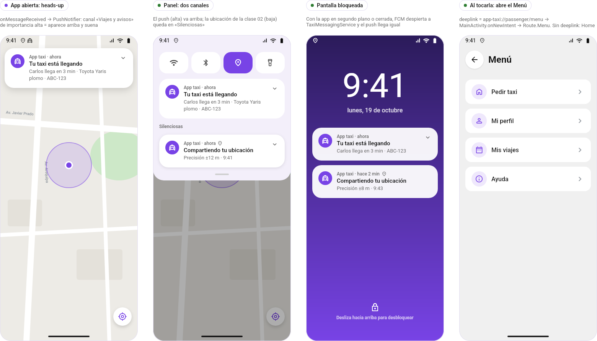
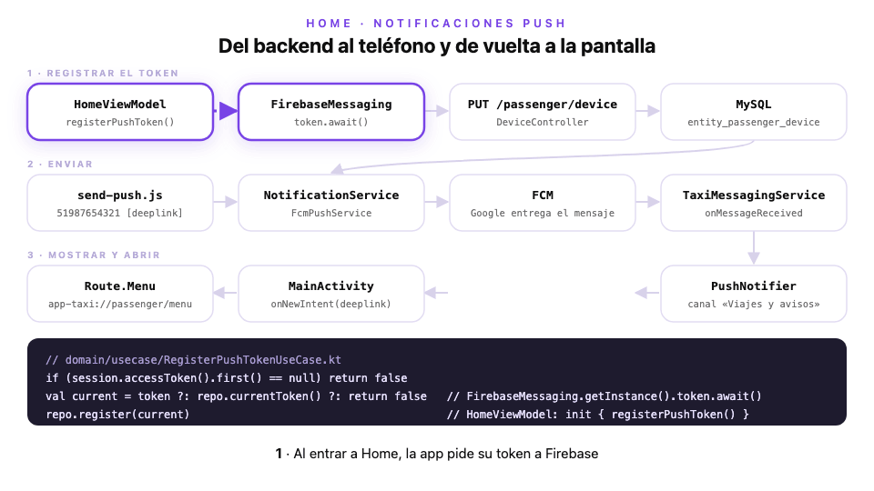
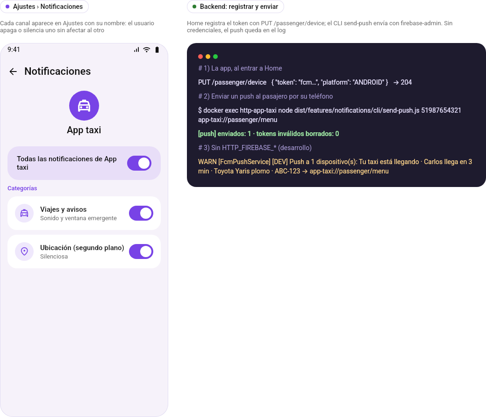

# Módulo 4 · Sesión 3

## Notificaciones y push: del backend al teléfono

---

## Objetivos

1. Crear **canales** y publicar una **notificación** que abra una pantalla.
2. Integrar **Firebase Cloud Messaging (FCM)**: token, servicio y mensajes.
3. Conectar con el **backend**: guardar el token y enviar el push.
4. Probar cada parte sin depender de Firebase.

---

## Contenido

1. Notificaciones en Android, en tres tablas
2. Proyectos de la clase
3. Paso a paso
4. ¿Y los recordatorios programados?
5. Errores comunes

---

## 1) Notificaciones en Android, en tres tablas

| Versión     | Cambio                                                                    |
| ----------- | ------------------------------------------------------------------------- |
| Android 8   | Nacen los **canales**: el usuario decide cómo suena cada tipo de aviso    |
| Android 12  | Tocar la notificación debe abrir una Activity directamente (`PendingIntent` inmutable) |
| Android 13  | Mostrar notificaciones pide permiso: `POST_NOTIFICATIONS`                 |

La **importancia** del canal decide cómo aparece:

| Importancia | Cómo se ve                         | En la app                          |
| ----------- | ---------------------------------- | ---------------------------------- |
| `HIGH`      | Suena y aparece arriba (heads-up)  | «Viajes y avisos»: el push         |
| `DEFAULT`   | Suena, sin heads-up                | —                                  |
| `LOW`       | Sin sonido, en «Silenciosas»       | «Ubicación en segundo plano» (clase 02) |

FCM manda dos tipos de mensajes:

| Tipo            | Con la app abierta             | Con la app cerrada                  | Usamos |
| --------------- | ------------------------------ | ----------------------------------- | ------ |
| `notification`  | Llega a `onMessageReceived`    | La muestra el sistema, sin tu código | —      |
| `data`          | Llega a `onMessageReceived`    | Llega a `onMessageReceived`         | **Sí**: la app siempre arma la notificación |

> Más detalle sobre mensajes silenciosos, prioridades y límites: [`firebase_messaging_push_silenciosos.md`](./firebase_messaging_push_silenciosos.md).

---

## 2) Proyectos de la clase

| Proyecto                                         | Qué es                                                                          | Guía                                   |
| ------------------------------------------------ | ------------------------------------------------------------------------------- | -------------------------------------- |
| [`infra-app-taxi`](./infra-app-taxi)             | MySQL 9.7, Redis 8.10 y la API con Docker Compose (+ variables de Firebase)      | [README](./infra-app-taxi/README.md)   |
| [`backend-app-taxi`](./backend-app-taxi)         | API NestJS 12 + **`PUT /passenger/device`** y **envío de push con `firebase-admin`** | [README](./backend-app-taxi/README.md) |
| [`android-app-taxi`](./android-app-taxi)         | App de la clase anterior + **notificaciones push con FCM**                      | [README](./android-app-taxi/README.md) |
| [`design-m04-c03.pen`](./design-m04-c03.pen)     | Diseño con la sección **«9 · Notificaciones push»**                             | —                                      |
| [`diagrama-push.html`](./diagrama-push.html)     | **Diagrama interactivo**: ábrelo en el navegador y avanza paso a paso           | —                                      |

Los tres proyectos parten de los del **módulo 4 · clase 02**.



---

## 3) Paso a paso



> El mismo flujo, interactivo: [`diagrama-push.html`](./diagrama-push.html). Usa ← → o toca una caja para ver su código.

```
backend-app-taxi/src/features/notifications/   // Pasos 3 y 5
android-app-taxi/.../features/home/
├─ domain/  PushMessage, PushTokenRepository, RegisterPushTokenUseCase   // Paso 4
└─ data/push/
   ├─ PushNotifier.kt                                                    // Paso 2
   ├─ DeviceApi.kt, PushTokenRepositoryImpl.kt                           // Paso 4
   └─ TaxiMessagingService.kt, PushMessageMapper.kt                      // Paso 6
android-app-taxi/.../core/presentation/activity/MainActivity.kt          // Paso 7
```

### Paso 1 · Firebase en el proyecto

1. En [Firebase Console](https://console.firebase.google.com) crea un proyecto y registra la app Android con el paquete `com.example.android`.
2. Descarga `google-services.json` y cópialo en `android-app-taxi/app/` (está en `.gitignore`).

```toml
# gradle/libs.versions.toml
firebaseBom = "35.0.2"
googleServices = "4.5.0"
```

```kotlin
// app/build.gradle.kts
if (file("google-services.json").exists()) {
    apply(plugin = libs.plugins.google.services.get().pluginId)
}

dependencies {
    implementation(platform(libs.firebase.bom))
    implementation(libs.firebase.messaging)
}
```

El plugin solo se aplica si existe el archivo: sin él, la app compila y funciona, pero no recibe pushes.

### Paso 2 · Una notificación que abre una pantalla

```kotlin
// data/push/PushNotifier.kt
NotificationChannelCompat.Builder("trips", NotificationManagerCompat.IMPORTANCE_HIGH)
    .setName("Viajes y avisos")
    .build()

NotificationCompat.Builder(context, "trips")
    .setSmallIcon(R.drawable.ic_push_taxi)
    .setContentTitle(message.title)
    .setContentText(message.body)
    .setAutoCancel(true)
    .setContentIntent(open(id, message.deeplink))
    .build()

private fun open(requestCode: Int, deeplink: String) = PendingIntent.getActivity(
    context, requestCode,
    Intent(context, MainActivity::class.java)
        .putExtra(MainActivity.EXTRA_DEEPLINK, deeplink)
        .addFlags(Intent.FLAG_ACTIVITY_SINGLE_TOP or Intent.FLAG_ACTIVITY_CLEAR_TOP),
    PendingIntent.FLAG_IMMUTABLE or PendingIntent.FLAG_UPDATE_CURRENT
)
```

1. El **canal** se crea una vez; después el usuario lo controla en Ajustes.
2. `setAutoCancel(true)`: al tocarla, desaparece.
3. El `PendingIntent` lleva el **deeplink** a `MainActivity`.



### Paso 3 · Backend: guardar el token

Cada instalación de la app tiene un **token** de FCM. El backend lo guarda por pasajero:

```ts
// features/notifications/controllers/device.controller.ts
@Put("device")
@UseGuards(AccessTokenGuard)
@HttpCode(HttpStatus.NO_CONTENT)
async registerDevice(@Req() request, @Body() dto: PassengerDeviceRequestDto) {
    await this.service.registerDevice(request.user.sub, dto);
}
```

| Tabla `entity_passenger_device` | Para qué                                          |
| ------------------------------- | ------------------------------------------------- |
| `id_passenger` (FK)             | Un pasajero puede tener varios teléfonos          |
| `token` (único)                 | Si otro pasajero inicia sesión en ese teléfono, el token cambia de dueño |
| `platform`                      | `ANDROID` o `IOS`                                  |

### Paso 4 · App: registrar el token

```kotlin
// domain/usecase/RegisterPushTokenUseCase.kt
suspend operator fun invoke(token: String? = null): Boolean {
    if (session.accessToken().first() == null) return false
    val current = token ?: repo.currentToken() ?: return false
    return try {
        repo.register(current)
        true
    } catch (e: DomainException) {
        false
    }
}

// data/push/PushTokenRepositoryImpl.kt
override suspend fun currentToken() = messaging()?.let { safeCall { it.token.await() } }
override suspend fun register(token: String) = safeCall { api.register(DeviceRequest(token)) }

// presentation/HomeViewModel.kt
init { viewModelScope.launch { registerPushToken() } }
```

-   Solo con **sesión**: el backend necesita saber de quién es el token.
-   Si falla la red, devuelve `false`: Home sigue funcionando y se reintenta la próxima vez.

### Paso 5 · Backend: enviar el push

```ts
// features/notifications/remote/fcm-push.service.ts
getMessaging(app).sendEachForMulticast({
    tokens,
    data: { title, body, deeplink },
    android: { priority: "high" },
});
```

```bash
docker exec http-app-taxi node dist/features/notifications/cli/send-push.js 51987654321 app-taxi://passenger/menu
# [push] enviados: 1 · tokens inválidos borrados: 0
```

| Variables `HTTP_FIREBASE_*` en `infra-app-taxi/.env` | Resultado                                     |
| ---------------------------------------------------- | --------------------------------------------- |
| Con la cuenta de servicio de Firebase                | El push llega al teléfono                     |
| Vacías (desarrollo)                                  | El log muestra `[DEV] Push a 1 dispositivo(s): …` |

El JSON de la cuenta de servicio se genera en *Firebase Console → Configuración → Cuentas de servicio*. Nunca se sube a git.

### Paso 6 · App: recibir el push

```kotlin
// data/push/TaxiMessagingService.kt
@AndroidEntryPoint
class TaxiMessagingService : FirebaseMessagingService() {

    override fun onNewToken(token: String) {
        scope.launch { registerPushToken(token) }
    }

    override fun onMessageReceived(message: RemoteMessage) {
        message.data.toPushMessage()?.let(notifier::show)
    }
}
```

```xml
<service
    android:name=".features.home.data.push.TaxiMessagingService"
    android:exported="false">
    <intent-filter>
        <action android:name="com.google.firebase.MESSAGING_EVENT" />
    </intent-filter>
</service>
```

-   `onNewToken`: FCM rota el token (reinstalación, datos borrados). Hay que volver a registrarlo.
-   `onMessageReceived`: como es un mensaje `data`, corre con la app abierta o cerrada.

### Paso 7 · Abrir la pantalla correcta

```kotlin
// core/presentation/activity/MainActivity.kt
override fun onNewIntent(intent: Intent) {
    super.onNewIntent(intent)
    intent.getStringExtra(EXTRA_DEEPLINK)?.let { pendingDeeplink.value = it }
}

LaunchedEffect(deeplink, currentRoute) {
    val link = deeplink ?: return@LaunchedEffect
    if (currentRoute != Route.Home.path && currentRoute != Route.Menu.path) return@LaunchedEffect
    when (link) {
        DEEPLINK_MENU -> nav.navigate(Route.Menu.path) { launchSingleTop = true }
        DEEPLINK_HOME -> nav.popBackStack(Route.Home.path, inclusive = false)
    }
    pendingDeeplink.value = null
}
```

| La app estaba…            | Al tocar el push                                    |
| ------------------------- | --------------------------------------------------- |
| Abierta                   | `onNewIntent` → navega al instante                  |
| Cerrada                   | `onCreate` guarda el deeplink → Splash → Home → navega |
| Sin sesión                | El deeplink espera hasta que el usuario entre a Home |

### Paso 8 · Cerrar sesión: borrar el token

```kotlin
// domain/usecase/SignOutUseCase.kt
suspend operator fun invoke() {
    push.delete()        // FirebaseMessaging.deleteToken()
    session.clear()
    localCache.clear()
}
```

Ese token deja de servir. En el siguiente envío, FCM responde `registration-token-not-registered` y el backend lo borra de `entity_passenger_device`.

### Paso 9 · Probarlo

```bash
./gradlew testDebugUnitTest           # 70 pruebas JVM (9 nuevas): caso de uso, mapper, SignOut, HomeViewModel
./gradlew connectedDebugAndroidTest   # PushNotifierTest: canal de importancia alta con contentIntent
pnpm test                             # backend: 49 pruebas (11 nuevas): NotificationService y PushSender
```

De punta a punta:

1. Levanta infra y backend, y entra a Home con un pasajero.
2. El log del backend muestra `PUT /passenger/device` con **204**.
3. Envía el push con el CLI del Paso 5 y míralo llegar. Tócalo: se abre el Menú.

---

## 4) ¿Y los recordatorios programados?

Un push viene del servidor. Si el aviso depende **solo del teléfono** (un recordatorio a una hora), se programa con `AlarmManager` y se muestra con el mismo `PushNotifier`:

```kotlin
val pending = PendingIntent.getBroadcast(
    context, 1001, Intent(context, ReminderReceiver::class.java),
    PendingIntent.FLAG_UPDATE_CURRENT or PendingIntent.FLAG_IMMUTABLE
)
context.getSystemService(AlarmManager::class.java)
    .setInexactRepeating(AlarmManager.RTC_WAKEUP, triggerAtMillis, AlarmManager.INTERVAL_DAY, pending)
```

| Necesito…                                   | Uso                    |
| ------------------------------------------- | ---------------------- |
| Avisar algo que pasó en el servidor         | **Push (FCM)**         |
| Recordar algo a una hora, sin servidor      | `AlarmManager` inexacto |
| Alarma a la hora exacta (Android 12+)       | Permiso `SCHEDULE_EXACT_ALARM` |
| Reprogramar después de reiniciar            | Receiver de `BOOT_COMPLETED` |

---

## 5) Errores comunes

| Error                                             | Qué pasa                                        | En el proyecto                                   |
| ------------------------------------------------- | ----------------------------------------------- | ------------------------------------------------ |
| Enviar mensajes `notification`                    | Con la app cerrada, el sistema ignora tu canal y tu deeplink | Solo `data`                           |
| Publicar sin canal (Android 8+)                   | La notificación no aparece                      | `PushNotifier` crea `trips` en su `init`         |
| Un solo canal para todo                           | El usuario silencia todo para callar uno        | «Viajes y avisos» (alta) y «Ubicación» (baja)    |
| Registrar el token una sola vez                   | Tras reinstalar, el backend envía a un token muerto | Home + `onNewToken`                          |
| No borrar el token al cerrar sesión               | El teléfono recibe pushes de otra cuenta        | `deleteToken()` en `SignOutUseCase`              |
| Guardar tokens inválidos para siempre             | Envíos que fallan en silencio                   | `deleteByTokens(invalidTokens)`                  |
| Subir `google-services.json` o la cuenta de servicio | Credenciales expuestas                       | `.gitignore` y variables `FIREBASE_*`            |
| `PendingIntent` mutable o sin `requestCode` único | Crash en Android 12+ o todos abren lo mismo     | `FLAG_IMMUTABLE` y un id por notificación        |

---

## Recursos recomendados

-   [Crear y administrar canales de notificación](https://developer.android.com/develop/ui/views/notifications/channels) (Android Developers).
-   [Configurar un cliente de FCM en Android](https://firebase.google.com/docs/cloud-messaging/android/client) y [recibir mensajes](https://firebase.google.com/docs/cloud-messaging/android/receive).
-   [Enviar mensajes con el Admin SDK](https://firebase.google.com/docs/cloud-messaging/send-message).
-   [Permiso de notificaciones en tiempo de ejecución](https://developer.android.com/develop/ui/views/notifications/notification-permission).
-   Clase anterior: [Servicio de ubicación en segundo plano](../clase-02/README.md).
