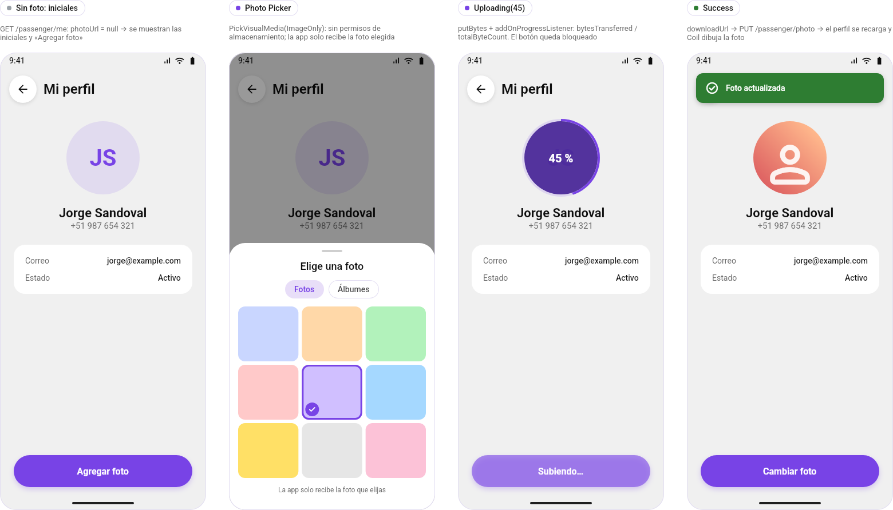
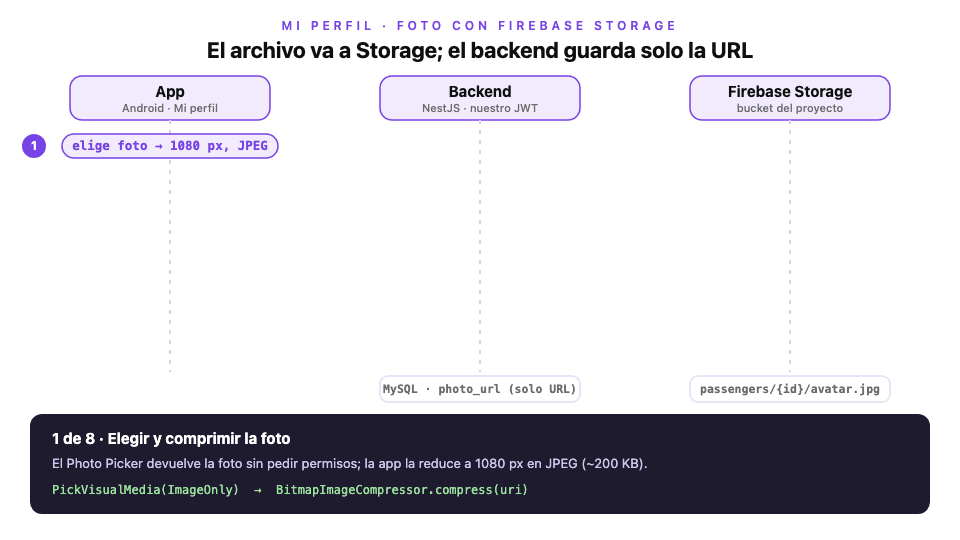
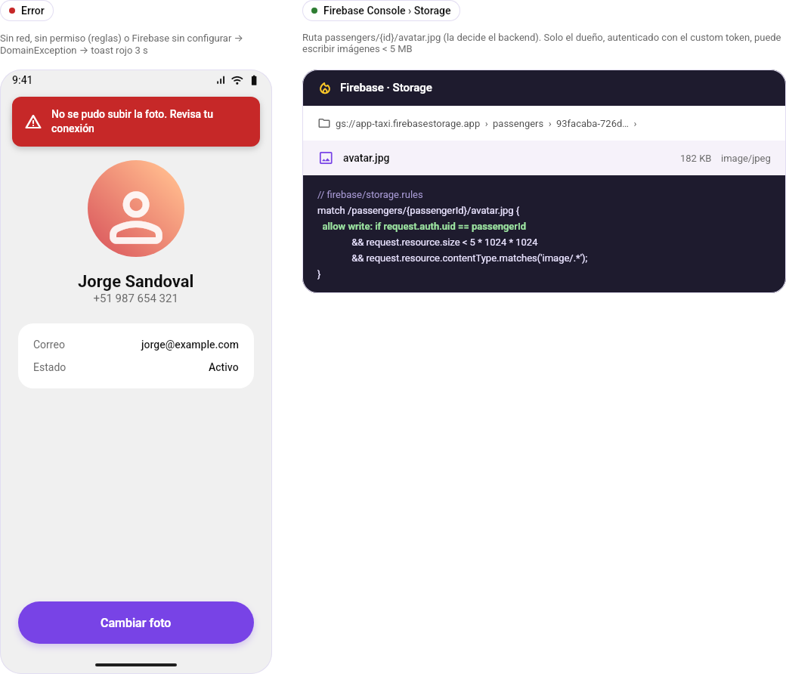

# Módulo 4 · Sesión 4

## Firebase: autenticación (teoría) y archivos con Storage (práctica)

---

## Objetivos

1. Entender **SSO** y cómo funciona **Firebase Auth** (correo, Google y custom token).
2. Subir un archivo a **Firebase Storage** con barra de progreso.
3. Proteger los archivos con **reglas de seguridad** sin cambiar el login de la app.
4. Guardar la URL en el backend y mostrar la imagen.

---

## Contenido

1. Firebase Auth (teoría)
2. Firebase Storage, en dos tablas
3. Proyectos de la clase
4. Paso a paso: la foto de perfil
5. ¿Y Firestore?
6. Errores comunes

---

## 1) Firebase Auth (teoría)

**SSO (Single Sign-On):** inicias sesión una vez con un proveedor (Google, Apple…) y entras a varias apps sin otra contraseña.

| Proveedor de identidad | Qué es                                     | Precio base                 |
| ---------------------- | ------------------------------------------ | --------------------------- |
| **Firebase Auth**      | Integrado con Storage, Firestore y FCM     | Gratis hasta 50 000 MAU     |
| Auth0                  | Muy configurable, reglas y roles avanzados | De pago                     |
| Amazon Cognito         | Parte de AWS                               | Gratis hasta 10 000 MAU     |
| Keycloak               | Open source, lo hospedas tú                | Gratis (pagas el servidor)  |

Firebase Auth entrega un **ID token** (JWT) que Storage, Firestore y tu backend pueden verificar:

| Método            | Cómo entra el usuario                      | Código en Android                                         |
| ----------------- | ------------------------------------------ | --------------------------------------------------------- |
| Correo y clave    | Formulario propio                          | `auth.signInWithEmailAndPassword(email, password)`        |
| Google            | Credential Manager muestra sus cuentas     | `auth.signInWithCredential(GoogleAuthProvider.getCredential(idToken, null))` |
| Teléfono (SMS)    | Código que envía Firebase                  | `PhoneAuthProvider.verifyPhoneNumber(...)`                |
| **Custom token**  | Tu backend ya autenticó al usuario         | `auth.signInWithCustomToken(token)`                       |

Google con Credential Manager (lo que reemplaza al antiguo `GoogleSignInClient`):

```kotlin
val option = GetGoogleIdOption.Builder()
    .setServerClientId(webClientId)
    .build()
val result = CredentialManager.create(context)
    .getCredential(context, GetCredentialRequest(listOf(option)))
val idToken = GoogleIdTokenCredential.createFrom(result.credential.data).idToken
Firebase.auth.signInWithCredential(GoogleAuthProvider.getCredential(idToken, null)).await()
```

**¿Y nuestra app?** Ya inicia sesión con **OTP + JWT propio** (módulo 2). No la cambiamos: el backend firma un **custom token** con el id del pasajero y la app lo canjea en silencio. Firebase Auth solo nos sirve para que las reglas de Storage sepan **quién** sube el archivo.

---

## 2) Firebase Storage, en dos tablas

| Servicio                 | Integración móvil        | Seguridad                    |
| ------------------------ | ------------------------ | ---------------------------- |
| **Firebase Storage**     | SDK Android/iOS oficial  | Reglas con `request.auth`    |
| AWS S3                   | SDK de AWS               | Políticas IAM / URL firmadas |
| Supabase Storage         | SDK móvil                | Políticas con JWT            |
| Cloudflare R2            | API compatible con S3    | Tokens y URL firmadas        |

| Concepto        | Qué es                                                        | En la app                              |
| --------------- | ------------------------------------------------------------- | -------------------------------------- |
| Bucket          | El «disco» del proyecto                                       | `app-taxi-xxxxx.firebasestorage.app`   |
| Referencia      | Ruta de un archivo                                            | `passengers/{id}/avatar.jpg`           |
| `putBytes` / `putFile` | Sube; avisa el progreso con `addOnProgressListener`     | `putBytes(jpeg, metadata)`             |
| `downloadUrl`   | URL pública con token para descargar                          | Se guarda en `photo_url` del backend   |
| Reglas          | Quién puede leer/escribir y qué                               | Solo el dueño, imágenes < 5 MB         |

---

## 3) Proyectos de la clase

| Proyecto                                             | Qué es                                                                       | Guía                                   |
| ---------------------------------------------------- | ---------------------------------------------------------------------------- | -------------------------------------- |
| [`infra-app-taxi`](./infra-app-taxi)                 | MySQL 9.7, Redis 8.10 y la API con Docker Compose                             | [README](./infra-app-taxi/README.md)   |
| [`backend-app-taxi`](./backend-app-taxi)             | API NestJS 12 + **`GET /passenger/me`, `POST /passenger/storage-token`, `PUT /passenger/photo`** y `firebase/storage.rules` | [README](./backend-app-taxi/README.md) |
| [`android-app-taxi`](./android-app-taxi)             | App de la clase anterior + **pantalla «Mi perfil» con subida de foto**       | [README](./android-app-taxi/README.md) |
| [`design-m04-c04.pen`](./design-m04-c04.pen)         | Diseño con la sección **«10 · Foto de perfil»**                              | —                                      |
| [`diagrama-storage.html`](./diagrama-storage.html)   | **Diagrama interactivo**: ábrelo en el navegador y avanza paso a paso        | —                                      |

Los tres proyectos parten de los del **módulo 4 · clase 03**.



---

## 4) Paso a paso: la foto de perfil



> El mismo flujo, interactivo: [`diagrama-storage.html`](./diagrama-storage.html). Usa ← → o toca una caja para ver su código.

```
backend-app-taxi/
├─ firebase/storage.rules                                // Paso 2
├─ src/core/firebase/firebase-admin.service.ts           // Paso 3
└─ src/features/passengers/                              // Pasos 3 y 7
android-app-taxi/.../features/profile/
├─ domain/  ChangePhotoUseCase, PhotoStorage, ImageCompressor   // Paso 4
├─ data/storage/BitmapImageCompressor.kt                        // Paso 5
├─ data/storage/FirebasePhotoStorage.kt                         // Paso 6
└─ presentation/ProfileScreen.kt, ProfileViewModel.kt           // Paso 8
```

### Paso 1 · Firebase en el proyecto

1. En Firebase Console activa **Storage** (el proyecto y `google-services.json` son los de la clase 03).
2. Agrega las librerías:

```kotlin
// app/build.gradle.kts
implementation(platform(libs.firebase.bom))   // 35.0.2
implementation(libs.firebase.auth)
implementation(libs.firebase.storage)
implementation(libs.coil.compose)             // 3.6.3: mostrar la foto
implementation(libs.coil.network.okhttp)
```

### Paso 2 · Las reglas de Storage

```
// backend-app-taxi/firebase/storage.rules
match /passengers/{passengerId}/avatar.jpg {
  allow read: if request.auth != null;
  allow write: if request.auth != null
               && request.auth.uid == passengerId
               && request.resource.size < 5 * 1024 * 1024
               && request.resource.contentType.matches('image/.*');
}
```

Se publican en *Firebase Console → Storage → Reglas* o con `firebase deploy --only storage`. Sin reglas, cualquiera con la app podría escribir en cualquier ruta.

### Paso 3 · Backend: el custom token

```ts
// features/passengers/services/storage-token.service.ts
return {
    token: await this.firebase.createCustomToken(passengerId, { role: "passenger" }),
    bucket: this.firebase.storageBucket(),
    photoPath: `passengers/${passengerId}/avatar.jpg`,
};
```

-   `POST /passenger/storage-token` exige el access token de siempre: el `uid` sale de **nuestra** sesión.
-   Usa la misma cuenta de servicio del push (`FIREBASE_*`). Sin ella responde **503**.

### Paso 4 · El caso de uso

```kotlin
// domain/usecase/ChangePhotoUseCase.kt
operator fun invoke(uri: String): Flow<PhotoState> = flow {
    emit(PhotoState.Preparing)
    val image = compressor.compress(uri)
    emitAll(storage.upload(image).map { event ->
        when (event) {
            is UploadEvent.Progress -> PhotoState.Uploading(event.percent)
            is UploadEvent.Done -> PhotoState.Success(repo.savePhoto(event.url))
        }
    })
}.catch { emit(PhotoState.Error(it.toDomainException().message)) }
```

El dominio no conoce Firebase: solo `PhotoStorage`, `ImageCompressor` y `ProfileRepository`. Por eso se prueba con fakes.

### Paso 5 · Comprimir antes de subir

```kotlin
// data/storage/BitmapImageCompressor.kt
val bitmap = ImageDecoder.decodeBitmap(source) { decoder, info, _ ->
    decoder.setTargetSize(...)                      // lado mayor: 1080 px
}
bitmap.compress(Bitmap.CompressFormat.JPEG, 85, out)
```

Una foto de cámara pesa ~4 MB; comprimida, ~200 KB: sube en segundos y cumple la regla de 5 MB.

### Paso 6 · Subir con progreso

```kotlin
// data/storage/FirebasePhotoStorage.kt
val access = safeCall { api.storageToken() }
FirebaseAuth.getInstance().signInWithCustomToken(access.token).await()
val ref = FirebaseStorage.getInstance("gs://${access.bucket}").reference.child(access.photoPath)

callbackFlow {
    val task = ref.putBytes(image, metadata)
        .addOnProgressListener { trySend(UploadEvent.Progress((it.bytesTransferred * 100 / it.totalByteCount).toInt())) }
        .addOnSuccessListener { launch { send(UploadEvent.Done(ref.downloadUrl.await().toString())); close() } }
        .addOnFailureListener { close(it) }
    awaitClose { if (!task.isComplete) task.cancel() }
}
```

1. **Autorizar:** el custom token deja `request.auth.uid` = id del pasajero.
2. **Subir:** `callbackFlow` convierte los *listeners* en un `Flow` (como el GPS de la clase 01).
3. **Limpiar:** `awaitClose` cancela la subida si el usuario sale de la pantalla.

### Paso 7 · Backend: guardar la URL

```ts
// PassengerService.updatePhoto
if (!isPassengerAvatarUrl(request.photoUrl, passengerId)) {
    throw new HttpCustomException(await this.i18n.t("photo.invalidUrl", { lang }));   // 422
}
return toPassengerDto(await this.passengerDao.updatePhotoUrl(passengerId, request.photoUrl));
```

El backend no confía en la app: solo acepta URLs de Firebase Storage de **la ruta del propio pasajero**.

### Paso 8 · La pantalla

```kotlin
// presentation/ProfileScreen.kt (ProfileRoute)
val picker = rememberLauncherForActivityResult(ActivityResultContracts.PickVisualMedia()) { uri ->
    uri?.let { vm.onPhotoPicked(it.toString()) }
}
picker.launch(PickVisualMediaRequest(ActivityResultContracts.PickVisualMedia.ImageOnly))

AsyncImage(model = passenger.photoUrl, contentScale = ContentScale.Crop)   // Coil
```

| `PhotoState`    | Pantalla                                   |
| --------------- | ------------------------------------------ |
| `Preparing`     | Anillo girando; botón bloqueado            |
| `Uploading(45)` | Anillo al 45 % sobre el avatar             |
| `Success`       | Foto nueva y toast verde                   |
| `Error`         | Toast rojo; la foto anterior se mantiene   |

Se entra desde **Menú › Mi perfil** (el deeplink `app-taxi://passenger/profile` que ya enviaba el backend).



### Paso 9 · Probarlo

```bash
./gradlew testDebugUnitTest           # 77 pruebas JVM (7 nuevas): ChangePhoto, GetProfile, ProfileViewModel
./gradlew connectedDebugAndroidTest   # BitmapImageCompressorTest: 3000×2000 → 1080×720 JPEG
pnpm test                             # backend: 58 pruebas (9 nuevas): custom token, URL del avatar, perfil
```

De punta a punta: levanta infra y backend con `HTTP_FIREBASE_*`, entra a **Menú › Mi perfil**, toca «Agregar foto» y mira el archivo en *Firebase Console → Storage → passengers/{id}/avatar.jpg*.

---

## 5) ¿Y Firestore?

Firestore es la base de datos NoSQL de Firebase (colecciones y documentos, con escucha en tiempo real). En App Taxi los datos viven en **MySQL** detrás de nuestro backend, así que no la usamos; sería útil, por ejemplo, para la posición del conductor en tiempo real.

```kotlin
Firebase.firestore.collection("trips").document(tripId)
    .snapshots()                                   // Flow: cada cambio llega solo
    .collect { trip -> render(trip.toObject<Trip>()) }
```

| Necesito…                                   | Uso                       |
| ------------------------------------------- | ------------------------- |
| Guardar archivos (fotos, PDF, audio)        | **Storage**               |
| Datos que cambian en vivo entre usuarios    | Firestore                 |
| Datos de negocio con reglas y SQL           | Nuestro backend + MySQL   |

---

## 6) Errores comunes

| Error                                          | Qué pasa                                         | En el proyecto                                   |
| ---------------------------------------------- | ------------------------------------------------ | ------------------------------------------------ |
| Reglas abiertas (`allow read, write: if true`) | Cualquiera sube o borra archivos                 | Solo el dueño, imágenes y < 5 MB                 |
| Subir la foto original                         | 4 MB por foto, lento y caro                      | 1080 px y JPEG 85                                |
| Pedir `READ_MEDIA_IMAGES` para elegir una foto | Permiso innecesario y rechazos en Play           | Photo Picker                                     |
| Cambiar todo el login a Firebase Auth          | Dos sistemas de usuarios                         | Custom token desde el backend                    |
| Guardar cualquier URL que mande la app         | Un usuario apunta su foto a la de otro           | `isPassengerAvatarUrl` en el backend             |
| No cancelar la subida                          | Sigue gastando datos con la pantalla cerrada     | `awaitClose { task.cancel() }`                   |
| Un nombre de archivo nuevo en cada subida      | El bucket se llena de fotos huérfanas            | Siempre `avatar.jpg`: se reemplaza               |
| Subir la cuenta de servicio a git              | Cualquiera firma tokens de tu proyecto           | Variables `FIREBASE_*` en `.env`                 |

---

## Recursos recomendados

-   [Firebase Auth en Android](https://firebase.google.com/docs/auth/android/start) y [custom tokens](https://firebase.google.com/docs/auth/admin/create-custom-tokens).
-   [Iniciar sesión con Google y Credential Manager](https://developer.android.com/identity/sign-in/credential-manager-siwg).
-   [Subir archivos con Cloud Storage para Firebase](https://firebase.google.com/docs/storage/android/upload-files) y [reglas de seguridad](https://firebase.google.com/docs/storage/security).
-   [Photo Picker](https://developer.android.com/training/data-storage/shared/photopicker).
-   Clase anterior: [Notificaciones y push](../clase-03/README.md).
