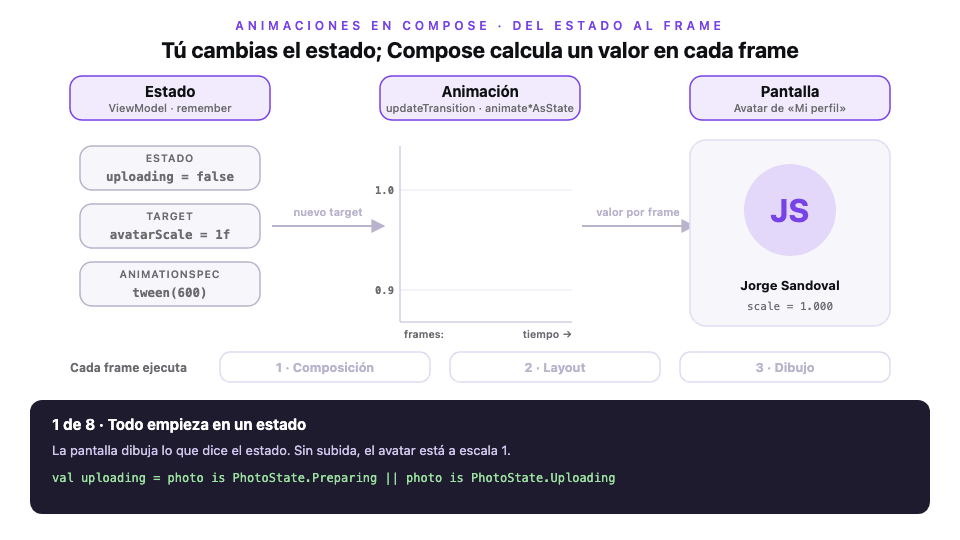
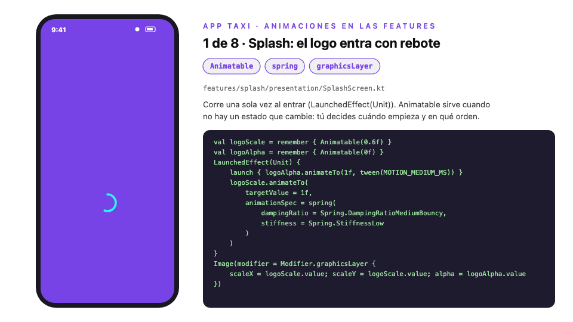

# Módulo 5 · Sesión 1

## Animaciones con Jetpack Compose en App Taxi

---

## Objetivos

1. Entender la idea base: **cambias el estado y Compose anima** el valor frame a frame.
2. Elegir la API correcta: `animate*AsState`, `updateTransition`, `AnimatedVisibility`, `AnimatedContent`, `Animatable` y `rememberInfiniteTransition`.
3. Configurar el movimiento con `tween`, `spring` e `infiniteRepeatable`.
4. Animar sin perder rendimiento: leer los valores en la fase correcta.

---

## Contenido

1. La idea: del estado al frame
2. ¿Qué API uso?
3. `AnimationSpec`: cómo se mueve
4. Proyectos de la clase
5. Paso a paso: animar App Taxi
6. Rendimiento y buenas prácticas
7. Antes de Compose: el sistema de vistas
8. Errores comunes

---

## 1) La idea: del estado al frame



> El mismo diagrama, interactivo: [`diagrama-estado-a-frame.html`](./diagrama-estado-a-frame.html). Usa ← → o toca un número para ir a un paso.

En Compose **no se ordena «anima esto»**. Se declara a qué valor llegar en cada estado y Compose hace el resto:

| Paso | Quién              | Qué pasa                                                                 |
| ---- | ------------------ | ------------------------------------------------------------------------ |
| 1    | ViewModel          | El estado cambia (`PhotoState.Uploading`)                                |
| 2    | Composable         | Calcula el nuevo destino (`targetValue = 0.9f`)                          |
| 3    | Animación          | En cada frame (~16 ms) entrega un valor intermedio: 1.0 → 0.98 → … → 0.9 |
| 4    | Pantalla           | Usa ese valor; idealmente solo vuelve a **dibujar**                      |
| 5    | Compose            | Si el estado cambia a mitad, sigue desde el valor actual, sin saltos     |
| 6    | Compose            | Si el composable sale de pantalla, la animación se cancela sola          |

---

## 2) ¿Qué API uso?

| Necesito…                                               | API                              | En App Taxi                                  |
| ------------------------------------------------------- | -------------------------------- | -------------------------------------------- |
| Animar **un** valor cuando cambia un estado             | `animate*AsState`                | Borde de las casillas OTP, círculo de precisión |
| Animar **varios** valores con el **mismo** estado       | `updateTransition`               | Avatar de «Mi perfil» (escala + oscurecido)  |
| Que algo **aparezca o desaparezca**                     | `AnimatedVisibility`             | Panel de ubicación, botón «centrar», ítems del menú |
| **Cambiar** un contenido por otro                       | `AnimatedContent` / `Crossfade`  | Botón ↔ spinner, toast, skeleton ↔ lista     |
| Una **secuencia** o animar sin estado (al entrar, al fallar) | `Animatable` + `LaunchedEffect` | Logo del Splash, temblor del OTP, barra del registro |
| Algo que se **repite** mientras está en pantalla        | `rememberInfiniteTransition`     | Pulso «Buscando tu ubicación…», skeleton     |
| Pasar de **una pantalla a otra**                        | `NavHost(enterTransition = …)`   | Todas las rutas                              |

Regla rápida: empieza por la API más simple de la tabla que resuelva el caso.

---

## 3) `AnimationSpec`: cómo se mueve

| Spec                         | Cómo se mueve                                     | Cuándo usarlo                          | En App Taxi                     |
| ---------------------------- | ------------------------------------------------- | -------------------------------------- | ------------------------------- |
| `tween(ms, easing)`          | Duración fija con curva de aceleración            | Colores, opacidad, desplazamientos     | Casi todo (150 / 300 / 600 ms)  |
| `spring(dampingRatio, stiffness)` | Física de resorte: puede pasarse y volver    | Escalas, «rebotes», gestos             | Logo del Splash, avatar         |
| `keyframes { }`              | Valores exactos en momentos exactos               | Movimientos con varios puntos          | — (el temblor usa `animateTo` en secuencia) |
| `infiniteRepeatable(spec, RepeatMode)` | Repite otra spec para siempre           | Indicadores de carga y pulsos          | Pulso del Home, skeleton        |

Las duraciones viven en un solo lugar: [`commons/presentation/Motion.kt`](android-app-taxi/app/src/main/java/com/example/android/commons/presentation/Motion.kt).

---

## 4) Proyectos de la clase

| Proyecto                                                     | Qué es                                                                    | Guía                                   |
| ------------------------------------------------------------ | ------------------------------------------------------------------------- | -------------------------------------- |
| [`infra-app-taxi`](./infra-app-taxi)                         | MySQL 9.7, Redis 8.10 y la API con Docker Compose (sin cambios)           | [README](./infra-app-taxi/README.md)   |
| [`backend-app-taxi`](./backend-app-taxi)                     | API NestJS 12 (sin cambios)                                               | [README](./backend-app-taxi/README.md) |
| [`android-app-taxi`](./android-app-taxi)                     | App de la clase anterior + **animaciones en todas las features**          | [README](./android-app-taxi/README.md) |
| [`design-m05-c01.pen`](./design-m05-c01.pen)                 | Diseño de las pantallas que se animan                                     | —                                      |
| [`diagrama-estado-a-frame.html`](./diagrama-estado-a-frame.html) | **Diagrama interactivo**: cómo un estado se vuelve animación          | —                                      |
| [`diagrama-animaciones-app.html`](./diagrama-animaciones-app.html) | **Diagrama interactivo**: las 8 animaciones de la app con su código | —                                      |

Los tres proyectos parten de los del **módulo 4 · clase 04**. Backend e infra no cambian: esta clase es solo de UI.

---

## 5) Paso a paso: animar App Taxi



> Interactivo: [`diagrama-animaciones-app.html`](./diagrama-animaciones-app.html). Algunos pasos van en cámara lenta (×2, ×3) para que se vea el movimiento.

```
android-app-taxi/.../com/example/android/
├─ commons/presentation/
│  ├─ Motion.kt                     // Paso 1: duraciones y shake()
│  ├─ OtpCodeInput.kt               // Paso 2: animate*AsState
│  └─ PrimaryButton.kt              // Paso 5: AnimatedContent
├─ core/presentation/activity/MainActivity.kt   // Paso 8: transiciones del NavHost
└─ features/
   ├─ splash/.../SplashScreen.kt                // Paso 6: Animatable
   ├─ signin/.../SignInValidateOtpScreen.kt     // Pasos 5 y 6: contador y temblor
   ├─ signup/.../SignUpStepHeader.kt            // Paso 6: barra de pasos
   ├─ home/.../HomeScreen.kt                    // Pasos 2, 4 y 7
   ├─ menu/.../MenuScreen.kt                    // Pasos 4, 5 y 7
   └─ profile/.../ProfileScreen.kt              // Pasos 3 y 5
```

### Paso 1 · Un solo lugar para las duraciones

```kotlin
// commons/presentation/Motion.kt
const val MOTION_SHORT_MS = 150    // cambios pequeños: bordes, botón
const val MOTION_MEDIUM_MS = 300   // aparecer, cambiar contenido, navegar
const val MOTION_LONG_MS = 600     // recorridos largos: barra de pasos, círculo del mapa
```

Si mañana el diseño pide «todo más rápido», se cambia aquí y no en 20 archivos.

### Paso 2 · `animate*AsState`: las casillas del OTP

```kotlin
// commons/presentation/OtpCodeInput.kt
val filled = value.isNotEmpty()
val borderColor by animateColorAsState(
    targetValue = if (filled) Color(0xFF222222) else Color(0xFFCFCFCF),
    animationSpec = tween(MOTION_SHORT_MS),
    label = "otpBorderColor"
)
val borderWidth by animateDpAsState(
    targetValue = if (filled) 2.dp else 1.dp,
    animationSpec = tween(MOTION_SHORT_MS),
    label = "otpBorderWidth"
)
```

1. El estado es «la casilla tiene un dígito».
2. Cada `animate*AsState` anima **un** valor: `Color`, `Dp`, `Float`, `Int`, `Offset`…
3. El mismo patrón agranda el **círculo de precisión** del mapa: `animateFloatAsState(location?.accuracyMeters ?: 0f)` en `HomeScreen`.

### Paso 3 · `updateTransition`: el avatar mientras sube la foto

```kotlin
// features/profile/presentation/ProfileScreen.kt (Avatar)
val transition = updateTransition(targetState = uploading, label = "avatarUpload")
val avatarScale by transition.animateFloat(
    transitionSpec = { spring(dampingRatio = Spring.DampingRatioMediumBouncy) },
    label = "avatarScale"
) { if (it) 0.9f else 1f }
val overlayAlpha by transition.animateFloat(
    transitionSpec = { tween(MOTION_MEDIUM_MS) },
    label = "overlayAlpha"
) { if (it) 1f else 0f }
```

| `uploading` | `avatarScale` | `overlayAlpha` | Se ve                                 |
| ----------- | ------------- | -------------- | ------------------------------------- |
| `false`     | 1.0           | 0              | Foto o iniciales                      |
| `true`      | 0.9 (rebote)  | 1              | Avatar más chico, oscuro, con el %    |

Dos valores, **un** estado: con `updateTransition` empiezan y terminan juntos. Además:

-   El anillo usa `animateFloatAsState(percent / 100f)`: avanza suave entre cada % que llega de Storage.
-   La foto nueva entra con fundido: `ImageRequest.Builder(context).data(url).crossfade(MOTION_MEDIUM_MS)` (Coil).

### Paso 4 · `AnimatedVisibility`: aparecer y desaparecer

```kotlin
// features/home/presentation/HomeScreen.kt
AnimatedVisibility(
    visible = success == null,
    enter = slideInVertically { it } + fadeIn(),
    exit = slideOutVertically { it } + fadeOut()
) { LocationPanel(...) }

AnimatedVisibility(visible = success != null, enter = scaleIn() + fadeIn(), exit = scaleOut() + fadeOut()) {
    MapCircleButton(...)   // «Centrar en mi ubicación»
}
```

Para que algo se anime **al aparecer por primera vez** (los ítems del Menú), el estado inicial es `false` y el destino `true`:

```kotlin
// features/menu/presentation/MenuScreen.kt (MenuList)
itemsIndexed(items = items, key = { _, item -> item.key }) { index, item ->
    val visible = remember { MutableTransitionState(false).apply { targetState = true } }
    val delay = index * STAGGER_MS                                          // 60 ms por posición
    AnimatedVisibility(
        visibleState = visible,
        enter = fadeIn(tween(MOTION_MEDIUM_MS, delayMillis = delay)) +
            slideInVertically(tween(MOTION_MEDIUM_MS, delayMillis = delay)) { it / 2 },
        modifier = Modifier.animateItem()                                   // reordenar también se anima
    ) { MenuItemCard(...) }
}
```

| Enter                   | Exit                    | Efecto                     |
| ----------------------- | ----------------------- | -------------------------- |
| `fadeIn()`              | `fadeOut()`             | Fundido                    |
| `slideInVertically { it }` | `slideOutVertically { it }` | Entra/sale desde abajo |
| `scaleIn()`             | `scaleOut()`            | Crece/se encoge            |
| `expandVertically()`    | `shrinkVertically()`    | Empuja el contenido vecino |

Se combinan con `+`.

### Paso 5 · `AnimatedContent` y `Crossfade`: cambiar un contenido por otro

```kotlin
// commons/presentation/PrimaryButton.kt
AnimatedContent(
    targetState = loading,
    transitionSpec = {
        (fadeIn(tween(MOTION_SHORT_MS)) + scaleIn(initialScale = 0.8f)) togetherWith fadeOut(tween(MOTION_SHORT_MS))
    },
    contentAlignment = Alignment.Center,
    label = "primaryButtonContent"
) { isLoading ->
    if (isLoading) CircularProgressIndicator(...) else Text(text = text, ...)
}
```

| Dónde                          | API               | Cambia entre                                   |
| ------------------------------ | ----------------- | ---------------------------------------------- |
| `PrimaryButton` (todas)        | `AnimatedContent` | Texto ↔ spinner                                |
| `SignInValidateOtpScreen`      | `AnimatedContent` | «Enviando…» ↔ cuenta regresiva ↔ «Reenviar código» |
| `ToastHost` (ya existía)       | `AnimatedContent` | Sin toast ↔ toast (entra desde arriba)         |
| `MenuScreen`                   | `Crossfade`       | Skeleton ↔ lista ↔ vacío                       |
| `ProfileScreen`                | `AnimatedContent` | Cargando ↔ error ↔ perfil (`contentKey = { it::class }`) |

`Crossfade` es el caso simple (solo fundido). `AnimatedContent` deja elegir la transición y, con `contentKey`, decidir qué cuenta como «otro contenido»: en el Perfil, un `Success` con datos nuevos **no** vuelve a animar.

### Paso 6 · `Animatable`: secuencias y animaciones sin estado

**Al entrar** (Splash):

```kotlin
// features/splash/presentation/SplashScreen.kt
val logoScale = remember { Animatable(0.6f) }
val logoAlpha = remember { Animatable(0f) }
LaunchedEffect(Unit) {
    launch { logoAlpha.animateTo(1f, tween(MOTION_MEDIUM_MS)) }      // en paralelo
    logoScale.animateTo(1f, spring(Spring.DampingRatioMediumBouncy, Spring.StiffnessLow))
}
Image(modifier = Modifier.graphicsLayer { scaleX = logoScale.value; scaleY = logoScale.value; alpha = logoAlpha.value })
```

**Al fallar** (temblor del OTP):

```kotlin
// commons/presentation/Motion.kt
suspend fun Animatable<Float, AnimationVector1D>.shake(distancePx: Float) {
    SHAKE_PATTERN.forEach { factor ->                       // 1, -1, 0.6, -0.6, 0.3, 0
        animateTo(distancePx * factor, tween(durationMillis = SHAKE_STEP_MS))
    }
}

// features/signin/presentation/SignInValidateOtpScreen.kt
val shakeOffset = remember { Animatable(0f) }
LaunchedEffect(validateState) {
    if (validateState is OtpValidateState.Error) shakeOffset.shake(shakeDistance)
}
OtpCodeInput(..., modifier = Modifier.graphicsLayer { translationX = shakeOffset.value })
```

**Desde el paso anterior** (barra del registro): `Animatable(step - 1f)` y `animateTo(step.toFloat())` hacen que la barra del paso 2 se llene al llegar.

| `animate*AsState`               | `Animatable`                                  |
| ------------------------------- | --------------------------------------------- |
| Va a un destino que dicta el estado | Tú decides cuándo y hacia dónde (`animateTo`, `snapTo`) |
| Una sola transición             | Secuencias: un `animateTo` tras otro          |
| No necesita corrutina           | Necesita `LaunchedEffect` o `rememberCoroutineScope` |

### Paso 7 · `rememberInfiniteTransition`: mientras esté en pantalla

```kotlin
// features/home/presentation/HomeScreen.kt (SearchingPulse)
val pulse by rememberInfiniteTransition(label = "searching").animateFloat(
    initialValue = 0f,
    targetValue = 1f,
    animationSpec = infiniteRepeatable(tween(PULSE_MS, easing = LinearOutSlowInEasing), RepeatMode.Restart),
    label = "pulse"
)
Box(Modifier.graphicsLayer { scaleX = 0.4f + pulse * 0.6f; scaleY = 0.4f + pulse * 0.6f; alpha = 1f - pulse })
```

Reemplaza al spinner de «Buscando tu ubicación…». Cuando llega `Success`, el panel sale de la composición y el pulso **se detiene solo**. El skeleton del Menú usa lo mismo con `RepeatMode.Reverse`.

### Paso 8 · Transiciones entre pantallas

```kotlin
// core/presentation/activity/MainActivity.kt
NavHost(
    navController = nav,
    startDestination = Route.Splash.path,
    enterTransition = { forwardEnter() },      // entra por la derecha (desde el Splash: fundido)
    exitTransition = { forwardExit() },        // la anterior se corre 1/4 a la izquierda y se desvanece
    popEnterTransition = { backEnter() },      // al volver, regresa desde la izquierda
    popExitTransition = { backExit() }         // y la actual sale por la derecha
) { ... }
```

Por dentro el `NavHost` usa `AnimatedContent`: `slideIntoContainer` y `slideOutOfContainer` vienen de su `AnimatedContentTransitionScope`. Se definen una vez y aplican a todas las rutas; una ruta puede tener las suyas en `composable(route, enterTransition = …)`.

### Paso 9 · Probarlo

```bash
./gradlew assembleDebug          # compila
./gradlew testDebugUnitTest      # 77 pruebas JVM: las animaciones no cambian ViewModels ni casos de uso
```

| Para…                                      | Haz                                                                     |
| ------------------------------------------ | ----------------------------------------------------------------------- |
| Ver una animación cuadro a cuadro          | Android Studio → `@Preview` → **Animation Preview** (por eso el `label`) |
| Verlas en cámara lenta en el emulador      | Opciones de desarrollador → **Escala de duración de animación ×5**      |
| Ver el temblor                             | Ingresa un código OTP incorrecto                                        |
| Ver el pulso del Home                      | Apaga la ubicación del emulador y vuelve a encenderla                   |
| Ver el avatar                              | Menú › Mi perfil › Agregar foto (necesita Firebase, clase anterior)     |

---

## 6) Rendimiento y buenas prácticas

| Práctica                                                  | Por qué                                                        | En el proyecto                                     |
| --------------------------------------------------------- | -------------------------------------------------------------- | -------------------------------------------------- |
| Leer el valor dentro de `graphicsLayer { }` o `drawBehind { }` | Solo se repite la fase de **dibujo**, no la recomposición  | Splash, temblor, pulso, avatar, skeleton, barra del registro |
| `Modifier.offset { }` (lambda) en vez de `offset(x = …)`  | Igual: salta composición y layout                              | —                                                  |
| Animar `scale`/`alpha`/`translation` antes que `size`/`padding` | Cambiar tamaño obliga a medir y ubicar otra vez cada frame | Avatar con `scaleX`, no con `size`                 |
| `label` en cada animación                                 | Se ve con nombre en Animation Preview y en el inspector        | Todas                                              |
| `remember { Animatable(...) }`                            | Sin `remember` se crea uno nuevo en cada recomposición         | Splash, OTP, registro                              |
| `LocalInspectionMode` para el valor inicial               | El `@Preview` estático muestra el estado final, no un logo invisible | Splash, registro, Menú                       |
| Duraciones cortas (150–300 ms)                            | La animación acompaña, no hace esperar                         | `Motion.kt`                                        |
| `key` estable en listas                                   | `animateItem()` sabe qué ítem se movió                         | `key = { _, item -> item.key }`                    |
| La animación en la UI, nunca en el ViewModel              | El dominio no sabe de frames ni de `Dp`                        | Los ViewModels no cambiaron                        |

```kotlin
// ✗ Lee en composición: recompone la pantalla en cada frame
Box(Modifier.alpha(skeletonAlpha))

// ✓ Lee en la fase de dibujo (así quedó MenuSkeleton)
Box(Modifier.graphicsLayer { alpha = skeletonAlpha })
```

---

## 7) Antes de Compose: el sistema de vistas

| Aspecto            | Vistas (XML, `ObjectAnimator`, `ValueAnimator`) | Compose                                          |
| ------------------ | ----------------------------------------------- | ------------------------------------------------ |
| Cómo se declara    | XML en `res/anim` + código imperativo           | Kotlin, junto a la UI                            |
| Qué la dispara     | Llamas a `start()`                              | Cambia el estado                                 |
| Aplicar el valor   | `addUpdateListener { view.translationX = … }`   | Se lee el valor (`shakeOffset.value`)            |
| Secuencias         | `AnimatorSet` + listeners                       | Corrutina: un `animateTo` tras otro              |
| Ciclo de vida      | `cancel()` manual en `onPause`/`onDestroy`      | Se cancela al salir de la composición            |
| Entrar/salir       | `visibility` + animación aparte                 | `AnimatedVisibility`                             |

El temblor del OTP en vistas habría sido `ObjectAnimator.ofFloat(view, "translationX", 0f, 24f, -24f, 0f)` más cancelarlo a mano.

---

## 8) Errores comunes

| Error                                                   | Qué pasa                                             | En el proyecto                                      |
| ------------------------------------------------------- | ---------------------------------------------------- | --------------------------------------------------- |
| `animate*AsState` para animar «al aparecer»             | No anima: en la primera composición ya está en el destino | `Animatable` o `MutableTransitionState(false)` |
| `Animatable(0f)` sin `remember`                         | Se reinicia en cada recomposición                    | `remember { Animatable(0f) }`                       |
| `LaunchedEffect(Unit)` para reaccionar a un estado      | Solo corre una vez                                   | `LaunchedEffect(validateState)`                     |
| Leer el valor animado en composición                    | Recompone toda la pantalla 60 veces por segundo      | `graphicsLayer { }` / `drawBehind { }`              |
| `AnimatedContent` sin `contentKey` con datos que cambian | Anima aunque sea la «misma» pantalla                | `contentKey = { it::class }` en el Perfil           |
| `AnimatedVisibility` dentro de un `Column` sin querer   | Usa la versión de `ColumnScope` (expande/contrae)    | Revisar el *scope* o usar un `if`                   |
| Animaciones largas (> 500 ms) en acciones frecuentes    | La app se siente lenta                               | 150 / 300 / 600 ms en `Motion.kt`                   |
| Animar dentro de un `MarkerComposable` del mapa         | El marcador es una imagen fija: no se anima          | Se anima el `Circle` (radio) y el panel             |
| Olvidar el `label`                                      | Animation Preview muestra nombres genéricos           | Todas tienen `label`                                |

---

## Recursos recomendados

-   [Animaciones en Compose: guía rápida](https://developer.android.com/develop/ui/compose/animation/quick-guide) y [¿qué API elegir?](https://developer.android.com/develop/ui/compose/animation/choose-api).
-   [Animar valores](https://developer.android.com/develop/ui/compose/animation/value-based) y [`AnimationSpec`](https://developer.android.com/develop/ui/compose/animation/customize).
-   [Animaciones de navegación](https://developer.android.com/guide/navigation/use-graph/animate-transitions) y [animaciones en listas](https://developer.android.com/develop/ui/compose/lists#item-animations).
-   [Rendimiento: aplazar lecturas de estado](https://developer.android.com/develop/ui/compose/performance/bestpractices#defer-reads) y [Animation Preview](https://developer.android.com/develop/ui/compose/tooling/animation-preview).
-   Novedades del ecosistema: [`novedades.md`](./novedades.md).
-   Clase anterior: [Firebase Auth y Storage](../../modulo-04/clase-04/README.md).
