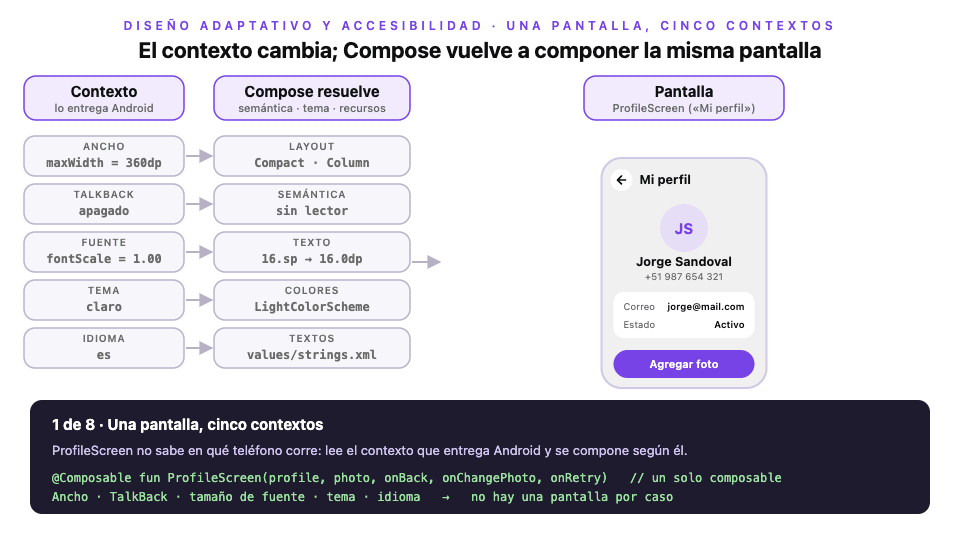

# Módulo 5 · Sesión 2

## Diseño adaptativo y accesibilidad con Jetpack Compose

Al terminar la clase sabrás:

1. Adaptar una pantalla al espacio disponible: teléfono vertical u horizontal, plegable o tablet.
2. Hacer que la app se pueda usar con TalkBack y con fuente grande.
3. Agregar modo oscuro y un segundo idioma sin duplicar pantallas.

Todo se aplica sobre [`android-app-taxi`](./android-app-taxi), que parte de la clase anterior (animaciones). El backend y la infra no cambian. El detalle de cada archivo está en el [README del proyecto](./android-app-taxi/README.md#58-diseño-adaptativo-accesibilidad-modo-oscuro-e-idiomas).

---

## 1. La idea: una pantalla, varios contextos



> Versión interactiva: [`diagrama-una-pantalla-cinco-contextos.html`](./diagrama-una-pantalla-cinco-contextos.html). Usa ← → para avanzar.

Una app no corre en «un teléfono». Corre en un **contexto** que define el usuario o el dispositivo: cuánto espacio hay, si usa un lector de pantalla, qué tamaño de letra eligió, si prefiere el tema oscuro y en qué idioma lee. Ese contexto puede cambiar con la app abierta: el usuario gira el teléfono, despliega un plegable o activa el tema oscuro desde los ajustes rápidos.

En Compose esto encaja de forma natural. La pantalla no se escribe una vez por caso: se escribe **una sola vez** y pregunta por su contexto. Cuando el contexto cambia, Compose vuelve a componer la misma función y el resultado se adapta. El estado vive en el ViewModel, así que girar el teléfono o cambiar el tema no pierde lo que el usuario tenía en pantalla.

---

## 2. Diseño adaptativo

### Mide el espacio, no el dispositivo

El error más común es preguntar «¿es una tablet?» o «¿está en horizontal?». Un teléfono en horizontal mide unos 800 dp de ancho; una tablet con la pantalla dividida puede dejarle a tu app solo 400 dp. Lo único confiable es **cuánto espacio tienes en dp**.

Material 3 propone tres clases de ancho:

- **Compact** (menos de 600 dp): teléfono vertical. Una columna.
- **Medium** (de 600 a 839 dp): teléfono horizontal, plegable abierto o tablet vertical. Hay espacio para dos paneles.
- **Expanded** (840 dp o más): tablet horizontal o escritorio.

En App Taxi la regla vive en una función pura, fácil de probar:

```kotlin
// commons/presentation/Adaptive.kt
fun widthClassOf(width: Dp): WidthClass = when {
    width < 600.dp -> WidthClass.Compact
    width < 840.dp -> WidthClass.Medium
    else -> WidthClass.Expanded
}
```

### `BoxWithConstraints`: decidir con el espacio real

`BoxWithConstraints` le dice al composable cuánto espacio le dieron (`maxWidth`, `maxHeight`). Con eso decides el diseño. En horizontal, la ilustración de «Generar OTP» y el formulario se pisaban; ahora se ponen lado a lado:

```kotlin
// features/signin/presentation/SignInGenerateOtpScreen.kt
BoxWithConstraints(modifier = modifier.fillMaxSize()) {
    if (widthClassOf(maxWidth) == WidthClass.Compact) {
        SignInPicture(Modifier.align(Alignment.TopCenter))
        SignInForm(Modifier.align(Alignment.BottomCenter))
    } else {
        Row(Modifier.fillMaxSize().padding(24.dp)) {
            SignInPicture(Modifier.weight(1f))
            SignInForm(Modifier.weight(1f))
        }
    }
}
```

La clave es partir la pantalla en piezas (`SignInPicture`, `SignInForm`) que se **reubican**, no se duplican. «Mi perfil» sigue la misma idea: avatar a la izquierda, datos y botón a la derecha.

Si necesitas decidir algo para toda la ventana, como cambiar la barra inferior por un riel lateral, existe `currentWindowAdaptiveInfo()` de la librería `material3-adaptive`. Para una pantalla o un componente, `BoxWithConstraints` es suficiente y no agrega dependencias.

### A veces basta con no estirar

No toda pantalla necesita otro diseño. Un formulario de 1200 dp de ancho se lee mal; limitarlo y centrarlo resuelve el problema:

```kotlin
Column(
    modifier = Modifier
        .align(Alignment.TopCenter)
        .widthIn(max = 560.dp)
        .fillMaxSize()
)
```

El orden importa: primero el límite (`widthIn`) y después ocupar el espacio (`fillMaxSize`). Al revés, el ancho ya quedó fijo y el límite no hace nada.

La altura también es contexto: en horizontal hay poca, así que «Validar OTP» reduce su margen superior cuando `maxHeight` es menor que 480 dp.

### Por qué ya no es opcional

Desde Android 16, en pantallas de 600 dp o más el sistema ignora `screenOrientation` y `resizeableActivity` de las apps que apuntan a esa versión. Bloquear la app en vertical ya no es una salida: tiene que adaptarse.

---

## 3. Accesibilidad

### Cómo «ve» TalkBack tu pantalla

TalkBack no ve píxeles. Recorre el **árbol de semántica**, una versión paralela de la UI donde cada nodo dice qué es (texto o descripción), qué rol tiene (botón, encabezado) y en qué estado está. Los componentes de Material ya llenan buena parte de ese árbol. Tu trabajo es completar lo que falta y quitar lo que sobra.

### Describir y marcar encabezados

Un ícono que significa algo necesita descripción; uno decorativo, `null` para que TalkBack no lea ruido. Los títulos se marcan como encabezados, y así el usuario puede saltar de título en título:

```kotlin
Icon(Icons.AutoMirrored.Filled.ArrowBack, contentDescription = stringResource(R.string.common_back))
Icon(Icons.AutoMirrored.Filled.KeyboardArrowRight, contentDescription = null)

Text(
    text = stringResource(R.string.signin_code_title),
    modifier = Modifier.semantics { heading() }
)
```

Las cuatro casillas del OTP eran cuatro «cuadros de edición» sin nombre. Ahora cada una se anuncia como «Dígito 1 de 4», «Dígito 2 de 4»…

### Agrupar y ocultar

Hay dos herramientas para dar forma al árbol:

- `semantics(mergeDescendants = true)` junta varios textos en una sola lectura. La fila del perfil se lee «Correo, jorge@mail.com» en una parada, no en dos.
- `clearAndSetSemantics { }` borra lo que hay dentro. Sirve para lo decorativo o duplicado: las iniciales «JS» del avatar (el nombre se lee justo después) o la barra de pasos del registro (el texto «Paso 1 de 2» ya lo dice).

```kotlin
Row(Modifier.semantics(mergeDescendants = true) { }) {
    Text(label)
    Text(value)
}
```

### Acciones y área táctil

Un `Text` con `clickable` funciona con el dedo, pero TalkBack no sabe que es un botón y el área para tocar suele medir menos de los 48 dp recomendados. «Reenviar código» ahora declara su rol, su acción y su tamaño mínimo:

```kotlin
Modifier
    .minimumInteractiveComponentSize()
    .clickable(
        onClickLabel = stringResource(R.string.signin_resend_action),
        role = Role.Button,
        onClick = onResend
    )
```

TalkBack dice: «Reenviar código, botón. Toca dos veces para reenviar el código».

### Anunciar cambios

Cuando algo cambia sin que el usuario haya tocado nada, una *live region* lo anuncia. El panel de ubicación de Home usa `LiveRegionMode.Polite`, que espera a que TalkBack termine de hablar. El toast usa `Assertive`, que interrumpe: resérvalo para errores y confirmaciones importantes.

### Fuente grande y contraste

El texto se mide en `sp` y crece con el tamaño de fuente del sistema, que puede llegar al 200 %. Si el contenedor tiene una altura fija, el texto se recorta. La solución es dar una altura **mínima**:

```kotlin
// ✗ .height(56.dp)
.heightIn(min = 56.dp)
```

Así quedaron el botón principal, los campos de texto, las casillas OTP y los ítems del menú.

El contraste mínimo recomendado es 4,5:1 para texto normal. El placeholder de los campos usaba un gris claro con 2,6:1; ahora usa `onSurfaceVariant`, con 5,3:1.

---

## 4. Modo oscuro

El modo oscuro no se resuelve pantalla por pantalla, sino con **tokens**. Una pantalla no pide «gris #F0F0F0»: pide «el fondo». El tema decide qué color es el fondo en claro y en oscuro.

```kotlin
// core/presentation/theme/Theme.kt
private val LightColorScheme = lightColorScheme(background = Color(0xFFF0F0F0), onSurface = Color(0xFF0F0F0F) /* … */)
private val DarkColorScheme = darkColorScheme(background = Color(0xFF121212), onSurface = Color(0xFFECECEC) /* … */)

@Composable
fun AndroidTheme(darkTheme: Boolean = isSystemInDarkTheme(), content: @Composable () -> Unit) {
    MaterialTheme(colorScheme = if (darkTheme) DarkColorScheme else LightColorScheme, content = content)
}
```

En las pantallas, cada `Color(0xFF…)` pasó a un token:

```kotlin
Modifier.background(MaterialTheme.colorScheme.background)
Text(text, color = MaterialTheme.colorScheme.onSurface)
```

Tres detalles que suelen olvidarse:

- **Aplicar el tema.** App Taxi tenía `AndroidTheme` definido pero nadie lo usaba; ahora envuelve la app en `MainActivity`.
- **La marca puede quedarse fija.** El botón morado con texto blanco se lee bien en ambos temas. Para el texto morado sobre fondo oscuro se usa un tono más claro, porque el original no alcanza el contraste mínimo.
- **La ventana también.** `res/values-night/themes.xml` evita un destello blanco antes de que cargue Compose.

---

## 5. Idiomas

La regla es simple: **ningún texto visible en el código**. Los textos viven en recursos y Android elige la carpeta según el idioma:

```
res/values/strings.xml       ← español, idioma por defecto
res/values-en/strings.xml    ← inglés
```

```kotlin
Text(stringResource(R.string.profile_title))   // «Mi perfil» o «My profile»
```

Si una clave falta en `values-en/`, Android usa la de `values/`. Por eso el idioma por defecto debe estar completo; lint lo revisa.

Tres casos que conviene conocer:

- **Variables:** nunca concatenes `"Paso " + step + " de 2"`. El orden de las palabras cambia entre idiomas. Usa un recurso con formato: `Paso %1$d de %2$d`.
- **Plurales:** «1 dígito» y «4 dígitos» se resuelven con `<plurals>` y `pluralStringResource(...)`.
- **Idioma por app:** desde Android 13 el usuario puede elegir el idioma de cada app en Ajustes. Basta con declarar los idiomas en `res/xml/locales_config.xml` y referenciarlo en el manifest con `android:localeConfig`.

Los mensajes que vienen del backend siguen en español: traducirlos es trabajo del servidor.

---

## 6. Cómo probarlo

- **Espacio:** gira el emulador o usa un AVD *Resizable*. En Android Studio hay previews `Horizontal`, `Oscuro`, `Inglés` y `Fuente 200 %`.
- **TalkBack:** actívalo en Ajustes › Accesibilidad y recorre «Validar OTP» y «Mi perfil» deslizando a la derecha.
- **Revisión automática:** la app **Accessibility Scanner** de Google marca contraste bajo, áreas táctiles pequeñas y descripciones faltantes.
- **Fuente grande:** `adb shell settings put system font_scale 2.0` (vuelve con `1.0`).
- **Tema oscuro:** `adb shell cmd uimode night yes` (vuelve con `no`).
- **Idioma:** Ajustes › Apps › App taxi › Idioma.

La semántica también se prueba con código. `OtpCodeInputSemanticsTest` busca cada casilla por su descripción y verifica que el foco avance:

```kotlin
rule.onNodeWithContentDescription(digit(1)).performTextInput("7")
rule.onNodeWithContentDescription(digit(2)).assertIsFocused()
```

---

## 7. Errores comunes

- Decidir el diseño por «es tablet» o por orientación en vez de por ancho.
- Escribir `fillMaxWidth().widthIn(max = …)`: el límite no se aplica.
- Usar alturas fijas en botones y campos: con fuente grande el texto se recorta.
- Poner `contentDescription` a íconos decorativos: TalkBack lee ruido.
- Usar `clickable` sobre un texto sin `role`: TalkBack no dice que es un botón.
- Usar colores fijos en las pantallas: el modo oscuro no los cambia.
- Concatenar textos: no se pueden traducir bien.

---

## Recursos

- [Diseño adaptativo en Compose](https://developer.android.com/develop/ui/compose/layouts/adaptive)
- [Accesibilidad en Compose](https://developer.android.com/develop/ui/compose/accessibility)
- [Tema oscuro](https://developer.android.com/develop/ui/views/theming/darktheme)
- [Idioma por app](https://developer.android.com/guide/topics/resources/app-languages)
- Clase anterior: [Animaciones con Jetpack Compose](../clase-01/README.md)
