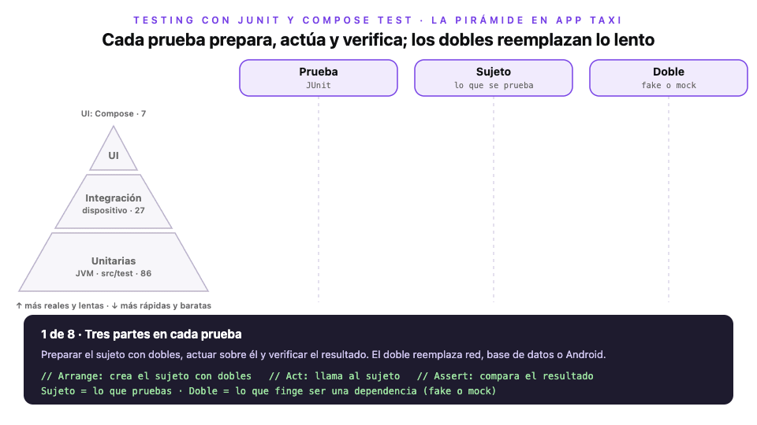

# Módulo 5 · Sesión 3

## Testing con JUnit y Compose Test

Al terminar la clase sabrás:

1. Elegir el tipo de prueba correcto: unitaria, de UI o de integración.
2. Reemplazar dependencias lentas con fakes y mocks.
3. Probar un caso de uso, un ViewModel, una pantalla de Compose y la unión de todo.

Todo se aplica sobre el flujo de inicio de sesión de [`android-app-taxi`](./android-app-taxi), que parte de la clase anterior. El backend y la infra no cambian. La lista completa de pruebas está en el [README del proyecto](./android-app-taxi/README.md#comandos-y-pruebas).

---

## Contenido

1. [Por qué probar](#1-por-qué-probar)
2. [La pirámide de pruebas](#2-la-pirámide-de-pruebas)
3. [Pruebas unitarias](#3-pruebas-unitarias)
4. [Fakes y mocks](#4-fakes-y-mocks)
5. [Probar un ViewModel](#5-probar-un-viewmodel)
6. [Pruebas de UI con Compose](#6-pruebas-de-ui-con-compose)
7. [Integración: las piezas juntas](#7-integración-las-piezas-juntas)
8. [Cómo correrlas](#8-cómo-correrlas)
9. [Errores comunes](#9-errores-comunes)

**Lectura complementaria:** [Publicar una app en Google Play (2026)](./publicacion-google-play.md). Cuenta de desarrollador y verificación, build de release firmado, declaraciones de Play Console, políticas que afectan a App Taxi, pistas de prueba y calendario de cambios 2026–2027.

---

## 1. Por qué probar

El inicio de sesión por OTP es la puerta de entrada de App Taxi. Si se rompe, nadie usa la app. Probarlo a mano en cada cambio significa abrir el emulador, escribir un teléfono, esperar el SMS y repetir con cada caso de error. Nadie lo hace siempre, y los errores se escapan.

Una prueba automática hace ese trabajo en segundos y cada vez que la ejecutas. Además tiene dos beneficios menos obvios:

- **Documenta.** Una prueba llamada «el botón se habilita solo con 9 dígitos» explica la regla mejor que un comentario, y no se desactualiza: si la regla cambia, la prueba falla.
- **Permite cambiar sin miedo.** Puedes reescribir el ViewModel o el repositorio por dentro; si las pruebas siguen pasando, el comportamiento se mantiene.

---

## 2. La pirámide de pruebas



> Versión interactiva: [`diagrama-piramide-de-pruebas.html`](./diagrama-piramide-de-pruebas.html). Usa ← → para avanzar.

En Android las pruebas viven en dos carpetas, y la diferencia importa:

- **`src/test`** corre en la JVM de tu computadora. No hay Android: ni pantalla, ni `Context`, ni base de datos real. A cambio es muy rápida, y ahí van la mayoría de las pruebas: casos de uso, repositorios, ViewModels.
- **`src/androidTest`** corre en un emulador o un teléfono. Es más lenta, pero tiene Android de verdad. Ahí van las pruebas de pantallas y las que necesitan Room, el Keystore o un servicio.

La pirámide resume la estrategia: **muchas pruebas rápidas abajo y pocas lentas arriba**. App Taxi tiene 86 pruebas en la JVM y 35 en el dispositivo.

Toda prueba, sea del tipo que sea, sigue el mismo patrón en tres partes:

1. **Preparar** (*arrange*): crear lo que se prueba, el **sujeto**, con sus dependencias.
2. **Actuar** (*act*): llamarlo como lo haría la app.
3. **Verificar** (*assert*): comparar el resultado con lo esperado.

---

## 3. Pruebas unitarias

Una prueba unitaria aísla una pieza y la prueba sola. El caso de uso `OtpGenerateUseCase` depende de un `AuthRepository` que llama al backend. En la prueba no queremos red: queremos una respuesta inmediata y controlada.

Para eso se usa un **doble**, una clase que cumple la misma interfaz pero responde lo que la prueba necesita:

```kotlin
// test/.../signin/domain/usecase/OtpGenerateUseCaseTest.kt
@Test
fun `emite Loading y Success y envia el telefono con prefijo de pais`() = runTest {
    val repo = FakeAuthRepository()

    val states = OtpGenerateUseCase(repo)("987654321").toList()

    assertEquals(listOf(OtpGenerateState.Loading, OtpGenerateState.Success("987654321", "2026-09-28T15:02:00Z")), states)
    assertEquals(listOf("51987654321"), repo.generatedFor)
}
```

Dos detalles:

- `runTest` ejecuta código con corrutinas dentro de la prueba y salta los `delay` sin esperar.
- `toList()` junta todos los estados que emite el `Flow`. Así se verifica la **secuencia** completa, no solo el final.

Esto es posible gracias a la arquitectura del curso: el caso de uso recibe el repositorio por constructor y depende de una interfaz. Si creara su propio Retrofit adentro, no habría forma de reemplazarlo.

---

## 4. Fakes y mocks

Hay dos formas de crear un doble:

- Un **fake** es una implementación real pero simple, escrita a mano. `FakeAuthRepository` responde de inmediato y guarda con qué teléfono lo llamaron. Es fácil de leer y se reutiliza en muchas pruebas.
- Un **mock** se crea con una librería, como MockK, y se programa dentro de cada prueba: «cuando te llamen así, responde esto». Su fuerte es **verificar llamadas**, incluso las que no deben ocurrir.

```kotlin
// test/.../signin/domain/usecase/OtpValidateUseCaseMockTest.kt
private val repo = mockk<AuthRepository>()
private val session = mockk<SessionStore>(relaxUnitFun = true)

@Test
fun `si el codigo es invalido no toca la sesion`() = runTest {
    coEvery { repo.otpValidate(any(), any()) } throws DomainException.ValidationException("El código OTP es inválido o ha expirado.")

    OtpValidateUseCase(repo, session)("987654321", "0000").toList()

    coVerify(exactly = 0) { session.saveTokens(any(), any()) }
}
```

`coEvery` y `coVerify` son las versiones para funciones `suspend` de `every` y `verify`.

¿Cuál usar? Por defecto, **fakes**: las pruebas quedan más claras y no se rompen cuando cambias detalles internos. Usa un mock cuando lo importante es la interacción misma, por ejemplo comprobar que no se guardó la sesión. App Taxi usa fakes en casi todo y tiene este ejemplo con MockK para comparar.

---

## 5. Probar un ViewModel

Un ViewModel tiene dos dificultades. Usa `viewModelScope`, que corre en `Dispatchers.Main`, y en la JVM no hay hilo principal de Android. Además, su resultado cambia en el tiempo: primero `Loading`, después `Success`.

La primera se resuelve reemplazando `Main` por un dispatcher de prueba antes de cada test. Para la segunda, un `CompletableDeferred` hace que el fake **espere** hasta que la prueba decida responder:

```kotlin
// test/.../signin/presentation/SignInViewModelTest.kt
@Before fun setUp() = Dispatchers.setMain(UnconfinedTestDispatcher())
@After fun tearDown() = Dispatchers.resetMain()

@Test
fun `pedir el codigo pasa por Loading y termina en Success`() = runTest {
    val response = CompletableDeferred<OtpGenerateResult>()
    val vm = viewModel(FakeAuthRepository(onGenerate = { response.await() }))

    vm.callGenerateOtp("987654321")
    assertEquals(OtpGenerateState.Loading, vm.generateOtpUi.value)

    response.complete(OtpGenerateResult("2026-11-02T15:00:00Z"))
    assertEquals(OtpGenerateState.Success("987654321", "2026-11-02T15:00:00Z"), vm.generateOtpUi.value)
}
```

Con el mismo truco se prueba que, mientras carga, un segundo toque no dispara otra petición.

---

## 6. Pruebas de UI con Compose

Compose Test dibuja un composable y lo maneja como lo haría un usuario. Corre en `androidTest`. La regla `createComposeRule()` da tres tipos de operaciones:

- **Buscar** nodos: `onNodeWithText("Ingresar")`, `onNodeWithContentDescription(...)`, `onNode(hasSetTextAction())`.
- **Actuar**: `performClick()`, `performTextInput("987654321")`.
- **Verificar**: `assertIsEnabled()`, `assertIsDisplayed()`, `assertDoesNotExist()`.

Compose Test busca en el **árbol de semántica**, el mismo que lee TalkBack. Por eso una pantalla accesible también es fácil de probar, y lo que hiciste en la clase anterior (encabezados, descripciones, roles) se puede verificar.

La clave es probar la **Screen**, no la Route. `SignInGenerateOtpScreen` no conoce al ViewModel: recibe el estado y avisa con callbacks. La prueba le pasa el estado que quiera y captura los callbacks:

```kotlin
// androidTest/.../signin/presentation/SignInGenerateOtpScreenTest.kt
@Test
fun theButtonIsEnabledOnlyWithNineDigits() {
    setScreen()

    rule.onNodeWithText(submit).assertIsNotEnabled()
    rule.onNode(hasSetTextAction()).performTextInput("98765432")
    rule.onNodeWithText(submit).assertIsNotEnabled()
    rule.onNode(hasSetTextAction()).performTextInput("1")
    rule.onNodeWithText(submit).assertIsEnabled()
}

@Test
fun anErrorStateShowsItsMessage() {
    setScreen(state = OtpGenerateState.Error("Ya existe un código activo."))
    rule.onNodeWithText("Ya existe un código activo.").assertIsDisplayed()
}
```

`submit` no es el texto «Ingresar» escrito a mano: se lee de `R.string.signin_submit`. Así la prueba pasa con el emulador en español o en inglés.

Un detalle que sorprende: un campo **deshabilitado** pierde la acción de escribir, así que `hasSetTextAction()` ya no lo encuentra. Para verificar que está bloqueado se busca por su texto: `onNodeWithText("987654321").assertIsNotEnabled()`.

### El reloj de Compose

Compose Test controla el tiempo con un reloj propio, `mainClock`. Por defecto avanza solo (`autoAdvance`) hasta que no queda trabajo pendiente: las animaciones terminan al instante y los `delay` se saltan. Casi siempre es lo que quieres, porque las pruebas no esperan.

Pero a veces lo que pruebas **es** el tiempo. En App Taxi, el toast de error se muestra 3 segundos y desaparece. Con el reloj automático, cuando la prueba mira, el toast ya se fue. La solución es tomar el control:

```kotlin
rule.mainClock.autoAdvance = false
rule.mainClock.advanceTimeBy(500)
rule.onNodeWithText("Ya existe un código activo.").assertIsDisplayed()

rule.mainClock.advanceTimeBy(3_000)
rule.mainClock.autoAdvance = true
rule.onNodeWithText("Ya existe un código activo.").assertDoesNotExist()
```

---

## 7. Integración: las piezas juntas

Las pruebas anteriores verifican cada pieza por separado. Falta comprobar que encajan: que al tocar «Ingresar», la Route llame al ViewModel, este al caso de uso, y que al final se navegue.

En una prueba de integración, todo es real **menos lo que sale de la app**: el repositorio sigue siendo un fake. No hace falta Hilt: la Route recibe el ViewModel como parámetro con valor por defecto, y la prueba lo construye a mano:

```kotlin
// androidTest/.../signin/presentation/SignInGenerateOtpRouteTest.kt
val vm = SignInViewModel(OtpGenerateUseCase(repo), OtpValidateUseCase(repo, NoSessionStore))
rule.setContent { SignInGenerateOtpRoute(onGoValidate = { phone, expiresAt -> destination = phone to expiresAt }, vm = vm) }

rule.onNode(hasSetTextAction()).performTextInput("987654321")
rule.onNodeWithText(submit).performClick()
rule.waitUntil(timeoutMillis = 5_000) { destination != null }

assertEquals("987654321" to "2026-11-02T15:00:00Z", destination)
```

`waitUntil` espera a que termine el trabajo asíncrono del ViewModel antes de verificar.

Al escribir con `performTextInput` se abre el teclado. La actividad vacía que usa `createComposeRule()` no tiene `adjustResize`, como sí la tiene `MainActivity`, así que la ventana sube y lo que está arriba, como el toast, queda fuera de la pantalla. Por eso la prueba cierra el teclado con `Espresso.closeSoftKeyboard()` antes de seguir.

---

## 8. Cómo correrlas

```bash
cd android-app-taxi
./gradlew testDebugUnitTest            # JVM: segundos, sin emulador
./gradlew connectedDebugAndroidTest    # dispositivo: necesita un emulador encendido
```

En Android Studio también puedes usar el ícono ▶ junto a cada clase o método de prueba. El reporte HTML queda en `app/build/reports/tests/`.

Un hábito práctico: corre las pruebas JVM en cada cambio y las del dispositivo antes de subir tu código.

---

## 9. Errores comunes

- Probar la Route con Hilt cuando lo que quieres verificar es la pantalla: prueba la Screen con estado.
- Escribir textos a mano en las pruebas de UI: fallan al cambiar de idioma. Léelos de los recursos.
- Verificar algo que dura un tiempo (un toast, una cuenta regresiva) con el reloj automático: el `delay` se salta. Usa `mainClock.autoAdvance = false`.
- Buscar un campo deshabilitado con `hasSetTextAction()`: ya no tiene esa acción.
- Olvidar `Dispatchers.setMain` en una prueba de ViewModel: falla porque en la JVM no existe el hilo principal de Android.
- Verificar solo el último estado de un `Flow`: un `Loading` que nunca se emitió pasa desapercibido.
- Usar mocks para todo: las pruebas se vuelven frágiles y difíciles de leer.
- Llevar a `androidTest` lo que puede correr en la JVM: la suite se vuelve lenta y se deja de ejecutar.
- Probar que «no falla» en vez de probar un resultado concreto.

---

## Recursos

- [Fundamentos de pruebas en Android](https://developer.android.com/training/testing/fundamentals)
- [Probar el diseño de Compose](https://developer.android.com/develop/ui/compose/testing)
- [Probar corrutinas](https://developer.android.com/kotlin/coroutines/test)
- [MockK](https://mockk.io)
- Lectura complementaria: [Publicar una app en Google Play (2026)](./publicacion-google-play.md)
- Clase anterior: [Diseño adaptativo y accesibilidad](../clase-02/README.md)
