# Publicar una app en Google Play

## Del proyecto en Android Studio a la tienda (actualizado a noviembre de 2026)

Volver a la clase: [Testing con JUnit y Compose Test](./README.md).

> Las reglas de Google Play cambian varias veces al año. Esto está vigente a noviembre de 2026; antes de publicar, revisa los [plazos de políticas](https://support.google.com/googleplay/android-developer/table/12921780).

---

## Contenido

1. [El camino completo](#1-el-camino-completo)
2. [La cuenta de desarrollador](#2-la-cuenta-de-desarrollador)
3. [Preparar el build de release](#3-preparar-el-build-de-release)
4. [La ficha de la tienda](#4-la-ficha-de-la-tienda)
5. [El contenido de la app: declaraciones](#5-el-contenido-de-la-app-declaraciones)
6. [Políticas que tocan a App Taxi](#6-políticas-que-tocan-a-app-taxi)
7. [Pistas de prueba y acceso a producción](#7-pistas-de-prueba-y-acceso-a-producción)
8. [Lanzar y mantener la app](#8-lanzar-y-mantener-la-app)
9. [Calendario 2026–2027](#9-calendario-20262027)
10. [Checklist antes de publicar](#10-checklist-antes-de-publicar)

---

## 1. El camino completo

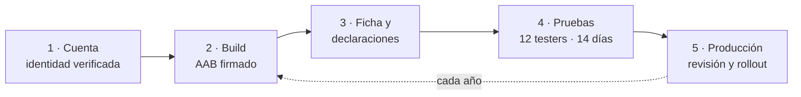

El build es lo más corto. Lo que más demora es la cuenta, las declaraciones y la prueba cerrada: **empiézalas antes de terminar la app**.

---

## 2. La cuenta de desarrollador

Se crea en [Play Console](https://play.google.com/console) con un pago único.

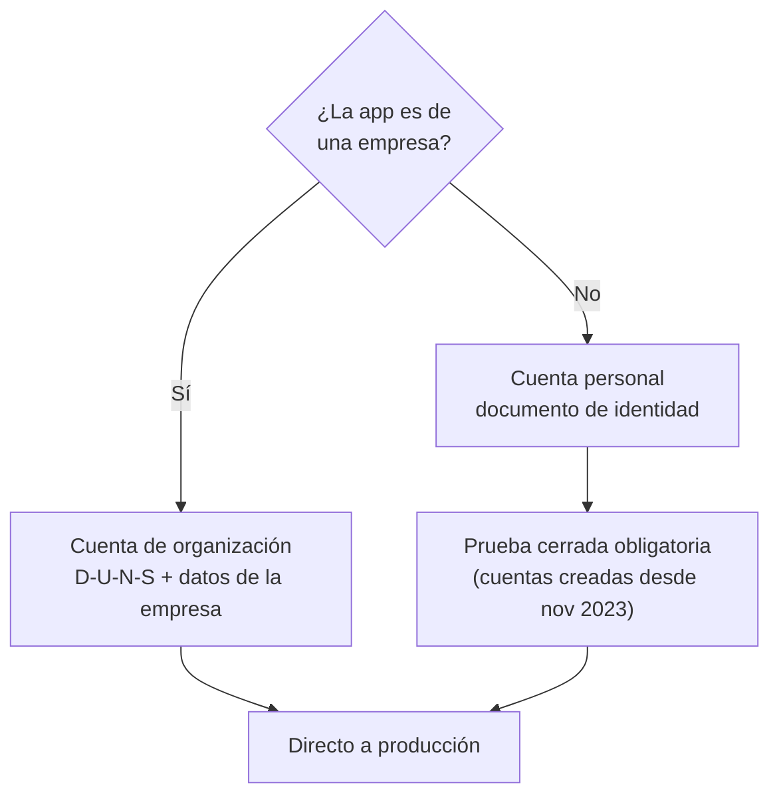

- **Estado de comerciante**: desde noviembre de 2026 todas las cuentas deben declararlo. Si vendes o representas un negocio, tus datos de contacto se muestran en la Unión Europea.
- **Transferir una app** entre cuentas solo se puede con el flujo oficial *Transfer ownership*. Mejor publicar desde el inicio con la cuenta correcta.

### Verificación de desarrolladores de Android

Desde 2026, **toda app instalada en un Android certificado debe venir de un desarrollador registrado**, esté o no en Play.

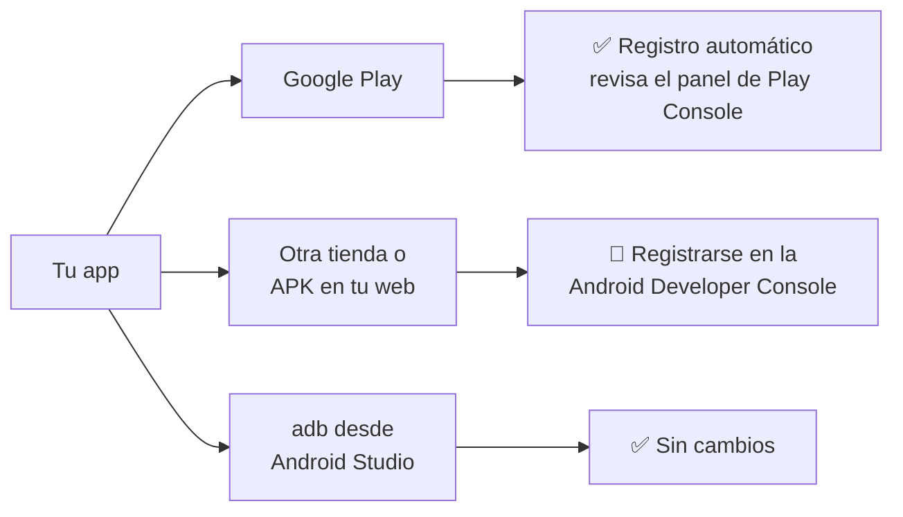

- **30 sep 2026**: obligatorio en Brasil, Indonesia, Singapur y Tailandia. **2027**: en todo el mundo.
- Estudiantes y aficionados tienen **cuentas de distribución limitada**: hasta 20 dispositivos, sin documento ni pago.

---

## 3. Preparar el build de release

### Identidad y versión

```kotlin
defaultConfig {
    applicationId = "pe.tuempresa.taxi"
    targetSdk = 37
    versionCode = 3
    versionName = "1.0.2"
}
```

- `applicationId`: **permanente**. Play rechaza `com.example...`, que es lo que usa App Taxi en el curso.
- `versionCode`: debe **subir** en cada envío. `versionName` es solo lo que ve el usuario.
- `targetSdk`: desde el **31 ago 2026** el mínimo es **API 36**; App Taxi usa 37 y cumple.
- **Páginas de 16 KB**: solo afecta si la app o un SDK traen código nativo (`.so`). Play Console avisa al subir el bundle.

### Debug frente a release

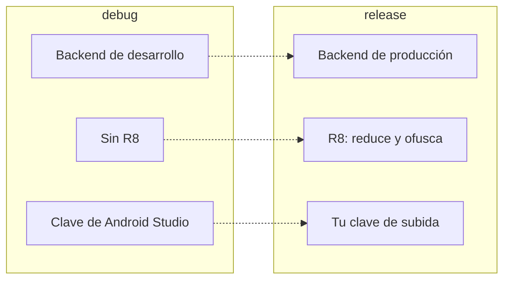

```kotlin
release {
    isMinifyEnabled = true
    isShrinkResources = true
    signingConfig = signingConfigs.getByName("release")
    buildConfigField("String", "API_BASE_URL", "\"https://api.tu-dominio.com/\"")
}
```

Con R8 activo, **prueba siempre el build de release**: Retrofit, Room y la serialización pueden fallar si faltan reglas.

### Play App Signing: dos claves

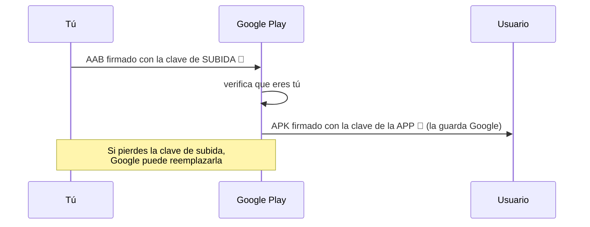

### La firma en App Taxi

```text
android-app-taxi/
├── key/
│   └── upload-keystore.jks          ← la llave, la creas tú
├── keystore.properties              ← las 4 variables, fuera de git
├── keystore.properties.example      ← plantilla, sí va a git
└── app/build.gradle.kts             ← lee keystore.properties
```

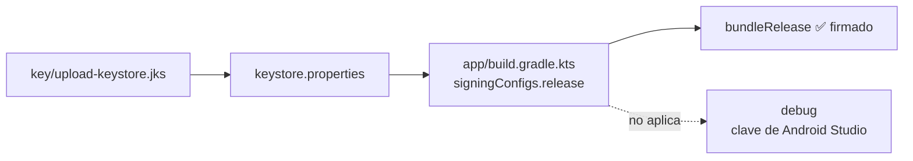

**1. Crear la llave** desde la raíz del proyecto:

```bash
keytool -genkeypair -v -keystore key/upload-keystore.jks -alias upload -keyalg RSA -keysize 2048 -validity 10000
```

**2. Completar `keystore.properties`** (copia de `keystore.properties.example`). La ruta es relativa a la raíz:

```properties
storeFile=./key/upload-keystore.jks
storePassword=CHANGE_ME
keyAlias=upload
keyPassword=CHANGE_ME
```

**3. Gradle lo lee y firma solo el release:**

```kotlin
val keystoreProperties = Properties().apply {
    val file = rootProject.file("keystore.properties")
    if (file.exists()) file.inputStream().use { load(it) }
}

android {
    signingConfigs {
        create("release") {
            storeFile = keystoreProperties.getProperty("storeFile")?.let { rootProject.file(it) }
            storePassword = keystoreProperties.getProperty("storePassword")
            keyAlias = keystoreProperties.getProperty("keyAlias")
            keyPassword = keystoreProperties.getProperty("keyPassword")
        }
    }

    buildTypes {
        release {
            signingConfig = signingConfigs.getByName("release")
        }
    }
}
```

`rootProject.file(...)` resuelve desde la raíz, por eso `./key` funciona. Debug no cambia: la app y las pruebas corren sin la llave.

**4. Nada secreto en git** (`.gitignore` del proyecto):

```gitignore
keystore.properties
/key/*
!/key/.gitkeep
*.jks
*.keystore
```

**5. Comprobar y generar:**

```bash
./gradlew :app:signingReport   # release debe mostrar key/ y el alias upload
./gradlew :app:bundleRelease   # app/build/outputs/bundle/release/app-release.aab
```

En CI, `keystore.properties` se genera con variables secretas del pipeline. Gradle no nota la diferencia.

### El Android App Bundle

Play solo acepta **AAB**. Con él arma un APK a la medida de cada teléfono:

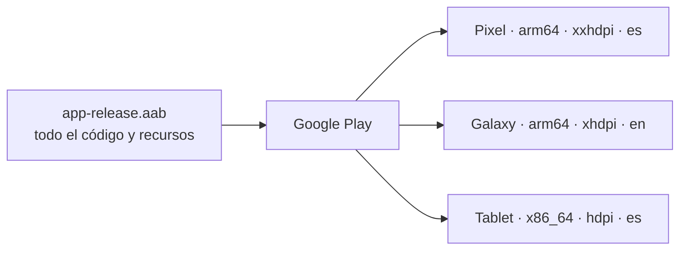

---

## 4. La ficha de la tienda

```text
┌──────────────────────────────────────────────┐
│  [ícono 512×512]  Nombre (máx. 30)           │
│                   Descripción breve (máx. 80)│
├──────────────────────────────────────────────┤
│      Gráfico de funciones 1024×500           │
├──────────────────────────────────────────────┤
│  [captura] [captura] [captura]   ← mín. 2    │
├──────────────────────────────────────────────┤
│  Descripción completa (máx. 4000)            │
└──────────────────────────────────────────────┘
```

- Una ficha **por idioma**: App Taxi ya tiene español e inglés.
- Si declaras tablets, pide capturas de tablet: aquí luce lo de la clase 02.
- **Experimentos de ficha** para probar íconos o capturas con usuarios reales.

---

## 5. El contenido de la app: declaraciones

En **Política > Contenido de la app**. Sin todas completas, no hay producción.

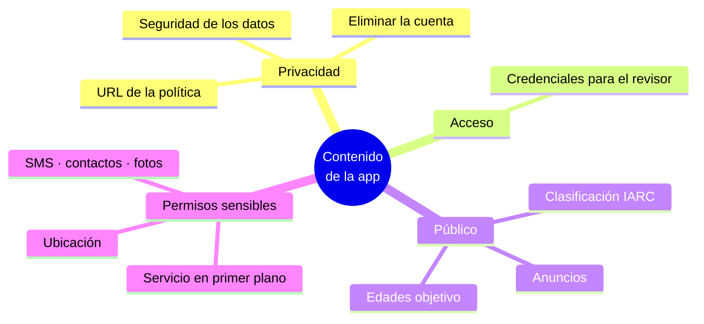

Las tres que más rechazos causan:

- **Seguridad de los datos**: debe coincidir con lo que hacen la app **y sus SDK** (Firebase, Maps).
- **Eliminar la cuenta**: dentro de la app **y** desde un enlace web.
- **Acceso**: con OTP, entrega al revisor un **teléfono de prueba con código fijo**.

---

## 6. Políticas que tocan a App Taxi

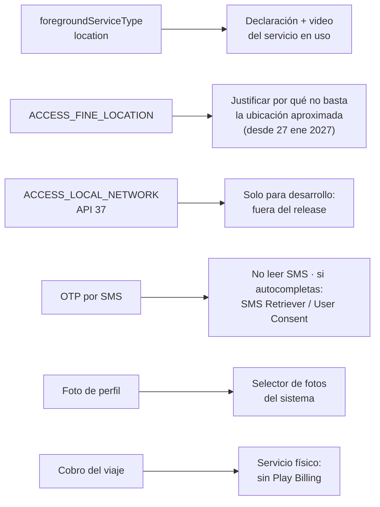

- **Ubicación (27 ene 2027)**: para pedidos puntuales, las apps con API 37 usan el **botón de ubicación** del sistema. App Taxi sigue el viaje de forma continua, así que justifica la ubicación precisa.
- **Geofencing** deja de ser un uso válido de un servicio en primer plano el mismo día.
- **Red local**: declaración obligatoria desde el **25 ago 2027** para apps con API 37 que la pidan.
- **Pagos**: los bienes digitales van por Play Billing (o las alternativas permitidas por país); un viaje en taxi no.

---

## 7. Pistas de prueba y acceso a producción

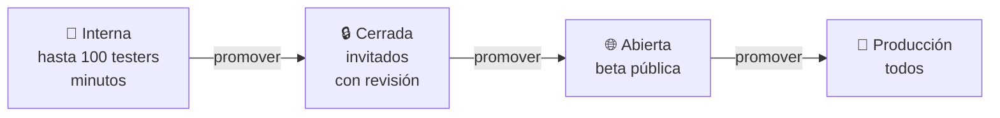

Una versión se **promueve** de pista en pista sin volver a compilar.

### La prueba cerrada obligatoria (cuentas personales)

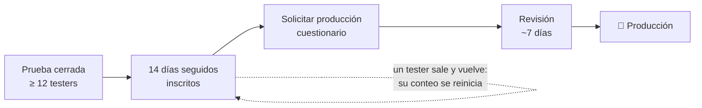

Para el curso, los compañeros de clase son los testers naturales.

Cada subida a una pista genera un **informe previo al lanzamiento**: Google recorre la app en dispositivos reales y reporta cierres, accesibilidad y capturas.

---

## 8. Lanzar y mantener la app

### Lanzamiento gradual

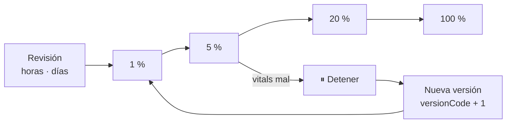

- Con **publicación gestionada**, tú eliges cuándo sale la versión aprobada.
- En Android **no hay vuelta atrás**: se corrige con una versión nueva.

### Android vitals

Tres métricas centrales afectan la **visibilidad** en la tienda:

- 💥 Cierres inesperados percibidos por el usuario.
- ⏳ ANR (la app no responde).
- 🔋 Wake locks parciales excesivos (desde marzo de 2026). App Taxi debe soltarlos al terminar el viaje.

### El ciclo anual

Cada año: subir el `targetSdk` antes del **31 de agosto** y atender los avisos de política (suelen dar 30 días). Una app sin mantener queda oculta para usuarios nuevos.

---

## 9. Calendario 2026–2027

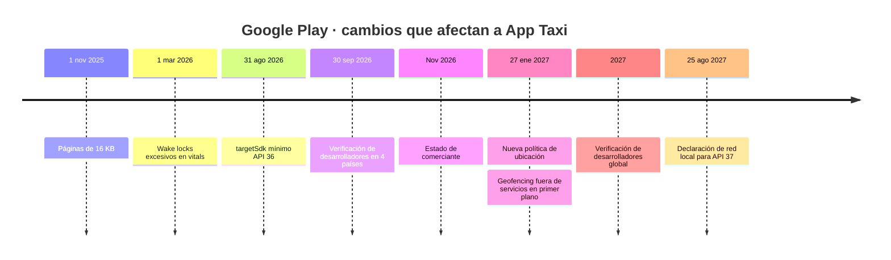

---

## 10. Checklist antes de publicar

- [ ] `applicationId` definitivo, sin `com.example`.
- [ ] `versionCode` mayor que el anterior.
- [ ] `key/upload-keystore.jks` creado y `keystore.properties` fuera de git.
- [ ] URL del backend de producción en release.
- [ ] R8 activo y build de release probado.
- [ ] Política de privacidad y Seguridad de los datos alineadas con los SDK.
- [ ] Eliminar la cuenta desde la app y desde la web.
- [ ] Teléfono de prueba con OTP fijo para el revisor.
- [ ] Declaraciones de ubicación y servicio en primer plano con video.
- [ ] Prueba cerrada de 14 días iniciada a tiempo.
- [ ] Lanzamiento gradual, no al 100 %.

---

## Recursos

- [Crear y configurar tu app](https://support.google.com/googleplay/android-developer/answer/9859152)
- [Requisitos de nivel de API objetivo](https://developer.android.com/google/play/requirements/target-sdk)
- [Requisitos de prueba para cuentas personales nuevas](https://support.google.com/googleplay/android-developer/answer/14151465)
- [Verificación de desarrolladores de Android](https://developer.android.com/developer-verification)
- [Play App Signing](https://support.google.com/googleplay/android-developer/answer/9842756)
- [Seguridad de los datos](https://support.google.com/googleplay/android-developer/answer/10787469)
- [Plazos de políticas de Google Play](https://support.google.com/googleplay/android-developer/table/12921780)
- [Android vitals](https://developer.android.com/topic/performance/vitals)
- Volver a la clase: [Testing con JUnit y Compose Test](./README.md)
