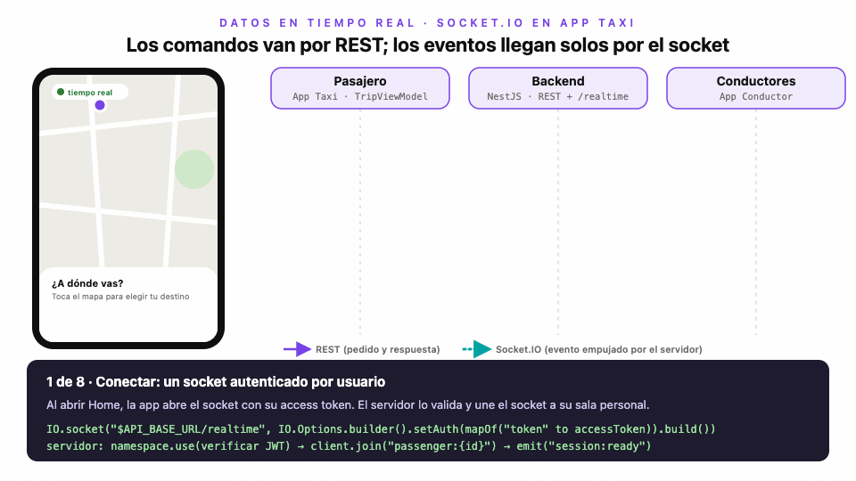

# Módulo 5 · Sesión 4

## Datos en tiempo real con Socket.IO

Al terminar la clase sabrás:

1. Distinguir cuándo un dato debe pedirse (REST) y cuándo debe llegar solo (tiempo real).
2. Conectar una app Android a un servidor Socket.IO autenticado con el token de la sesión.
3. Convertir los eventos del socket en estado de la pantalla con `Flow` y un ViewModel.
4. Recuperarte de una conexión perdida sin perder información.

En esta clase App Taxi deja de ser solo una app de pasajero: ahora tiene viajes de verdad. El pasajero solicita un viaje, los conductores cercanos ofertan, el pasajero acepta una oferta y sigue al conductor en el mapa hasta calificarlo. Para eso el proyecto crece en cinco piezas:

- [`android-app-taxi`](./android-app-taxi): la app del pasajero, que parte de la clase anterior.
- [`android-driver-app-taxi`](./android-driver-app-taxi): una app básica del conductor, nueva.
- [`backend-app-taxi`](./backend-app-taxi): viajes, ofertas, conductores, tarifa y el gateway de Socket.IO. Las rutas se calculan con OSRM.
- [`backoffice-app-taxi`](./backoffice-app-taxi): un panel web en Vue para administrar y ver los mapas en vivo.
- [`infra-app-taxi`](./infra-app-taxi): los mismos contenedores de siempre, más el backoffice.

Son muchos eventos, pero la clase se concentra en uno solo, de punta a punta: **cómo llegan las ofertas al pasajero**. Si entiendes este flujo, entiendes todos los demás, porque funcionan igual. El detalle de cada proyecto está en su propio README.

---

## 1. Pedir o esperar

Hasta ahora la app siempre preguntaba: abre el perfil y pide `GET /passenger/me`, abre el menú y pide `GET /menu/active`. El servidor responde y la conversación termina. Eso es **REST**: el cliente habla primero y el servidor solo contesta.

Las ofertas no encajan en ese modelo. El pasajero solicita un viaje y no sabe cuándo, ni cuántos, conductores van a ofertar. Hay dos formas de enterarse:

- **Polling.** Preguntar cada pocos segundos «¿hay ofertas?». Funciona, pero casi siempre la respuesta es «no». Gasta batería, datos y servidor, y la oferta igual llega con retraso.
- **Push.** Dejar una conexión abierta para que el servidor avise en cuanto ocurre algo. Llega al instante y solo cuando hay algo que decir.

Las notificaciones de FCM del módulo 4 ya eran push, pero llegan aunque la app esté cerrada y no garantizan el orden ni la rapidez. Mientras la pantalla está abierta, lo que se necesita es un canal directo con el servidor. Eso es lo que da Socket.IO.

---

## 2. El flujo de la clase: ofertas en tiempo real



> Versión interactiva: [`diagrama-ofertas-en-tiempo-real.html`](./diagrama-ofertas-en-tiempo-real.html). Usa ← → para avanzar.

Mira el diagrama dos veces: primero las flechas moradas, luego las punteadas en cian.

- Las moradas son **comandos**: solicitar un viaje, enviar una oferta, aceptarla. El cliente pide algo y necesita saber si salió bien, así que usa REST, con su código de estado y su mensaje de error.
- Las cian son **eventos**: «llegó una oferta», «el conductor se movió», «el viaje terminó». Nadie los pidió. El servidor los empuja por el socket a quien le interesan.

Esa división es la idea más importante de la clase: **los comandos van por REST; los eventos llegan solos por el socket**. Mezclarlos, por ejemplo aceptar una oferta emitiendo un evento, obliga a reinventar en el socket lo que HTTP ya resuelve: validaciones, errores y reintentos.

La única excepción es la ubicación del conductor. Es un flujo constante, una posición cada 3 segundos, y nadie espera respuesta. Mandarla por REST sería abrir una petición HTTP cada 3 segundos. Por eso va por el socket, con `driver:location`.

---

## 3. Qué agrega Socket.IO sobre un WebSocket

Un WebSocket es un tubo abierto entre cliente y servidor por el que ambos pueden escribir cuando quieran. Socket.IO es una librería encima de ese tubo que resuelve lo que en una app real siempre hace falta:

- **Eventos con nombre.** En lugar de mensajes sueltos, cada mensaje tiene un nombre (`trip:offer`) y un JSON. El cliente se suscribe solo a los que le interesan.
- **Reconexión automática.** Si la red se corta, el cliente reintenta solo, con esperas cada vez más largas.
- **Salas.** El servidor agrupa sockets bajo un nombre y emite a todo el grupo con una línea. App Taxi usa una sala por usuario: `passenger:{id}`, `driver:{id}` y `admins`.
- **Autenticación en el saludo.** El cliente envía su token al conectarse y el servidor decide si lo acepta antes de abrir el canal.

---

## 4. En el servidor: autenticar, unir a una sala y emitir

El backend expone el namespace `/realtime`. Cuando un socket llega, un middleware valida el access token, el mismo de las peticiones REST. Si el token es inválido, la conexión se rechaza con el error `unauthorized`. Si es válido, el socket entra a la sala de su usuario:

```ts
// backend-app-taxi/src/features/realtime/realtime.gateway.ts
afterInit(namespace: Namespace): void {
    this.emitter.attach(namespace);
    namespace.use((socket, next) => {
        this.authenticate(socket)
            .then((session) => { socket.data.session = session; next(); })
            .catch(() => next(new Error("unauthorized")));
    });
}

handleConnection(client: Socket): void {
    const session = this.session(client);
    if (!session) return void client.disconnect(true);
    void client.join(this.roomOf(session));   // passenger:{id}, driver:{id} o admins
    client.emit("session:ready", session);
}
```

Gracias a las salas, emitir a una persona es emitir a su sala. Da igual si tiene la app abierta en uno o dos teléfonos, o si su socket se reconectó con otro identificador. Cuando un conductor oferta, el servicio guarda la oferta y avisa al pasajero del viaje:

```ts
// backend-app-taxi/src/features/trips/services/trip-notifier.service.ts
offer(passengerId: string, offer: OfferDto): void {
    this.realtime.emit(Rooms.passenger(passengerId), "trip:offer", offer);
}
```

El servicio de viajes no conoce el socket. Llama a `TripNotifier`, que a su vez usa `RealtimeEmitter`. Por eso las pruebas del servicio verifican «se notificó la oferta al pasajero» sin levantar ningún servidor.

---

## 5. En Android: del socket a un `Flow`

La app usa el cliente oficial `io.socket:socket.io-client`. Toda la conexión vive en una sola clase de `core`, `SocketIoRealtimeClient`, detrás de una interfaz pequeña:

```kotlin
// core/domain/realtime/RealtimeClient.kt
interface RealtimeClient {
    val connection: StateFlow<RealtimeConnection>
    fun connect()
    fun disconnect()
    fun on(event: String): Flow<String>
}
```

Al conectarse envía el token en el saludo, igual que el `AuthInterceptor` lo envía en cada petición HTTP. Si el servidor responde `unauthorized` porque el token venció, renueva la sesión con el mismo `TokenRefresher` del módulo 3 y vuelve a conectar.

El paso clave es convertir los *listeners* de la librería en un `Flow`. Con `callbackFlow`, el listener se registra cuando alguien empieza a recolectar y se quita en `awaitClose`, cuando deja de hacerlo:

```kotlin
// core/data/realtime/SocketIoRealtimeClient.kt
override fun on(event: String): Flow<String> = socket.flatMapLatest { current ->
    callbackFlow {
        val listener = Emitter.Listener { args -> args.firstOrNull()?.let { trySend(it.toString()) } }
        current?.on(event, listener)
        awaitClose { current?.off(event, listener) }
    }
}
```

El repositorio del viaje junta los tres eventos que le importan al pasajero y convierte cada JSON en un evento de dominio. A partir de aquí, el resto de la app no sabe que existe Socket.IO: solo ve un `Flow<TripEvent>`.

```kotlin
// features/trip/data/repository/TripRepositoryImpl.kt
override fun events(): Flow<TripEvent> = merge(
    realtime.on("trip:offer").mapNotNull { parser.parse("trip:offer", it) },
    realtime.on("trip:status").mapNotNull { parser.parse("trip:status", it) },
    realtime.on("driver:location").mapNotNull { parser.parse("driver:location", it) }
)
```

---

## 6. El ViewModel: cada evento cambia el estado

`TripViewModel` describe la pantalla con una etapa: elegir destino, cotizar, buscar conductores, en viaje y calificar. Mientras busca, la etapa guarda el viaje y las ofertas recibidas. Cuando llega un `OfferReceived`, el ViewModel la agrega a la lista y Compose redibuja el panel:

```kotlin
// features/trip/presentation/TripViewModel.kt
is TripEvent.OfferReceived -> if (stage is TripStage.Searching && stage.trip.id == event.offer.tripId) {
    if (stage.offers.none { it.id == event.offer.id }) setStage(stage.copy(offers = stage.offers + event.offer))
}
```

Fíjate en las dos condiciones. Un evento puede llegar tarde, repetido o de un viaje que ya no es el actual. El ViewModel no confía a ciegas en el orden de llegada: solo acepta lo que tiene sentido para la etapa en que está. Con `trip:status` pasa lo mismo: `ARRIVED` actualiza el panel, `COMPLETED` abre la calificación y `CANCELLED` vuelve al inicio.

---

## 7. Cuando se corta la conexión

Un evento emitido mientras el pasajero estaba en un túnel **se pierde**. El socket se reconecta solo, pero no recupera lo que pasó mientras estaba caído. Si la app solo escuchara eventos, al salir del túnel seguiría mostrando «0 ofertas» aunque ya haya tres.

La solución es tratar al servidor como la fuente de verdad. Cada vez que la conexión vuelve a `Connected`, el ViewModel pide el estado completo por REST y reemplaza el suyo:

```kotlin
// features/trip/presentation/TripViewModel.kt
init {
    observeTripEvents().onEach(::onEvent).launchIn(viewModelScope)
    observeTripEvents.connected().onEach { syncWithServer() }.launchIn(viewModelScope)
    syncWithServer()
}
```

`GET /trips/current` devuelve el viaje activo con sus ofertas pendientes. Es la misma llamada que usa la app al abrirse, así que cerrar la app en medio de un viaje y volver a abrirla también funciona.

---

## 8. Cómo probarlo

Levanta MySQL, Redis y la API como en clases anteriores, desde [`infra-app-taxi`](./infra-app-taxi/README.md). Para que las apps del emulador lleguen a la API de tu máquina, ejecuta `adb reverse tcp:3001 tcp:3001` y usa `http://127.0.0.1:3001/` como `API_BASE_URL` (ver errores comunes), o un túnel HTTPS. Las migraciones crean las tablas nuevas y los seeders cargan dos conductores (`51900000001` y `51900000002`, contraseña `Driver123*`), un administrador (`admin@apptaxi.pe` / `Admin123*`) y la tarifa inicial. Las rutas se piden al servidor público de OSRM, así que la API necesita salida a Internet.

1. Abre el backoffice (`pnpm dev` en `backoffice-app-taxi`) e inicia sesión. Deja abierto el **Mapa de conductores**.
2. En un emulador, inicia sesión en la app del conductor y toca **Iniciar labores**. Su punto aparece en el mapa del backoffice y se mueve con él.
3. En otro emulador, entra a la app del pasajero, toca el mapa para elegir destino y solicita el viaje.
4. La solicitud aparece en la app del conductor. Envía una oferta: llega a la app del pasajero sin que nadie recargue nada.
5. Acepta la oferta y avanza los estados desde la app del conductor. El pasajero ve cada cambio y al conductor moverse; el backoffice también.

Para cortar la conexión a propósito, activa el modo avión en el emulador del pasajero mientras el conductor oferta y desactívalo después: la oferta aparece en cuanto vuelve la red.

Las pruebas JVM cubren el flujo sin emulador ni servidor: `TripViewModelTest` usa un repositorio falso y emite eventos a mano, incluido el caso de la reconexión.

```bash
cd android-app-taxi
./gradlew testDebugUnitTest --tests "*.TripViewModelTest"
```

---

## 9. Errores comunes

- Mandar comandos por el socket. Aceptar una oferta con un evento pierde el código de estado, el mensaje de error y la respuesta.
- Emitir a un `socket.id` en lugar de a una sala. El identificador cambia con cada reconexión y el mensaje se pierde.
- Confiar en que el socket nunca se corta. Sin resincronizar con REST al reconectar, la pantalla queda desactualizada.
- Agregar cada evento sin revisar si ya existe o si es de otro viaje. Los eventos pueden llegar repetidos o tarde.
- Conectar el socket sin token, o con un token vencido, y no renovarlo al recibir `unauthorized`.
- Registrar listeners y no quitarlos. `callbackFlow` con `awaitClose` lo resuelve; un `socket.on` suelto en un ViewModel se acumula con cada pantalla.
- Hacer `polling` «por si acaso» además del socket: duplica el trabajo y el consumo.
- Apuntar el emulador a `10.0.2.2` o a la IP de tu red. Desde Android 17, una app con `targetSdk 37` necesita el permiso `ACCESS_LOCAL_NETWORK` para llegar a direcciones privadas: sin él, la conexión se queda colgando hasta el timeout. En el emulador usa `adb reverse tcp:3001 tcp:3001` con `http://127.0.0.1:3001/`, o un túnel HTTPS.

---

## Recursos

- [Socket.IO: cómo funciona](https://socket.io/docs/v4/how-it-works/)
- [Salas en Socket.IO](https://socket.io/docs/v4/rooms/)
- [Cliente Java de Socket.IO](https://socketio.github.io/socket.io-client-java/)
- [Gateways de WebSocket en NestJS](https://docs.nestjs.com/websockets/gateways)
- [`callbackFlow`](https://kotlinlang.org/api/kotlinx.coroutines/kotlinx-coroutines-core/kotlinx.coroutines.flow/callback-flow.html)
- [OSRM: servicio de rutas](https://project-osrm.org/docs/v5.24.0/api/#route-service)
- Clase anterior: [Testing con JUnit y Compose Test](../clase-03/README.md)
