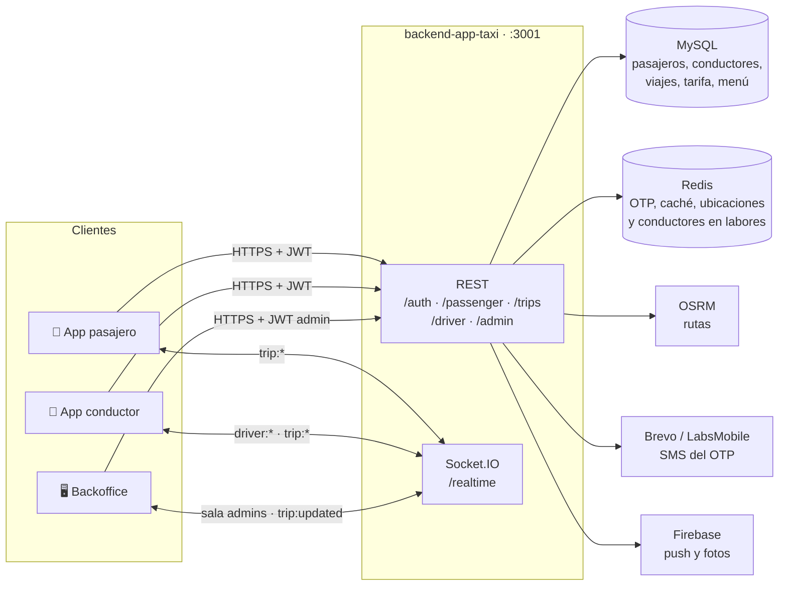
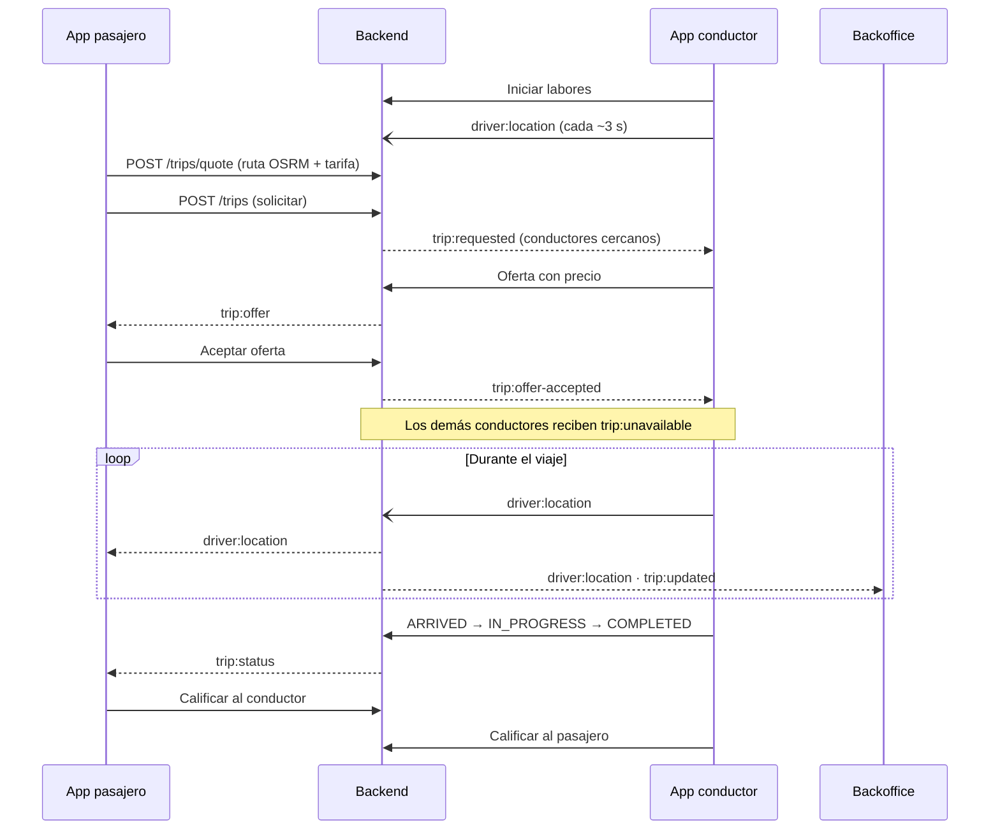

# App Taxi · Proyecto final

App Taxi es una plataforma completa de taxi construida a lo largo de la especialización en Android. La forman **dos apps nativas** (pasajero y conductor), un **backend** con API REST y tiempo real, un **backoffice web** y la **infraestructura** para levantarlo todo en tu máquina con Docker.

El pasajero inicia sesión con un código OTP por SMS, pide un viaje con ruta y tarifa estimada, recibe ofertas de los conductores cercanos en tiempo real, acepta una y sigue al conductor en el mapa hasta calificarlo. El conductor inicia labores, comparte su ubicación, envía ofertas y lleva el viaje por sus estados. El administrador lo ve todo en vivo desde el backoffice.

---

## Contenido

1. [Componentes](#1-componentes)
2. [Arquitectura](#2-arquitectura)
3. [Flujo de un viaje](#3-flujo-de-un-viaje)
4. [Usuarios por defecto (seed)](#4-usuarios-por-defecto-seed)
5. [Puesta en marcha](#5-puesta-en-marcha)
6. [Configuración local que no está en git](#6-configuración-local-que-no-está-en-git)
7. [Estructura de carpetas](#7-estructura-de-carpetas)
8. [Documentación de cada parte](#8-documentación-de-cada-parte)

---

## 1. Componentes

| Carpeta | Qué es | Stack principal |
| --- | --- | --- |
| [`android-app-taxi`](./android-app-taxi/README.md) | App del **pasajero** | Kotlin, Jetpack Compose, Hilt, Retrofit, Room, Maps Compose, Socket.IO, Firebase (FCM y Storage) |
| [`android-driver-app-taxi`](./android-driver-app-taxi/README.md) | App del **conductor** | Kotlin, Jetpack Compose, Hilt, Retrofit, Maps Compose, Socket.IO, Foreground Service de ubicación |
| [`backend-app-taxi`](./backend-app-taxi/README.md) | API REST y gateway de tiempo real | NestJS, TypeORM, MySQL, Redis, Socket.IO, OSRM, Firebase Admin |
| [`backoffice-app-taxi`](./backoffice-app-taxi/README.md) | Panel web de **administración** | Vue 3, Vite, Pinia, Leaflet, Socket.IO |
| [`infra-app-taxi`](./infra-app-taxi/README.md) | Entorno local con Docker Compose | MySQL 9.7, Redis 8.10, API y backoffice con nginx |
| [`design-assets`](./design-assets) | Imágenes de diseño de la app | PNG |

Las dos apps Android comparten arquitectura (Clean Architecture + MVVM por feature), línea gráfica (`#7843E6`), modo oscuro, textos en español e inglés y firma de release con `keystore.properties`.

---

## 2. Arquitectura



- **REST** atiende el inicio de sesión, el perfil, la cotización y la solicitud de viajes, las acciones del conductor y la API del backoffice.
- **Socket.IO** (`/realtime`) empuja los eventos en vivo: solicitudes y ofertas, cambios de estado del viaje y la ubicación del conductor. Cada conexión se autentica con el mismo JWT de la API.
- **Redis** guarda lo efímero (códigos OTP, intentos, conductores disponibles y su última posición) y **MySQL** lo persistente.
- Sin credenciales de SMS o Firebase, fuera de producción, el backend escribe el código OTP y los push en su log. Así todo se puede probar sin servicios externos.

---

## 3. Flujo de un viaje



La tarifa estimada es **tarifa base + precio por km** de la ruta de OSRM. El conductor puede ajustar su oferta en pasos de S/ 0.50, y el administrador cambia la tarifa desde el backoffice.

---

## 4. Usuarios por defecto (seed)

La API ejecuta las migraciones y los seeds **cada vez que arranca** (`entrypoint.sh`). Los seeds son idempotentes: solo insertan lo que no existe, así que reiniciar la API no duplica datos ni restablece contraseñas cambiadas.

### Administrador · backoffice

| Correo | Contraseña |
| --- | --- |
| `admin@apptaxi.pe` | `Admin123*` |

Entra en `http://localhost:8080` (Docker) o `http://localhost:5173` (`pnpm dev`).

### Conductores · app del conductor

| Teléfono | En la app se escribe | Contraseña | Nombre | Vehículo |
| --- | --- | --- | --- | --- |
| `51900000001` | `900000001` | `Driver123*` | Carlos Quispe | Toyota Yaris blanco · `ABC-123` |
| `51900000002` | `900000002` | `Driver123*` | María Rojas | Kia Rio gris · `XYZ-789` |

Con dos conductores se puede probar cómo llegan **varias ofertas** al mismo pasajero: usa dos emuladores o un emulador y un teléfono.

### Pasajero · app del pasajero

| Teléfono | En la app se escribe | Nombre | Estado |
| --- | --- | --- | --- |
| `51980773166` | `980773166` | Jorge Sandoval | `ACTIVE` |

El pasajero **no tiene contraseña**: entra con un código OTP de 4 dígitos. Sin credenciales de SMS en el `.env`, el código aparece en el log de la API:

```bash
cd infra-app-taxi
docker compose -f docker-compose.http.yml -p app-taxi logs http | grep "OTP para"
```

El pasajero del seed está `ACTIVE` y entra directo al mapa. **Cualquier otro teléfono** crea un pasajero nuevo al pedir el código y pasa por el registro de dos pasos.

### Otros datos del seed

- **Tarifa**: S/ 5.00 de base + S/ 1.50 por km (moneda `PEN`).
- **Menú del pasajero**: Pedir taxi, Mi perfil, Mis viajes y Ayuda.

### Cambiar las contraseñas del seed

Se leen del `.env` de `infra-app-taxi` al crear los usuarios por primera vez:

```env
HTTP_SEED_ADMIN_PASSWORD="Admin123*"
HTTP_SEED_DRIVER_PASSWORD="Driver123*"
```

Si los usuarios ya existen, cambiar estas variables no tiene efecto: hay que borrar el volumen de MySQL o cambiar la contraseña desde el backoffice. Los datos de los seeds viven en `backend-app-taxi/src/core/database/seeders/data/`.

---

## 5. Puesta en marcha

Requisitos: Docker Desktop (o Docker Engine 24+ con Compose v2), Android Studio con un emulador de Android 17 y, para el backoffice en modo desarrollo, Node 24 con pnpm.

### 5.1 Backend e infraestructura

Desde `infra-app-taxi`, con su `.env` listo:

```bash
docker network create network-app-taxi                              # una sola vez
docker compose -f docker-compose.mysql.yml -p app-taxi up -d         # espera "healthy"
docker compose -f docker-compose.redis.yml -p app-taxi up -d
docker compose -f docker-compose.http.yml -p app-taxi up -d --build  # migraciones + seeds + API
docker compose -f docker-compose.backoffice.yml -p app-taxi up -d --build   # opcional
```

| Servicio | URL |
| --- | --- |
| API | `http://localhost:3001` |
| Documentación (Swagger) | `http://localhost:3001/api/docs` |
| Backoffice | `http://localhost:8080` |

### 5.2 Apps Android

1. Abre `android-app-taxi` o `android-driver-app-taxi` en Android Studio.
2. Apunta la app al backend. Desde Android 17, una app con `targetSdk 37` no llega a `10.0.2.2` sin el permiso de red local, así que redirige el puerto y usa el loopback:

   ```bash
   adb reverse tcp:3001 tcp:3001
   ```

   ```kotlin
   buildConfigField("String", "API_BASE_URL", "\"http://127.0.0.1:3001/\"")
   ```

   Con dos emuladores, ejecuta `adb -s <serial> reverse tcp:3001 tcp:3001` en cada uno. En un teléfono físico vale el mismo `adb reverse` por USB, o un túnel HTTPS.
3. Agrega `MAPS_API_KEY=...` en `local.properties`. Sin ella el mapa se ve gris, pero la app funciona.
4. Ejecuta la app e inicia sesión con un usuario del [seed](#4-usuarios-por-defecto-seed).

### 5.3 Probar un viaje completo

1. En la app del conductor, entra con `900000001` / `Driver123*` y pulsa **Iniciar labores**.
2. En la app del pasajero, entra con `980773166` y el OTP del log, elige un destino y solicita el viaje.
3. El conductor ve la solicitud, envía una oferta y el pasajero la acepta.
4. El conductor avanza los estados hasta **Completado** y ambos se califican.
5. En el backoffice, con `admin@apptaxi.pe`, sigue al conductor y al viaje en el mapa.

---

## 6. Configuración local que no está en git

Cada proyecto tiene archivos con claves o rutas de tu máquina. Están en el `.gitignore` y hay que crearlos al clonar:

| Archivo | Proyecto | Para qué | ¿Obligatorio? |
| --- | --- | --- | --- |
| `.env` | `infra-app-taxi` | Variables de MySQL, Redis, JWT, SMS, Firebase y seeds | Sí |
| `local.properties` | ambas apps | `sdk.dir` y `MAPS_API_KEY` | Sí (Android Studio crea `sdk.dir`) |
| `app/google-services.json` | app del pasajero | Push y subida de fotos con Firebase | No |
| `keystore.properties` | ambas apps | Las 4 variables de la firma de release (copia de `keystore.properties.example`) | Solo para release |
| `key/upload-keystore.jks` | ambas apps | Llave de subida a Google Play | Solo para release |
| `.env.local` | `backoffice-app-taxi` | `VITE_API_URL` si la API no está en `localhost:3001` | No |

La firma de release lee `keystore.properties` desde `app/build.gradle.kts` y se aplica solo al build `release`; debug no necesita la llave:

```bash
./gradlew :app:signingReport    # comprueba la llave
./gradlew :app:bundleRelease    # genera el AAB firmado
```

---

## 7. Estructura de carpetas

```text
app-taxi/
├── android-app-taxi/          # App del pasajero
│   ├── app/                   # Código fuente, pruebas y recursos
│   ├── docs/gif/              # Diagramas de cada feature
│   ├── key/                   # Llave de release (fuera de git)
│   └── keystore.properties.example
├── android-driver-app-taxi/   # App del conductor
│   ├── app/
│   ├── key/
│   └── keystore.properties.example
├── backend-app-taxi/          # API NestJS
│   ├── src/core/              # Config, base de datos, migraciones, seeds, HTTP
│   ├── src/features/          # auth, passengers, drivers, trips, admins, tariff, menu…
│   ├── Dockerfile
│   └── entrypoint.sh          # migraciones → seeds → API
├── backoffice-app-taxi/       # Panel Vue
│   ├── src/
│   ├── Dockerfile
│   └── nginx.conf
├── infra-app-taxi/            # Docker Compose
│   ├── docker-compose.mysql.yml
│   ├── docker-compose.redis.yml
│   ├── docker-compose.http.yml
│   ├── docker-compose.backoffice.yml
│   └── .env                   # fuera de git
└── design-assets/
```

---

## 8. Documentación de cada parte

Cada carpeta tiene su propio README con el detalle de su arquitectura, endpoints, pantallas y errores frecuentes:

- [App del pasajero](./android-app-taxi/README.md): features, capas, pruebas y arranque rápido.
- [App del conductor](./android-driver-app-taxi/README.md): labores, ofertas, viaje activo y tiempo real.
- [Backend](./backend-app-taxi/README.md): endpoints, eventos de Socket.IO, migraciones y variables.
- [Backoffice](./backoffice-app-taxi/README.md): pantallas, sesión de administrador y despliegue con Docker.
- [Infraestructura](./infra-app-taxi/README.md): servicios, variables del `.env`, arranque, actualización y apagado.
- [Publicar en Google Play](../../modulo-05/clase-03/publicacion-google-play.md): cuenta, firma, declaraciones y pistas de prueba.
